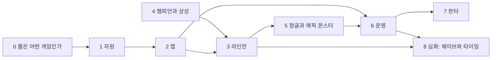

# 교과서 v3 — 롤 개념 지도 (curriculum-v3.md)

> 작성: 교과서 설계자 (p8-curr), 2026-11-04. 상태: 초안, 모션 디렉터와 조사원 확인 전
> 방향: 사용자가 제품의 중심을 "롤의 기본개념과 심화개념을 아주 자세하게 그리고 시각적으로 알려줄 수 있는 앱"으로 바꿨다. 한 판 분석(복기)은 V2 이후다.
> 근거: `facts-v3.md`(2026 시즌 사실 정본), `research.md` D-2·D-3, `curriculum.md`(원자 233개), `plain-language.md`(쉬운 말 정본), `copy-v2.md`(말투), LoL 위키 Nexus·Inhibitor·Turret 본문(2026-11-04 확인), Data Dragon 16.21.1(역할군 태그, 스킬 설명)
> 이 문서와 `curriculum.md`의 관계: 교과서 화면의 정본은 이 문서다. `curriculum.md`의 원자 ID와 지표는 V2 복기용으로 그대로 남고, 5절 대응표로 이어진다.

## 0. 쓰는 법

**개념 ID**: `C{장}.{nn}` (예: `C3.04` = 3장 라인전의 4번째 개념). 깊이는 **기본**(처음 보는 사람이 꼭 알아야 함)과 **심화**(기본을 알고 나서 이기는 쪽으로 쓰는 법) 두 단계다.

**규칙 8줄**

1. 모든 개념은 "상대 넥서스를 부순다"에 한 줄로 이어진다. 이어지지 않으면 교과서에 넣지 않는다(3절 '왜 중요한가' 칸).
2. 화면 말은 `plain-language.md`와 `copy-v2.md`를 따른다. 해요체, 본문 한 문장, 전문 용어는 앱에서 처음 나올 때 한 번 밑줄 풀이.
3. 화면에 쓰는 숫자는 게임 시계(5:00 같은 등장 시각), 게임 화면에 보이는 값, 사람이 바로 세는 개수뿐이다. 골드, 초, 거리, 퍼센트는 '자세히 보기'로 보낸다.
4. 사실은 2026 시즌(패치 26.21) 것만 쓴다. 정본은 `facts-v3.md`(조사원)다. 태그: `[26.01]` 같은 것은 그 패치에 들어온 값, `[위키 11-04]`는 위키 본문으로 확인한 값, `[미확인]`은 facts-v3가 미확인으로 둔 값(화면에 쓰지 않고 자세히에만), `[확인 필요]`는 facts-v3에도 없어 조사원에게 확인을 요청한 값이다. 어느 쪽이든 지어내지 않는다.
5. 아타칸은 26.01에서 제거됐다(research D-2). 2025 자료의 아타칸, 힘의 위업, "14분 방패 소멸"은 쓰지 않는다.
6. 모션은 1절 '가루 문법'을 따른다. 장식 반짝임은 0이다.
7. 챔피언끼리 누가 이긴다는 단정은 쓰지 않는다. 상성은 '왜 그런 관계가 생기나'만 가르친다(4장).
8. 개념은 두 가지 꼴로 쓴다. **행동 개념**(딜교 타이밍, 귀환 타이밍처럼 '그때 무엇을 하나')은 '언제(눈에 보이는 신호) → 무엇을 → 왜'로, **사실 개념**(넥서스, 에픽 몬스터 종류처럼 '무엇인가')은 '한 줄 정의 + 왜 중요한가'로 쓴다(리더 결정 2026-11-04).

## 1. 가루 문법 (모션 디렉터와 맞출 약속)

사용자 원문: "가루들이 막 쪼개졌다가 합쳐졌다가 하는 그런거". 이 앱에서 가루는 **게임 안에서 실제로 옮겨 가는 것**만 나타낸다. 그래서 가루가 쪼개지고 합쳐지는 장면 하나하나가 곧 개념 설명이 된다.

**가루의 종류 (색은 모션 디렉터가 정하고, 종류는 이 여섯 가지로 고정)**

| 가루 | 게임에서 무엇 | 쓰는 장면 예 |
|---|---|---|
| 금 가루 | 골드 | 미니언이 부서진 가루가 금화로 모여 내 주머니로 |
| 별 가루 | 경험치 | 근처 챔피언에게만 흘러 들어가 레벨 고리를 채움 |
| 진영 가루(우리 색, 상대 색) | 그 팀의 힘, 미니언, 땅 | 우리 미니언 가루 덩어리가 커지며 상대 쪽으로 밀고 감 |
| 흰 가루 | 시야, 정보 | 와드에서 퍼져 안개 가루를 걷어 냄 |
| 안개 가루 | 보이지 않는 곳 | 지도 위를 덮고, 시야가 닿은 곳만 걷힘 |
| 힘 가루 | 에픽 몬스터가 주는 강화 | 용이 부서진 가루가 다섯 갈래로 나뉘어 우리 팀에게 스며듦 |

**움직임 네 가지 = 뜻 네 가지**

| 움직임 | 뜻 | 예 |
|---|---|---|
| 쪼개짐 | 무엇이 없어지며 무언가를 남긴다(처치, 파괴) | 포탑이 쪼개져 금 가루가 팀 전체로 |
| 모임 | 쌓여서 힘이 된다(구매, 레벨 업, 버프 쌓임) | 금 가루가 아이템 모양으로 굳음 |
| 흐름 | 옮겨 간다(누구에게 가나) | 별 가루가 범위 안 챔피언에게만 흐름 |
| 퍼짐 | 영역이나 정보가 넓어진다 | 와드의 흰 가루가 둥글게 퍼짐 |

**뜻 검사 3문항** (모든 컷에 적용, 하나라도 '아니요'면 그 가루를 뺀다)

1. 가루의 출발점과 도착점이 게임 안에서 실제로 이어지나? (예: 미니언 → 막타 친 사람. 미니언 → 하늘이면 탈락)
2. 움직임을 멈춘 정지 두 장(전, 후)만 봐도 뜻이 남나?
3. 가루의 양이 실제 크기 차이와 같은 방향인가? (포탑 하나의 금 가루 > 미니언 하나의 금 가루. 정확한 비율은 몰라도 방향은 맞아야 함)

- 줄임 모션(`prefers-reduced-motion`)에서는 전과 후 정지 두 장 + 화살표 하나로 바꾼다.
- 한 컷에 움직이는 가루는 한 종류가 주인공이다. 둘 이상이면 순서대로 움직인다.
- 실제 롤 그림을 쓴다: Data Dragon 초상화와 스킬 아이콘, 협곡 지도(`map11.png`). 가루는 그 그림이 부서지고 모이는 것이지, 그림 위에 뿌리는 장식이 아니다.
- 에픽 몬스터는 Data Dragon에 그림이 없어서 우리가 그린 실루엣으로만 나타낸다(리더 결정, 승인되지 않은 출처의 그림은 쓰지 않음). 실루엣마다 누구나 알아볼 특징 하나: 날개 편 용, 왕관 같은 뿔의 장로, 마디진 애벌레 셋, 등에 큰 눈이 달린 전령, 긴 뿔과 긴 꼬리의 바론(`lessons-v3/04` 5절).

## 2. 개념 지도 (큰 흐름)

| 장 | 이름 | 장 질문 (넥서스와 잇는 한 줄) | 기본 | 심화 | 샘플 레슨 |
|---|---|---|---|---|---|
| 0 | 롤은 어떤 게임인가 | 상대 넥서스를 부수려면 무엇이 필요하나? | 7 | 1 | ① `lessons-v3/01-what-is-lol.md` |
| 1 | 자원 | 넥서스로 가는 힘은 어디서 생기나? | 5 | 3 | — |
| 2 | 맵 | 넥서스까지 가는 길은 어떻게 생겼나? | 7 | 2 | — |
| 3 | 라인전 | 초반에 자원을 누가 더 가져가나? | 8 | 3 | ② `lessons-v3/02-laning.md` |
| 4 | 챔피언과 상성 | 왜 어떤 챔피언끼리는 한쪽이 유리하나? | 4 | 5 | ③ `lessons-v3/03-matchups.md` |
| 5 | 정글과 에픽 몬스터 | 큰 몬스터는 넥서스로 가는 길을 어떻게 줄여 주나? | 9 | 6 | ④ `lessons-v3/04-epic-monsters.md` |
| 6 | 운영 | 라인전이 끝나면 무엇을 먼저 가져가나? | 5 | 3 | — |
| 7 | 한타 | 다섯이 부딪칠 때 누가 이기나? | 3 | 4 | — |
| 8 | 심화: 웨이브와 타이밍 | 미니언 줄과 시간을 내 편으로 만들려면? | 0 | 8 | — |

**순서 판단**
- 리더 예시 순서를 거의 그대로 따랐다. 바꾼 곳은 둘이다. 4장 '사거리'와 '역할군'은 3장 라인전의 딜교를 이해하는 데 필요해서, 앱에서는 4장 기본 두 개(`C4.01`, `C4.02`)를 3장 앞에 미리 보기로 연다(그래프의 4 → 3).
- '조작 기본'(어택땅, 무빙샷, 스킬샷 조준)은 개념이 아니라 손의 기술이지만, 라인전의 딜교와 바로 이어져서 3장 끝 기본 개념으로 넣었다(`C3.11`).
- 옛 5권 '학습법과 멘탈'은 교과서 개념 지도에서 뺐다. 복기와 함께 V2에서 다시 다룬다(5절).
- 기본 48개를 먼저 다 읽을 수 있게 하고, 심화는 그 장의 기본을 다 본 뒤에 추천한다. 읽기는 늘 모두 열려 있다(plan.md 6.4 원칙 유지).

**첫 2주 추천 경로**: 1일 0장 → 2일 1장 → 3일 2장 → 4~5일 4장 기본 둘 + 3장 → 6일 5장 기본 → 7일 복습 문제 → 2주차 6장, 7장 기본 → 그다음 심화(4장, 5장, 8장)를 고른다. 하루 한 레슨, 레슨마다 확인 문제 3개.

## 3. 개념 카드 (장마다 표)

칸: **정의**는 한 줄 정의, **넥서스로**는 왜 중요한가, **신호**는 눈에 보이는 신호, **오해**는 흔한 오해, **심화**는 심화 한 단계, **모션**은 가루가 무엇에서 무엇으로 가는지, **문제**는 확인 문제(괄호 안은 답).

### 0장 롤은 어떤 게임인가

| ID | 개념 | 깊이 | 정의 | 넥서스로 | 신호 | 오해 | 심화 | 모션 | 문제 |
|---|---|---|---|---|---|---|---|---|---|
| C0.01 | 승리 조건은 넥서스 | 기본 | 상대 기지 가장 안쪽의 넥서스를 먼저 부순 팀이 이긴다 [위키 11-04] | 모든 개념의 끝점 | 지도 양 끝의 두 넥서스. 킬 수와 상관없이 넥서스가 부서지면 끝난다 | 킬을 많이 하면 이긴다 | 킬, 골드, 오브젝트는 모두 넥서스로 가는 수단 | 상대 넥서스가 쪼개지는 장면을 먼저 보여 주고, 가루가 되감겨 다시 넥서스로 모인다(아직 먼 목표) | 킬이 더 많은 팀이 지기도 하나요? (네, 넥서스를 먼저 잃으면) |
| C0.02 | 넥서스를 지키는 벽 | 기본 | 라인마다 포탑 셋과 억제기, 그 뒤 넥서스 포탑 둘이 있고 바깥 것부터만 칠 수 있다 [위키 11-04] | 이 순서가 게임의 길이를 정한다 | 아직 칠 수 없는 구조물은 공격이 들어가지 않는다 | 넥서스로 바로 달려가면 된다 | 넥서스는 억제기 하나 이상이 깨지고 넥서스 포탑 둘이 다 부서져야 맞는다 [위키 11-04] | 바깥 포탑이 쪼개진 가루가 다음 구조물로 흘러가 '이제 칠 수 있음' 테두리를 그린다 | 억제기를 치려면 먼저? (그 라인 포탑 셋) |
| C0.03 | 5대5와 다섯 자리 | 기본 | 다섯 명이 탑, 정글, 미드, 원딜, 서포터로 맵을 나눠 맡는다 | 다섯이 자원을 나눠야 팀 전체가 커진다 | 시작하면 각자 다른 곳으로 걸어간다 | 서포터는 자원이 필요 없다 | 다섯 자리 모두 역할 퀘스트가 있다(C0.08) [26.01] | 우물에서 나온 열 줄기 진영 가루가 각자 자리로 흘러가 초상화로 모인다 | 바텀에는 우리 편 몇 명? (둘, 원딜과 서포터) |
| C0.04 | 미니언 | 기본 | 넥서스가 일정한 박자로 라인마다 보내는 작은 군대 | 미니언이 포탑을 맞아 주고 같이 쳐야 포탑이 무너진다 | 라인을 따라 줄지어 걷는 무리 | 미니언은 돈만 주는 몹이다 | 몇 웨이브마다 대포 미니언, 억제기가 깨지면 슈퍼 미니언 [26.01] | 넥서스에서 뿜어진 진영 가루가 미니언 모양으로 굳어 줄지어 걷는다 | 미니언은 어디서 나오나요? (넥서스) |
| C0.05 | 포탑은 미니언부터 쏜다 | 기본 | 포탑은 사거리에 든 대상 중 미니언을 챔피언보다 먼저 고르고, 근처에서 우리 챔피언을 때린 적 챔피언은 바로 노린다 [위키 11-04] | 우리 미니언이 맞아 주는 동안만 포탑을 안전하게 친다 | 포탑 빛줄기가 미니언에 꽂힘 | 포탑은 아무나 쏜다 | 미니언 없이 포탑에 들어가는 다이브의 비용 | 빛줄기 가루가 미니언에 꽂혀 미니언이 쪼개지고, 미니언이 다 사라지면 빛줄기가 챔피언 쪽으로 방향을 튼다 | 우리 미니언 없이 포탑을 치면? (포탑이 나를 쏴요) |
| C0.06 | 킬은 수단 | 기본 | 상대를 처치하면 골드를 얻고, 상대는 부활할 때까지 맵에서 사라진다 | 사라진 동안 숫자가 많아져 구조물과 오브젝트를 가져간다 | 상대 초상화가 회색이 되고 부활까지 남은 시간이 보인다 | 킬을 땄으면 할 일 끝 | 처치 직후 무엇을 가져갈지 고르기(6장) | 쪼개진 상대 챔피언 가루의 일부는 금 가루로 내게, 나머지는 상대 기지의 부활 고리로 흘러가 고리를 천천히 채운다 | 상대가 죽어 있는 동안 할 일은? (포탑이나 오브젝트) |
| C0.07 | 전략의 큰 고리 | 기본 | 자원을 모아 강해지고, 강해져서 숫자 우위를 만들고, 그 틈에 구조물을 부순다 | 이 고리가 넥서스까지 되풀이된다 | 골드 차, 레벨 차, 포탑 수 차 | 킬이나 파밍 하나만 잘하면 된다 | 고리가 끊기는 곳(죽음, 늦은 귀환)을 줄이는 것이 운영 | 가루 한 줄기가 미니언 → 금 → 아이템 → 처치 → 포탑 → 넥서스로 모양을 바꾸며 지도를 한 바퀴 돈다 | 골드가 많아도 아이템을 안 사면? (아직 힘이 아니에요) |
| C0.08 | 역할 퀘스트 | 심화 | 다섯 자리마다 자기 일을 하면 차오르는 퀘스트가 있고, 다 차면 자리별 보상을 받는다 [26.01] | 맡은 자리를 지킬수록 팀이 강해진다 | 역할 퀘스트 칸이 차오름 | 아무 데서나 미니언을 먹어도 같다 | 라인 밖 오브젝트에는 진행 페널티, 로밍은 일부 면제 [26.09] | 내 자리에서 얻은 가루 일부가 퀘스트 칸으로 흘러 칸을 채우고, 다 차면 보상 아이콘으로 굳는다 | 역할 퀘스트는 몇 자리에? (다섯 자리 모두) |

### 1장 자원

| ID | 개념 | 깊이 | 정의 | 넥서스로 | 신호 | 오해 | 심화 | 모션 | 문제 |
|---|---|---|---|---|---|---|---|---|---|
| C1.01 | 골드는 어디서 | 기본 | 골드는 미니언, 처치, 포탑, 정글 몬스터, 에픽 몬스터, 그리고 시간이 지나며 저절로 들어온다 [research D-3] | 골드가 아이템이 되고 아이템이 넥서스로 가는 힘이 된다 | 화면 아래 골드 | 킬이 가장 큰 골드다 | 꾸준히 가장 큰 몫은 미니언(CS)이다 | 미니언, 몬스터, 포탑이 쪼개진 금 가루가 다른 굵기로 흘러 주머니 하나로 모인다. 미니언 줄기가 가장 오래 이어진다 | 가장 꾸준한 골드는? (미니언) |
| C1.02 | 막타 | 기본 | 미니언에게 마지막 한 대를 친 사람만 그 미니언의 골드를 받는다 | 막타 수(CS)가 골드 차이를 만든다 | 미니언 체력바가 거의 빔, 화면의 CS 숫자 | 미니언을 많이 때리면 골드를 준다 | 포탑 아래, 압박 속, 스킬로 치는 막타 | 막타 순간 미니언이 쪼개져 금 가루가 친 사람에게만 흐른다. 아무도 못 치면 금 가루는 바닥에 흩어져 사라진다 | 우리 미니언이 마지막 한 대를 치면? (아무도 골드를 못 받아요) |
| C1.03 | 경험치와 레벨 | 기본 | 미니언이 죽을 때 근처 챔피언이 경험치를 받아 레벨이 오르고, 여럿이면 나눠 받는다 [26.01] | 레벨 한 칸 차이가 싸움을 바꾼다 | 초상화 옆 레벨, 경험치 고리 | 막타를 쳐야 경험치를 받는다 | 혼자 받을 때와 나눌 때의 차이, 레벨 6 | 쓰러진 미니언의 별 가루가 둥근 범위 안 챔피언에게만 흐르고, 범위 밖으로 가던 가루는 멈춘다 | 막타를 못 쳐도 경험치는? (가까이 있으면 받아요) |
| C1.04 | 아이템 | 기본 | 골드는 기지 상점에서 아이템으로 바꿔야 힘이 된다 | 아이템이 숫자 우위를 만든다 | 상점, 아이템 칸 | 골드를 모아 두면 강하다 | 큰 아이템 하나를 맞추는 골드 지점(아이템 스파이크) | 주머니의 금 가루가 상점에서 쪼개졌다가 아이템 아이콘으로 다시 모이고, 그 가루가 챔피언에게 스며든다 | 골드를 안 쓰고 싸우면? (쓴 사람보다 약해요) |
| C1.05 | 귀환과 상점 | 기본 | 귀환은 기지로 돌아가 체력을 채우고 아이템을 사는 일이다 | 강해져서 돌아와야 고리가 이어진다 | 귀환하는 동안 제자리에 멈춘 챔피언 | 귀환은 손해다 | 귀환하는 사이 라인에서 미니언을 잃는다(C3.07) | 라인에 남은 금 가루가 사라지는 양과 상점에서 아이템으로 굳는 양을 저울 양쪽에 나란히 놓는다 | 귀환하면 무엇을 잃나요? (그동안의 미니언) |
| C1.06 | 현상금 | 심화 | 첫 처치와 첫 포탑에는 추가 골드가, 연속으로 처치한 챔피언에게는 현상금이 붙는다 [26.01] | 지는 팀에게 따라잡을 기회 | 처치 알림, 현상금 표시 | 지고 있으면 끝이다 | 현상금이 붙은 아군은 더 조심 | 현상금이 걸린 챔피언 위에 금 가루 구름이 쌓여 있다가, 처치되면 구름 전체가 처치한 팀으로 쏟아진다 | 현상금 큰 상대를 잡으면? (골드를 많이 받아요) |
| C1.07 | 체력과 마나도 자원 | 심화 | 체력과 마나는 쓰면 줄고, 다 쓰면 귀환해야 하는 돈이다 | 체력이 많은 쪽이 라인에 오래 남는다 | 체력바, 마나 바 | 체력은 0만 아니면 괜찮다 | 위험 구간: 상대 콤보 한 번이면 죽는 체력(체력바 끝 빨간 칸) | 깎인 체력 가루가 '라인에 남을 시간' 모래시계로 들어가 모래가 빨리 빠진다 | 마나가 없으면 못 하는 것은? (스킬) |
| C1.08 | 소환사 주문 | 심화 | 모든 챔피언이 고르는 공통 주문 두 개(점멸 등)가 있고, 다시 쓰기까지 오래 걸린다 | 점멸 하나 차이가 처치와 생존을 가른다 | 화면 아래 주문 두 칸 | 점멸은 아무 때나 쓴다 | 상대 점멸이 없을 때가 갱 기회(C3.08) | 점멸을 쓴 순간 주문 아이콘이 가루로 쪼개져 빈 칸이 되고, 가루가 천천히 다시 모여 아이콘이 돌아온다 | 상대 점멸이 없으면 누구에게? (우리 정글) |

### 2장 맵

| ID | 개념 | 깊이 | 정의 | 넥서스로 | 신호 | 오해 | 심화 | 모션 | 문제 |
|---|---|---|---|---|---|---|---|---|---|
| C2.01 | 세 라인, 강, 정글 | 기본 | 협곡은 세 라인, 비스듬히 가로지르는 강, 라인 사이 네 정글 구역으로 나뉜다 | 넥서스로 가는 길이 셋이다 | 미니맵 | 정글은 정글러만의 곳 | 블루 진영과 레드 진영은 화면 방향과 버프 자리가 다르다 | 지도 위 진영 가루가 세 줄기 길로 흐르고, 강은 비스듬한 띠로, 정글은 길 사이 네 덩어리로 굳는다 | 넥서스로 가는 길은 몇 개? (셋) |
| C2.02 | 기지: 우물과 상점 | 기본 | 각 팀 기지에는 다시 태어나는 우물과 아이템을 사는 상점이 있다 | 귀환과 부활이 여기서 일어난다 | 지도 양 끝 모서리 | 상점은 아무 데서나 열린다 | 기지에서 라인까지 걷는 시간이 귀환의 비용(C2.08) | 죽은 챔피언 가루가 우물로 흘러가 다시 챔피언으로 모인다 | 아이템은 어디서? (우리 기지 상점) |
| C2.03 | 포탑과 방패 | 기본 | 라인마다 포탑 셋이 서 있고 포탑의 방패를 한 장씩 깰 때마다 골드를 준다. 방패는 14:00에 사라지지 않는다 [26.01] | 포탑이 없어져야 다음 길이 열린다 | 포탑 체력바의 칸 | 14분이면 방패가 없어진다(2025까지의 규칙) | 2·3차 포탑에도 방패가 생겼다, 방패 골드는 근처 사람이 나눈다 [26.01] | 방패가 한 장씩 쪼개질 때마다 금 가루가 근처 챔피언에게만 흐른다 | 2026 시즌 방패는 14분에 사라지나요? (아니요) |
| C2.04 | 억제기와 슈퍼 미니언 | 기본 | 억제기를 깨면 그 라인에 우리 편 슈퍼 미니언이 나오고, 억제기는 얼마 뒤 다시 생긴다 [위키 11-04] | 슈퍼 미니언이 라인을 대신 밀어 넥서스를 압박한다 | 억제기 자리가 빔, 큰 미니언 | 억제기를 깨면 바로 이긴다 | 다시 생기기 전에 다음 압박(C8.08) | 억제기가 쪼개진 가루가 우리 넥서스로 흘러가, 그 라인으로 나오는 미니언 하나를 큰 슈퍼 미니언으로 다시 빚는다 | 억제기는 한 번 깨면 영원히 없나요? (아니요, 다시 생겨요) |
| C2.05 | 전장의 안개 | 기본 | 우리 편 시야가 닿지 않는 곳은 가려져 그곳의 적이 보이지 않는다 | 안 보이는 적이 갱과 기습을 만든다 | 지도와 미니맵의 어두운 곳 | 안 보이면 없다 | 안 보이는 적은 '있다'고 생각하고 움직인다 | 지도 전체를 안개 가루가 덮고, 우리 챔피언과 미니언 둘레만 둥글게 걷힌다 | 상대 정글이 안 보이면? (어딘가 숨어 있다고 생각해요) |
| C2.06 | 수풀 | 기본 | 수풀 안에 들어가면 밖에서 보이지 않는다 | 수풀이 기습과 도망의 자리다 | 풀숲 무늬 | 수풀 앞은 안전하다 | 바텀 수풀을 먼저 가진 쪽이 라인전을 주도한다(C3.09) | 수풀에 들어간 챔피언이 안개 가루로 바뀌어 밖에서 사라지고, 같은 수풀 안이나 와드로만 다시 보인다 | 수풀 속 적을 보려면? (와드를 놓거나 같이 들어가요) |
| C2.07 | 와드 | 기본 | 와드를 놓으면 그 둘레의 안개가 걷혀 그곳을 볼 수 있다 | 시야가 있어야 오브젝트를 안전하게 가져간다 | 와드 아이콘과 둘레의 밝은 원 | 와드는 서포터만 놓는다 | 지정 자리에 놓으면 시야가 넓어지는 요정빛 [26.01], 시야 지우기(C6.05) | 와드가 꽂히는 순간 흰 가루가 둥글게 퍼지며 안개 가루를 밀어낸다 | 와드는 누가 놓나요? (다섯 명 모두) |
| C2.08 | 이동 시간 | 심화 | 라인과 오브젝트 사이를 걷는 데 시간이 든다 | 먼저 도착한 쪽이 숫자 우위다 | 미니맵 위 거리 | 부르면 바로 갈 수 있다 | 귀환, 순간이동, 로밍의 비용 계산 | 두 점 사이에 진영 가루 발자국이 찍히며 길이를 보여 준다 | 싸움에 늦게 도착하면? (그동안 숫자가 적어요) |
| C2.09 | 결정질 과성장 | 심화 | 라인 포탑에 시간이 지나면 수정이 자라, 다가온 적 챔피언에게 다음 공격이 큰 피해를 준다 [26.01] | 초반 포탑 앞 다이브를 막는다 | 포탑의 수정 | 초반 포탑은 2025와 같다 | 언제 자라고 얼마나 아픈지는 자세히 보기 | 포탑 둘레에 수정 가루가 모여 굳고, 다가온 적에게 한 번에 쪼개져 날아간다 | 포탑 수정은 누구를 치나요? (다가온 적 챔피언) |

### 3장 라인전

| ID | 개념 | 깊이 | 정의 | 넥서스로 | 신호 | 오해 | 심화 | 모션 | 문제 |
|---|---|---|---|---|---|---|---|---|---|
| C3.01 | 라인전이란 | 기본 | 게임 초반, 각자 라인에서 상대와 마주 서서 미니언 자원을 다투는 시간 | 초반 자원 차이가 첫 포탑과 첫 오브젝트를 정한다 | 라인마다 1대1, 바텀은 2대2 | 라인전은 싸우는 시간이다 | 싸움보다 막타와 경험치를 먼저 지킨다 | 세 라인에서 금 가루와 별 가루가 양쪽으로 나뉘어 흐르고, 더 많이 가져가는 쪽 줄기가 굵어진다 | 라인전에서 먼저 지킬 것은? (막타와 경험치) |
| C3.02 | 웨이브와 충돌 지점 | 기본 | 양쪽 미니언 무리(웨이브)가 만나 싸우는 자리가 충돌 지점이다 | 충돌 지점에 따라 안전한 쪽이 바뀐다 | 미니언끼리 싸우는 자리 | 웨이브는 늘 가운데서 만난다 | 남은 미니언 수가 충돌 지점을 옮긴다(C3.06) | 두 진영 가루 줄기가 부딪쳐 경계선이 생기고, 작은 쪽이 밀려난다 | 충돌 지점이 상대 포탑 가까이면 위험한 건? (나, 갱에 멀어요) |
| C3.03 | 딜교 | 기본 | 서로 체력을 깎는 짧은 싸움 | 체력이 많은 쪽이 라인을 지키고 막타를 더 먹는다 | 체력바, 상대 스킬 아이콘의 회색 | 아무 때나 때리면 이득이다 | 딜교 타이밍(상대가 바로 반격하지 못하는 틈): 회색 스킬, 막타 치러 온 순간 | 깎인 상대 체력 가루는 내 쪽 저울 접시에, 깎인 내 체력 가루는 상대 접시에 쌓인다 | 상대 주력 스킬이 회색이고 내 원 안이면? (한 걸음 앞으로 딜교) |
| C3.04 | 미니언 어그로 | 기본 | 평타나 찍어 쓰는 스킬로 상대 챔피언을 치면 근처 상대 미니언들이 나를 노린다. 날려 쓰는 스킬은 대개 괜찮다 [facts-v3 2-1] | 미니언에게 맞은 체력도 딜교 손해다 | 상대 미니언이 나를 향해 돌아섬 | 미니언 앞에서도 마음껏 평타 | 상대 포탑 근처에서는 무엇으로 치든 포탑이 나를 노린다. 26.10부터 적 미니언을 치는 것만으로는 어그로가 생기지 않는다 [26.10] | 내 평타가 상대 챔피언에 닿는 순간 근처 상대 미니언에게서 상대 진영 가루가 실처럼 뻗어 나에게 붙고, 날려 쓴 스킬에서는 실이 뻗지 않는다 | 상대 미니언이 많을 때 딜교는? (날려 쓰는 스킬로, 상대 포탑 근처는 빼고) |
| C3.05 | 포탑 어그로 | 기본 | 포탑 근처에서 적 챔피언이 우리 챔피언에게 피해를 주면, 평타든 스킬이든 포탑이 그 적을 노린다 [위키 11-04, facts-v3 2-1] | 포탑 아래는 내가 안전하고 상대는 위험한 곳 | 포탑 빛줄기가 향하는 대상 | 포탑 아래서는 딜교를 못 한다 | 포탑 어그로를 미니언이나 아군에게 넘기기 | 빛줄기 가루가 미니언에서 떨어져 나와 우리 챔피언을 때린 적에게로 방향을 튼다 | 포탑 아래서 상대가 나를 때리면? (포탑이 상대를 쏴요) |
| C3.06 | 밀기와 당기기 | 기본 | 우리 미니언이 더 많으면 웨이브가 상대 쪽으로 밀리고, 적으면 우리 쪽으로 온다 | 밀어 넣으면 상대 포탑을 칠 시간, 당겨 두면 안전 | 양쪽 미니언 수, 충돌 지점 위치 | 미니언을 빨리 잡으면 무조건 좋다 | 어떻게 밀지 고르는 웨이브 관리(8장) | 커진 쪽 미니언 가루 덩어리가 경계선을 밀고 나가 포탑에 부딪쳐 쪼개진다 | 웨이브가 상대 포탑까지 밀리면 생기는 것은? (귀환하거나 도울 시간) |
| C3.07 | 귀환 타이밍 | 심화 | 웨이브를 상대 포탑에 밀어 넣은 직후가 귀환하기 좋은 때다 | 잃는 미니언이 가장 적다 | 웨이브가 상대 포탑 아래, 골드가 다음 아이템만큼 | 체력이 없을 때만 귀환 | 상대와 귀환 맞추기(C8.06) | 상대 포탑에 부딪쳐 쪼개지는 우리 미니언 가루와 동시에 주머니의 금 가루가 아이템 모양으로 굳는다 | 웨이브가 우리 포탑 앞에 쌓였을 때 귀환하면? (미니언을 많이 잃어요) |
| C3.08 | 갱과 미아 | 기본 | 상대 정글이나 다른 라이너가 와서 숫자로 덮치는 것이 갱, 라이너가 사라졌다고 알리는 것이 미아 핑이다 | 갱에 죽으면 라인과 포탑을 함께 잃는다 | 미니맵에서 상대가 사라짐 | 웨이브를 밀면 안전하다 | 많이 밀려 있을수록 도망갈 길이 길다 | 안개 가루 속에서 상대 진영 가루가 모여 챔피언이 되고, 내 도망길이 발자국 가루로 길게 늘어난다 | 상대 미드가 사라지면? (핑으로 알려요) |
| C3.09 | 자리별 라인전 | 심화 | 탑은 길고 고립된 라인, 미드는 짧고 양쪽에서 갱이 오는 라인, 바텀은 2대2 라인이다 | 자리마다 위험과 기회가 다르다 | 미니맵의 라인 길이 | 라인전은 어디나 같다 | 탑 순간이동, 미드 로밍, 바텀 2레벨 싸움과 수풀 | 세 라인의 길이를 가루 줄기의 길이로, 갱 길을 옆에서 들어오는 가루 갈래 수로 비교한다 | 갱이 양쪽에서 올 수 있는 라인은? (미드) |
| C3.10 | 라인전의 끝 | 심화 | 첫 포탑들이 무너지면 라인전이 끝나고 다들 맵을 넓게 움직인다 | 이제 오브젝트와 구조물을 다툰다(6장) | 외곽 포탑이 부서짐 | 라인전이 끝나도 내 라인만 지킨다 | 라인전 끝 신호 읽기 | 외곽 포탑이 쪼개진 가루가 그 라인의 벽을 지우고, 세 줄기 가루가 강과 정글로 섞여 흐른다 | 외곽 포탑이 무너지면? (다들 넓게 움직여요) |
| C3.11 | 조작 기본 | 기본 | 평타 사이에 움직이고(무빙샷), 적만 치게 누르고(어택땅), 상대가 갈 곳에 스킬을 던진다 | 같은 딜교도 손이 따라가야 이긴다 | 평타 사거리 원, 스킬샷 경로 | 가만히 서서 치는 게 세다 | 26.09부터 WASD 이동도 랭크에서 쓸 수 있다 [26.09] | 평타 한 대마다 발밑 원 가장자리에 발자국 가루가 찍혀 '치고 움직임'의 박자를 보여 준다 | 평타 사이에 움직이면? (덜 맞아요) |

### 4장 챔피언과 상성

| ID | 개념 | 깊이 | 정의 | 넥서스로 | 신호 | 오해 | 심화 | 모션 | 문제 |
|---|---|---|---|---|---|---|---|---|---|
| C4.01 | 역할군 | 기본 | 챔피언은 암살자, 전사, 마법사, 원거리 딜러, 서포터, 탱커 여섯 무리로 나뉘고 둘을 가진 챔피언도 많다 [Data Dragon 16.21.1, facts-v3 7절] | 팀은 여러 역할군을 섞어야 강하다 | 챔피언 선택 화면의 역할 표시 | 역할군 = 포지션 | 아리는 마법사이자 암살자, 쓰레쉬는 서포터이자 탱커. 한국어 이름은 통용 표기다 | 초상화가 가루로 풀려 맞는 무리로 흘러가고, 둘에 걸친 챔피언은 가루가 두 갈래로 나뉜다 | 쓰레쉬의 역할군은? (서포터와 탱커) |
| C4.02 | 사거리 | 기본 | 챔피언마다 평타가 닿는 거리(평타 사거리)가 다르다 [Data Dragon 16.21.1] | 닿는 쪽만 때릴 수 있다 | 발밑 평타 사거리 원 | 원거리 챔피언은 사거리가 다 같다 | 케이틀린은 징크스보다 길고, 리 신은 근접이다 | 발밑에 진영 가루가 둥글게 모여 실제 비율의 원이 되고, 두 원의 크기 차이만큼의 띠가 칠해진다 | 원거리 딜러끼리도 사거리가 다른가요? (네) |
| C4.03 | 상성이란 | 기본 | 두 챔피언이 가진 도구(사거리, 기술, 성장 시점) 차이 때문에 한쪽이 유리해지는 관계 | 유리한 쪽이 라인을 밀고 오브젝트를 먼저 부른다 | 라인전 체력 차이가 한쪽으로 계속 벌어짐 | 상성이 나쁘면 무조건 진다 | 역할군끼리도 물고 물린다: 탱커는 몰아치는 피해에 강하고 꾸준히 때리는 피해에 약하며, 모두를 이기는 역할군은 없다 [facts-v3 8절, Riot 클래스 설계] | 두 초상화가 가루로 풀려 사거리, 기술, 성장 세 저울에 나눠 얹히고 저울마다 기우는 쪽이 다르다 | 상성이 나쁜 상대를 만나면? (불리한 때를 피하고 막타를 지켜요) |
| C4.04 | 사거리 상성 | 기본 | 사거리가 긴 쪽은 짧은 쪽이 닿지 않는 거리에서 때릴 수 있다 | 공짜 딜교가 쌓여 라인을 쥔다 | 두 원의 크기 차이 | 사거리가 짧으면 할 게 없다 | 짧은 쪽은 상대가 막타 치러 내 원 안에 올 때를 노린다 | 케이틀린 원과 징크스 원 사이 띠 안에서만 케이틀린의 가루가 징크스 체력바를 깎는다 | 사거리가 짧은 쪽의 기회는? (상대가 막타 치러 내 원 안에 올 때) |
| C4.05 | 성장 시점 상성 | 심화 | 어떤 챔피언은 초반에, 어떤 챔피언은 레벨과 아이템이 쌓인 뒤에 강하다 | 내가 강한 시간에 싸우고 약한 시간엔 버틴다 | 레벨, 아이템 완성 | 한 번 이기면 끝까지 이긴다 | 레벨 2, 3, 6과 핵심 아이템 완성 전후가 흔한 갈림길 | 두 챔피언의 힘이 가루 기둥으로 서 있다가, 시간이 흐르며 한쪽은 일찍 높아지고 다른 쪽은 늦게 따라잡는다 | 내가 후반에 강하면 초반에는? (막타를 지키며 버텨요) |
| C4.06 | 기술 상성 | 심화 | 다가오는 기술(돌진)과 밀어내거나 묶는 기술처럼 서로 맞물리는 도구가 있다 | 상대 도구가 빠진 순간이 내 기회 | 상대 핵심 스킬 아이콘이 회색 | 스킬이 많은 쪽이 이긴다 | 리 신 Q는 맞힌 적에게 돌진하고, 신드라 E는 적을 밀어낸다 [Data Dragon 16.21.1]. 누가 먼저 쓰느냐로 갈린다 | 돌진하는 쪽 가루 줄기와 밀어내는 쪽 가루 벽이 부딪쳐, 먼저 쓴 쪽 가루가 상대를 밀어낸다 | 상대 돌진 스킬이 회색이면? (들어올 수단이 없으니 내가 압박해요) |
| C4.07 | 자원 상성 | 심화 | 마나, 기력, 회복 수단처럼 오래 버티는 힘이 다르다 | 오래 버티는 쪽이 라인에 더 오래 남는다 | 마나 바, 기력 바, 체력 회복 | 체력이 같으면 똑같다 | 리 신은 마나 대신 기력을 쓴다 [Data Dragon 16.21.1] | 한쪽 자원 바 가루는 천천히, 다른 쪽은 빨리 줄어 먼저 빈 쪽이 귀환 모래시계로 들어간다 | 마나가 먼저 떨어지면? (먼저 귀환해야 해요) |
| C4.08 | 상성을 쓰는 법 | 심화 | 유리하면 딜교와 압박 시간을 늘리고, 불리하면 막타를 지키며 정글을 부른다 | 상성 차이를 포탑과 오브젝트로 바꾼다 | 라인 체력 차, 웨이브 위치 | 불리하면 포기한다 | 자주 만나는 상대부터 익히고, 패치마다 상성은 조금씩 바뀐다 | 유리한 쪽 가루가 라인을 넘어 포탑 쪽 길을 그리고, 불리한 쪽은 포탑 아래로 가루를 모아 지킨다 | 불리한 상성에서 먼저 할 일은? (막타 지키기) |
| C4.09 | 조합 | 심화 | 다섯 챔피언의 역할군과 사거리가 합쳐진 것이 팀의 상성이다 | 한타와 오브젝트 싸움을 미리 기울인다 | 챔피언 선택 화면의 두 팀 구성 | 내 챔피언만 좋으면 된다 | 앞에서 막는 쪽과 뒤에서 치는 쪽의 균형(7장) | 다섯 초상화 가루가 앞줄과 뒷줄 모양으로 모이고, 빈 자리는 비어 보인다 | 앞에서 막아 줄 챔피언이 없으면? (뒷줄이 위험해요) |

### 5장 정글과 에픽 몬스터

| ID | 개념 | 깊이 | 정의 | 넥서스로 | 신호 | 오해 | 심화 | 모션 | 문제 |
|---|---|---|---|---|---|---|---|---|---|
| C5.01 | 정글러의 일 | 기본 | 정글러는 정글 몬스터로 성장하며 라인을 돕고 에픽 몬스터를 챙긴다 | 맵 곳곳에 숫자 우위를 만든다 | 미니맵의 정글러 위치 | 정글러는 몬스터만 잡는다 | 파밍형과 갱형, 템포(같은 시간에 얻는 양) | 캠프가 쪼개진 금, 별 가루가 정글러에게 모이고, 정글러에게서 나온 진영 가루가 라인 쪽으로 뻗는다 | 정글러가 라인에 오면? (그 라인이 2대1) |
| C5.02 | 정글 캠프와 강타 | 기본 | 정글 몬스터 무리(캠프)는 잡으면 골드와 경험치를 주고 얼마 뒤 다시 생긴다. 강타는 정글러가 드는 주문이다 | 정글러의 골드 줄기 | 캠프 자리, 타이머 | 캠프는 한 번 잡으면 끝 | 캠프마다 다시 생기는 시간이 다르다 [26.01] | 캠프가 쪼개진 가루가 정글러에게 흐르고, 빈 자리에 가루가 천천히 다시 모여 캠프가 된다 | 강타는 누가 드나요? (정글러) |
| C5.03 | 정글 펫과 정글 퀘스트 | 심화 | 정글러는 펫과 함께 다니고, 큰 몬스터를 잡으면 간식이 쌓여 펫이 자라며 퀘스트가 찬다 [26.01] | 펫이 자라면 정글러가 강해진다 | 펫 모양, 간식 수 | 2025와 같다 | 진화에 필요한 간식 수가 바뀌었다 [26.01] | 큰 몬스터 가루 일부가 간식 모양으로 펫에게 흘러가고, 쌓이면 펫이 다음 모습으로 다시 빚어진다 | 펫이 자라려면? (큰 몬스터를 잡아 간식을 모아요) |
| C5.04 | 동선 | 심화 | 어느 캠프를 어떤 순서로 돌지 정한 길 | 끝에 갱이나 오브젝트가 있어야 이득이 크다 | 정글러 이동 경로 | 아무 순서나 같다 | 끝점부터 거꾸로 짜기(`lessons/03`) | 캠프를 잇는 발자국 가루가 이어지고 끝점에서 화살표로 굳는다 | 동선을 짤 때 먼저 정할 것은? (끝나는 곳) |
| C5.05 | 갱 | 기본 | 정글러가 라인에 들어가 그 라인을 2대1로 만드는 것 | 처치, 포탑, 오브젝트로 이어진다 | 상대가 많이 밀고 들어옴, 상대 점멸 없음 | 갱은 아무 때나 간다 | 성공 조건(밀린 웨이브, 묶는 스킬, 상대 정글 위치)과 포기 | 안개 속 정글러 가루가 라인 옆에 모였다가 도망길이 긴 상대 쪽으로 쏟아진다 | 갱 가기 좋은 라인은? (상대가 많이 밀고 들어온 라인) |
| C5.06 | 에픽 몬스터란 | 기본 | 원소 드래곤, 장로 드래곤, 공허 유충, 협곡의 전령, 내셔 남작처럼 팀에게 큰 보상을 주는 큰 몬스터 [research D-3] | 넥서스로 가는 길을 짧게 만든다 | 강 쪽 굴, 오브젝트 타이머 | 아타칸도 있다(26.01에 제거) | 보상으로 묶기: 팀 강화, 포탑 공략, 골드와 경험치 | 큰 몬스터가 쪼개진 힘 가루가 다섯 갈래로 나뉘어 우리 팀 초상화에 스며든다 | 26.21에 없는 에픽 몬스터는? (아타칸) |
| C5.07 | 원소 드래곤과 영혼 | 기본 | 5:00에 처음 나오고, 잡을 때마다 그 속성의 영구 버프가 팀에 한 겹씩 쌓이며, 네 겹을 먼저 모은 팀이 드래곤 영혼을 얻는다 [facts-v3 5-1, 5-2] | 쌓인 버프가 모든 싸움을 조금씩 기울인다 | 바텀 쪽 강의 용 둥지, 날개 편 용, 팀 문양 칸 | 용은 한 마리씩 따로다 | 속성 여섯(화염 공격, 대지 방어, 바다 회복, 바람 이동, 마법공학 스킬 가속과 공격 속도, 화학공학 강인함). 두 번째 용 뒤 협곡 지형이 바뀌고 같은 속성만 나온다. 고대의 원한으로 많이 잡은 팀은 다음 용이 어려워진다 [26.01] | 용이 쪼개진 힘 가루가 다섯 갈래로 스며들고, 네 번째 가루가 들어오면 문양 넷이 협곡 속성의 영혼 문양 하나로 합쳐진다 | 드래곤 영혼은 누가 얻나요? (용 넷을 먼저 잡은 팀) |
| C5.08 | 장로 드래곤 | 심화 | 한 팀의 드래곤 영혼이 정해진 뒤 나오는 더 강한 용으로, 잡은 팀은 잠깐 동안 체력이 낮은 적을 바로 처치하는 힘을 얻는다 [facts-v3 5-3] | 후반 한타를 끝내는 힘 | 왕관 같은 뿔이 솟은 큰 용 | 장로는 처음부터 나온다 | 버프는 죽으면 사라진다, 처치 보상도 원소 드래곤보다 크다 [26.01] | 장로 힘 가루가 살아 있는 우리 챔피언에게 스며들고, 체력이 조금 남은 상대를 때리는 순간 상대가 한 번에 쪼개진다 | 장로 버프를 가진 팀이 노릴 대상은? (체력이 낮은 적) |
| C5.09 | 공허 유충 | 기본 | 8:00에 탑 쪽 강 둥지에 세 마리가 한 번만 나오고, 잡을 때마다 팀이 포탑을 칠 때 추가 피해를 얻으며 셋을 다 모으면 공허 진드기가 함께 싸운다 [facts-v3 5-6] | 포탑을 더 빨리 부순다 | 마디진 작은 애벌레 셋 | 유충은 보상이 없다 | 한 번만 나오고 14:45에 사라진다, 같은 둥지에 15:00 전령이 나온다 [25.09] | 유충이 쪼개진 힘 가루가 우리 팀에 스며들었다가, 포탑을 칠 때 불씨 가루로 붙고 셋째 겹 뒤 작은 진드기 무리로 모여 포탑을 함께 친다 | 유충을 다 잡으면 쉬워지는 것은? (포탑 부수기) |
| C5.10 | 협곡의 전령 | 기본 | 15:00에 한 번 나오고, 잡으면 떨어지는 전령의 눈을 주워 쓰면 전령이 라인을 따라 포탑으로 돌진한다 [facts-v3 5-5] | 포탑 하나를 빠르게 무너뜨린다 | 등에 큰 눈이 달린 갑각 | 잡으면 바로 저절로 싸운다 | 눈은 정해진 시간 안에 써야 한다, 전령은 구조물을 칠 때 자기 체력을 잃는다 [26.01] | 전령이 쪼개진 가루가 눈 하나로 모이고, 눈을 쓰면 가루가 다시 전령으로 빚어져 라인을 따라 달려가 포탑 가루를 크게 떼어 낸다 | 전령을 불러 무엇을 하나요? (포탑 부수기) |
| C5.11 | 내셔 남작 | 기본 | 20:00에 나오는 가장 큰 몬스터로, 잡으면 살아 있는 팀원이 강해지고 곁의 미니언까지 강해진다 [facts-v3 5-4] | 강해진 미니언이 억제기와 넥서스까지 밀고 간다 | 긴 뿔과 긴 꼬리의 가장 큰 실루엣 | 바론은 25분에 나온다(2025까지) | 귀환이 빨라지고, 죽어 있던 팀원은 버프를 못 받는다, 뺏길 위험(C5.13) | 바론이 쪼개진 힘 가루가 살아 있는 우리 챔피언에게 스며들고, 곁 미니언에게 옮아 붙어 미니언 줄이 굵어진다 | 바론 버프가 미니언에게 주는 것은? (미니언도 강해져요) |
| C5.12 | 바위게 | 기본 | 강에 나오는 순한 몬스터로, 잡으면 그 자리에 빨리 걷게 해 주는 성소가 생긴다 [26.01] | 강을 먼저 가진 쪽이 용과 유충에 먼저 간다 | 강의 바위게 | 정글러 간식일 뿐 | 첫 바위게는 경험치가 적다(`lessons/03`) | 바위게가 쪼개진 가루가 땅에 둥글게 퍼져 성소가 되고, 성소를 지나는 발자국 간격이 넓어진다 | 바위게를 잡으면 생기는 것은? (빨리 걷게 해 주는 성소) |
| C5.13 | 강타 싸움과 스틸 | 심화 | 에픽 몬스터의 마지막 한 대를 친 팀이 그 몬스터를 가져간다 | 오래 친 팀도 마지막에 뺏길 수 있다 | 에픽 몬스터 체력바가 거의 빔 | 많이 친 팀이 가져간다 | 몬스터 체력이 강타 피해 안으로 들어오는 순간 | 마지막 체력 가루가 강타를 친 정글러 쪽으로 한꺼번에 빨려 간다 | 에픽 몬스터는 누가 가져가나요? (마지막 한 대를 친 팀) |
| C5.14 | 카정 | 심화 | 상대 정글에 들어가 상대 캠프를 먹는 것 | 상대 정글러를 덜 크게 하고 내가 더 큰다 | 상대 정글러 위치를 알 때 | 아무 때나 들어간다 | 우리 라인이 밀고 있을 때만 | 상대 캠프가 쪼개진 금 가루가 상대 정글러 대신 우리 정글러에게 흐른다 | 카정 전에 확인할 것은? (우리 라인이 밀고 있는지) |
| C5.15 | 상대 정글 위치 읽기 | 심화 | 상대 정글러를 마지막으로 본 자리와 시간으로 지금 있을 곳을 짐작한다 | 갱을 피하고 반대편 오브젝트를 가져간다 | 미니맵에 마지막으로 본 자리 | 안 보이면 모른다 | 시작 캠프, 비어 있는 캠프, 바위게로 읽기 | 마지막으로 본 자리의 가루가 시간이 지날수록 둥글게 번져 갈 수 있는 곳을 넓힌다 | 상대 정글이 방금 바텀에 보였다면 탑은? (잠깐 안전해요) |

### 6장 운영

| ID | 개념 | 깊이 | 정의 | 넥서스로 | 신호 | 오해 | 심화 | 모션 | 문제 |
|---|---|---|---|---|---|---|---|---|---|
| C6.01 | 라인전 뒤 | 기본 | 외곽 포탑이 무너진 뒤에는 웨이브, 오브젝트, 시야를 묶어 움직인다 | 고리의 '구조물' 칸을 직접 다툰다 | 포탑 수 차이 | 라인전이 끝나면 다 같이 미드 | 다섯이 뭉칠지 나눌지 | 세 라인의 가루 줄기가 하나로 합쳐졌다 다시 갈라지며 선택지를 보여 준다 | 라인전 뒤 먼저 볼 것은? (다음 오브젝트와 웨이브) |
| C6.02 | 사이드 웨이브 받기 | 기본 | 비어 있는 라인으로 오는 웨이브를 누군가 먹어야 한다 | 두면 우리 포탑이 미니언에게 깎인다 | 상대 미니언이 우리 포탑 쪽으로 옴 | 미니언은 안 먹어도 된다 | 시야 없는 사이드는 피한다 | 사이드의 상대 미니언 가루가 우리 포탑을 갉아먹고, 누군가 가서 먹으면 금 가루로 바뀐다 | 빈 라인 웨이브를 두면? (우리 포탑이 깎여요) |
| C6.03 | 오브젝트 교환 | 기본 | 둘을 동시에 못 지키면 하나를 주고 반대편 하나를 확실히 가져온다 | 모두 잃는 것보다 낫다 | 양쪽에서 동시에 일이 생김 | 모든 걸 다 지킨다 | 무엇이 더 큰가(영혼 용과 포탑 하나) | 저울 양쪽에 용 힘 가루와 포탑 금 가루가 놓이고 무거운 쪽을 고른다 | 용을 못 지키면? (반대편 포탑이나 유충을 가져와요) |
| C6.04 | 오브젝트 준비 | 기본 | 오브젝트가 나오기 전에 근처 라인을 먼저 밀고 시야를 잡는다 | 숫자 우위를 오브젝트 앞에서 만든다 | 오브젝트 타이머, 라인 위치 | 나오면 그때 간다 | 언제부터 준비하나 | 근처 라인의 미니언 가루가 먼저 밀려가고, 그 뒤 흰 가루가 오브젝트 둘레에 퍼진다 | 용 싸움 전에 바텀과 미드는? (웨이브를 먼저 밀어요) |
| C6.05 | 시야 싸움 | 기본 | 상대 와드를 지우고 우리 와드를 놓아 우리만 보는 곳을 만든다 | 보는 쪽이 먼저 덮치고 안전하게 친다 | 제어 와드, 렌즈 | 와드를 많이 놓으면 끝 | 제어 와드, 요정빛 자리 [26.01] | 우리 흰 가루가 퍼지는 곳에서 상대 흰 가루가 부서져 안개 가루로 돌아간다 | 상대 와드를 지우면? (상대가 그곳을 못 봐요) |
| C6.06 | 스플릿 푸시 | 심화 | 한 명이 따로 사이드를 밀어 상대를 갈라 놓는다 | 막으러 오면 다른 곳이 숫자 우위 | 한 사이드에 우리 한 명 | 혼자 밀면 이기적이다 | 1-3-1, 1-4 배치 | 사이드의 가루 한 줄기가 포탑으로 밀고 가자 상대 가루 일부가 그쪽으로 끌려간다 | 상대 둘이 내 사이드로 오면? (다른 곳이 숫자 우위예요) |
| C6.07 | 로밍 | 심화 | 라이너가 자기 라인을 비우고 다른 라인을 도우러 가는 것 | 다른 라인의 처치와 포탑 | 미드가 사라짐 | 로밍은 공짜다 | 비용(라인에서 잃는 것)과 조건(웨이브를 밀어 두기) | 내 라인의 금 가루가 조금 흩어지는 동안 다른 라인에서 처치 금 가루가 더 크게 모인다 | 로밍 전에 할 일은? (웨이브 밀어 두기) |
| C6.08 | 포탑 철거 순서 | 심화 | 다음 오브젝트에 가까운 포탑부터 부순다 | 그 오브젝트 주변이 우리 땅이 된다 | 남은 포탑 위치 | 아무 포탑이나 같다 | 포탑이 무너지면 그 둘레의 상대 시야가 사라진다 | 포탑이 쪼개진 가루가 둘레 땅을 우리 진영 색으로 물들인다 | 용 싸움 전에 어느 포탑부터? (용에 가까운 바텀이나 미드) |

### 7장 한타

| ID | 개념 | 깊이 | 정의 | 넥서스로 | 신호 | 오해 | 심화 | 모션 | 문제 |
|---|---|---|---|---|---|---|---|---|---|
| C7.01 | 한타란 | 기본 | 양 팀 대부분이 한곳에서 부딪치는 큰 싸움 | 이긴 팀이 오브젝트나 억제기를 가져간다 | 많은 챔피언이 한곳에 모임 | 한타는 그냥 싸움 | 보통 오브젝트 앞에서 일어난다 | 열 개의 초상화 가루가 한곳에 모여 부딪치고, 남은 쪽 가루가 오브젝트로 흘러간다 | 한타에서 이긴 뒤 할 일은? (오브젝트나 구조물) |
| C7.02 | 앞라인과 뒷라인 | 기본 | 앞에서 맞아 주는 쪽(탱커, 전사)과 뒤에서 치는 쪽(원거리 딜러, 마법사)이 있다 | 앞라인이 버티는 동안 뒷라인이 딜을 넣는다 | 서 있는 순서 | 다 앞으로 간다 | 상대가 닿는 거리 밖에서 친다 | 앞라인 가루는 방패 모양으로 굳고, 뒷라인 가루는 그 뒤에서 화살처럼 흐른다 | 원거리 딜러는 어디에? (앞라인 뒤) |
| C7.03 | 교전 개시 | 심화 | 누가 언제 싸움을 시작하나 | 좋은 시작이 숫자 우위를 만든다 | 묶는 스킬, 궁극기 준비 | 먼저 들어가면 이긴다 | 궁극기 수 세기, 반격 개시 | 개시 스킬 하나가 상대 가루 덩어리를 쪼개 놓고 우리 가루가 그 틈으로 흘러 들어간다 | 우리 궁극기가 적게 남았으면? (싸움을 미뤄요) |
| C7.04 | 노릴 대상 | 심화 | 닿는 범위 안에서 가장 위험하거나 약한 대상을 친다 | 상대 딜을 빨리 줄인다 | 상대 체력바, 위치 | 앞의 탱커만 친다 | 위협이 큰 순서, 포커스 신호 | 우리 가루 화살들이 한 대상에 모여 그 대상이 먼저 쪼개진다 | 닿지 않는 상대를 쫓으면? (우리 딜이 사라져요) |
| C7.05 | 지키기 | 심화 | 우리 뒷라인에게 달려드는 상대를 막아 준다 | 뒷라인이 살아야 딜이 남는다 | 우리 원딜 근처의 상대 암살자 | 모두 나가서 싸운다 | 묶는 스킬을 아껴 두기 | 우리 원딜에게 달려드는 상대 가루 줄기를 서포터 가루 벽이 가로막는다 | 상대 암살자가 우리 원딜에게 가면? (막아 줘요) |
| C7.06 | 숫자 세기 | 기본 | 싸우기 전에 양쪽 인원과 남은 체력을 센다 | 적은 쪽은 빠지고 많은 쪽이 친다 | 미니맵 인원, 상대가 죽어 있음 | 한 명 부족해도 싸울 만하다 | 작은 싸움(2대2, 3대3)과 잘라먹기 | 두 팀 초상화 가루를 저울에 올려 기운 쪽만 앞으로 흐른다 | 4대5면? (싸움을 피해요) |
| C7.07 | 자리 잡기 | 심화 | 좁은 길, 시야 밖, 옆으로 도는 각 같은 자리를 고른다 | 같은 인원이어도 자리가 승패를 바꾼다 | 지형, 시야 | 가운데가 제일 안전 | 탈출로, 시선 끌기 | 좁은 길에 몰린 가루 덩어리가 한 번에 쪼개지는 장면과 넓게 퍼진 가루가 일부만 쪼개지는 장면을 나란히 | 좁은 길에서 상대가 몰려 오면? (범위 스킬 기회) |

### 8장 심화: 웨이브와 타이밍

| ID | 개념 | 깊이 | 정의 | 넥서스로 | 신호 | 오해 | 심화 | 모션 | 문제 |
|---|---|---|---|---|---|---|---|---|---|
| C8.01 | 웨이브 상태 | 심화 | 충돌 지점(우리 쪽, 가운데, 상대 쪽)과 미니언 수 차이로 웨이브를 아홉 가지로 읽는다(`lessons/01`) | 다음 행동(밀기, 멈추기, 귀환)을 고른다 | 충돌 지점, 미니언 수 | 웨이브는 그냥 흘러간다 | 상태 고르기 결정 나무 | 3×3 판 위에서 미니언 가루 덩어리가 칸을 옮겨 다니다 지금 상태 칸에 멈춘다 | 우리 쪽에서 상대 미니언이 조금 많으면? (프리징을 노릴 수 있어요) |
| C8.02 | 슬로우 푸시 | 심화 | 상대 원거리 미니언만 먼저 정리해 우리 미니언을 웨이브마다 쌓는다(`lessons/01`) | 큰 웨이브가 포탑을 오래 친다 | 우리 미니언 수가 점점 늘어남 | 빨리 밀수록 좋다 | 크래시 시각을 오브젝트에 맞춘다 | 웨이브마다 우리 미니언 가루가 덩어리에 조금씩 더해져 커지다가 포탑에 한꺼번에 부딪친다 | 슬로우 푸시는 어떤 미니언부터? (상대 원거리 미니언만) |
| C8.03 | 프리징 | 심화 | 웨이브를 내 포탑 바로 앞에 붙잡아 둔다 | 상대는 막타를 먹으러 위험한 곳까지 와야 한다 | 우리 포탑 앞에 상대 미니언이 조금 더 많음 | 포탑 안에 넣으면 프리징 | 성립 조건과 깨는 법 | 상대 미니언 가루가 내 포탑 앞에 묶여 맴돌고, 먹으러 온 상대 챔피언 가루가 우리 쪽 안개 가까이 드러난다 | 프리징의 좋은 점은? (상대가 위험한 곳까지 와야 해요) |
| C8.04 | 크래시, 바운스, 리셋 | 심화 | 큰 웨이브가 포탑에 부딪치면(크래시) 웨이브가 다시 우리 쪽으로 돌아오고(바운스), 포탑에 다 녹으면 리셋된다 | 귀환과 로밍 시간을 만든다 | 포탑 아래 미니언이 모두 녹음 | 포탑에 넣으면 끝 | 당기기와 리셋 | 포탑에 부딪쳐 쪼개진 우리 가루 뒤로, 상대 쪽 새 가루가 돌아 흘러오는 순서를 보여 준다 | 크래시 뒤 웨이브는? (우리 쪽으로 돌아와요) |
| C8.05 | 미니언 시간표 | 심화 | 첫 웨이브와 대포 미니언이 나오는 때가 정해져 있다 [26.01] | 대포 웨이브에 맞춰 밀거나 귀환한다 | 대포 미니언 | 웨이브는 늘 같다 | 시간에 따라 간격과 대포 주기가 바뀐다(자세히 보기) | 넥서스의 가루가 일정한 박자로 미니언이 되고, 몇 박마다 큰 대포 모양이 끼는 리듬을 보여 준다 | 대포 미니언이 낀 웨이브를 밀면? (포탑을 더 많이 쳐요) |
| C8.06 | 귀환 맞추기와 템포 | 심화 | 상대와 같은 때 귀환하고, 정글러와 라인의 움직임을 맞춘다 | 손해 없이 사고 함께 움직인다 | 상대 귀환, 정글러 위치 | 귀환은 혼자 정한다 | 템포 | 두 챔피언의 귀환 모래시계가 같은 박자로 비고, 한쪽만 비면 그쪽 미니언 가루가 흩어진다 | 상대가 귀환하면 나는? (웨이브를 밀고 같이 귀환) |
| C8.07 | 크로스맵 | 심화 | 한쪽에서 내줄 때 반대쪽에서 가져온다 | 맵 전체 이득을 계산한다 | 맵 양쪽 동시 상황 | 싸움 난 곳에 다 간다 | 웨이브 우선권이 오브젝트 우선권 | 맵 양 끝에서 가루가 동시에 움직여, 한쪽이 줄 때 다른 쪽이 더 크게 모인다 | 상대 넷이 바론에 있으면 나는? (반대쪽 포탑을 밀어요) |
| C8.08 | 슈퍼 미니언과 억제기 재생 | 심화 | 억제기를 깬 뒤 슈퍼 미니언이 라인을 밀고, 억제기가 다시 생기기 전에 다음 압박을 한다 [위키 11-04] | 넥서스 앞 마지막 단계 | 억제기 자리, 슈퍼 미니언 | 억제기 깼으니 쉬어도 된다 | 억제기 셋을 다 깨면 라인마다 슈퍼 미니언이 둘씩 나온다 [위키 11-04] | 깨진 억제기 자리에 가루가 천천히 다시 모이는 동안 슈퍼 미니언 가루가 그 라인을 밀고 간다 | 억제기가 다시 생기기 전에 할 일은? (다음 압박) |

## 4. 사실 근거와 처음 풀이

### 4.1 이 문서와 샘플 레슨이 쓰는 사실

화면에는 게임 시계와 개수만 나간다. 아래 값은 '자세히 보기'와 제작 확인용이다.

| 사실 | 값 | 태그와 출처 | 쓰는 개념 |
|---|---|---|---|
| 승리 조건 | 상대 넥서스를 먼저 부순 팀이 이긴다 | 위키 Nexus 본문 (2026-11-04 확인) | C0.01 |
| 구조물 수 | 팀마다 포탑 11개(라인마다 3 + 넥서스 앞 2), 억제기 3, 넥서스 1 | 위키 Turret, Inhibitor 본문 (11-04) | C0.02 |
| 공격 순서 | 라인에서 가장 바깥 구조물만 칠 수 있다. 억제기는 그 앞 포탑이 깨져야, 넥서스는 억제기 하나 이상과 넥서스 포탑 둘이 모두 깨져야 맞는다 | 위키 Turret, Inhibitor, Nexus 본문 (11-04) | C0.02 |
| 억제기 | 깨지면 상대 쪽 그 라인에 슈퍼 미니언, 5분 뒤 다시 생김 `[미확인: 26.x 재확인]`, 셋 다 깨지면 라인마다 웨이브당 슈퍼 미니언 2 | 위키 Inhibitor 본문 (11-04), facts-v3 1절 | C2.04, C8.08 |
| 포탑 대상 | 사거리에 먼저 든 대상, 여럿이면 미니언(공성 → 근접 → 원거리)을 챔피언보다 먼저. 근처에서 우리 챔피언을 때린 적 챔피언으로 바꿈 | 위키 Turret 본문 (11-04), research D-3 ④ | C0.05, C3.05 |
| 미니언 | 첫 웨이브 0:30, 간격 30초 → 14:00부터 25초 → 30:00부터 20초, 대포는 3번째 웨이브(1:30)부터 | research D-3 ③ `[26.01]` | C0.04, C8.05 |
| 미니언 보상 | 근접 20, 원거리 14, 공성 50골드부터. 경험치는 1,500 안에서, 혼자면 100% | research D-3 ③ `[26.01]` | C1.02, C1.03 |
| 어그로 | 평타와 대상 지정 스킬 대부분이 미니언 지원 요청을 부르고, 그 밖의 스킬은 소수만. 포탑은 1,400 안 아군 챔피언에게 준 피해라면 무엇이든 대상 전환. 첫 웨이브, 미니언이 상대 포탑을 치는 중일 때는 지원 요청 무시 | facts-v3 2-1 | C3.04, C3.05 |
| 포탑 방패 | 방패 5장, 장당 120골드(근처 사람이 나눔), 14:00에 사라지지 않음, 2·3차 포탑에도 | research D-3 ④ `[26.01]` | C2.03 |
| 현상금 | 선취점 +100, 첫 포탑 +300 | research D-3 ③ ④ `[26.01]` | C1.06 |
| 결정질 과성장 | 게임 시각 1:40에 활성 | research D-3 ④ `[26.01]` | C2.09 |
| 요정빛, 역할 퀘스트, WASD, 미니언 어그로 | 26.01 요정빛과 다섯 자리 역할 퀘스트, 26.09 WASD 랭크 허용, 26.10 적 미니언을 쳐도 어그로 목록에 안 오름 | research D-2 | C2.07, C0.08, C3.11, C3.04 |
| 원소 드래곤 | 5:00 첫 등장, 처치 후 5분. 속성 여섯(화염, 대지, 바다, 바람, 마법공학, 화학공학), 잡을 때마다 그 속성 버프 한 겹(영구), 두 번째 뒤 협곡 지형이 바뀌고 같은 속성만, 네 겹을 먼저 모은 팀이 영혼. 고대의 원한(상대 팀 버프 한 겹마다 그 팀에게 받는 피해 감소). 겹당 값의 26.x 변경 `[미확인]` | facts-v3 5-1, 5-2 `[26.01]` | C5.07 |
| 장로 드래곤 | 영혼이 정해진 뒤, 처치 후 6분. 용의 위상 150초(죽으면 사라짐): 화상, 체력 20% 미만 적 챔피언 처치. 연속 처치 강화 `[미확인]` | facts-v3 5-3 `[26.01]` | C5.08 |
| 공허 유충 | 8:00, 3마리, 게임당 1회, 14:45 퇴장, 같은 둥지에 15:00 전령. 마리당 한 겹: 구조물 평타에 시간에 걸친 피해, 세 겹이면 공허 진드기. 겹당 피해와 진드기 수 `[미확인]` | facts-v3 5-6 `[25.09]` `[26.01]` | C5.09 |
| 협곡의 전령 | 15:00, 게임당 1회. 전령의 눈을 주워 20초 안에 소환, 소환된 전령은 가장 가까운 라인을 따라 밀고 가며 구조물에 큰 고정 피해를 주고 자기 체력을 잃음. 퇴장 19:45 `[미확인]` | facts-v3 5-5 `[25.09]` `[26.01]` | C5.10 |
| 내셔 남작 | 20:00(전 25:00), 처치 후 6분. 내셔 남작의 손길 180초, 살아 있는 팀원에게: 공격력과 주문력, 귀환 시간 절반, 주변 미니언 강화. 버프 수치의 26.x 변경 `[미확인]` | facts-v3 5-4 `[26.01]` | C5.11 |
| 아타칸 | 26.01에서 제거 | research D-2 | C5.06 |
| 바위게 | 2:55 첫 등장, 2:30 뒤 다시, 신속의 성소 90초 | research D-3 ① `[26.01]` | C5.12 |
| 역할군 | 태그 6종(Assassin, Fighter, Mage, Marksman, Support, Tank), 챔피언 173명 중 둘을 가진 챔피언 다수. 한국어 이름(암살자, 전사, 마법사, 원거리 딜러, 서포터, 탱커)은 통용 표기, 공식 표기 원문 `[미확인]` | Data Dragon 16.21.1 `champion.json` (11-04), facts-v3 7절 | C4.01 |
| 역할군 상성 | Riot은 클래스를 서로 견제하게 설계했다. 탱커는 몰아치는 피해에 강하고 꾸준한 피해에 약하다. 모두를 이기는 클래스는 없다 | facts-v3 8절(위키 Class, Riot 2016 블로그 인용) | C4.03, 레슨 ③ |
| 평타 사거리 | 케이틀린 650, 아리 550, 신드라 550, 징크스 525, 쓰레쉬 450, 리 신 125 | Data Dragon 16.21.1 | C4.02, C4.04 |
| 스킬 효과 | 아리 E 매혹, R 혼령 질주(돌진 최대 세 번) / 신드라 E 적군 와해(밀어냄, 구체에 맞으면 기절) / 리 신 Q 음파 · 공명의 일격, 기력 사용 / 쓰레쉬 Q·W·E·R | Data Dragon 16.21.1 ko_KR 스킬 설명 (11-04) | C4.06, C4.07, 레슨 ③ |

### 4.2 처음 풀이 (앱에서 처음 나올 때 한 번, 밑줄 낱말로)

`plain-language.md` 3절 사전에 없는 기본 낱말만 더한다. 사전에 들어갈지는 다음 문구 작업에서 정한다.

| 낱말 | 처음 풀이 한 줄 |
|---|---|
| 넥서스 | 각 팀 기지 가장 안쪽의 큰 수정. 부서지면 그 팀이 진다 |
| 포탑 | 라인을 지키며 다가온 적을 쏘는 탑 |
| 억제기 | 상대 슈퍼 미니언을 막아 주는 구조물 |
| 슈퍼 미니언 | 억제기가 깨진 라인에 나오는 크고 센 미니언 |
| 웨이브 | 한 번에 함께 나오는 미니언 무리 |
| CS | 막타로 잡은 미니언과 몬스터 수 |
| 귀환 | 기지로 순간 돌아가는 기능 |
| 갱 | 다른 라인이나 정글에서 와서 숫자로 덮치는 것 |
| 정글러 | 라인 대신 정글 몬스터로 크는 자리 |
| 에픽 몬스터 | 잡으면 팀에게 큰 보상을 주는 큰 몬스터 |
| 버프 | 잠깐 또는 오래 챔피언을 강하게 해 주는 효과 |
| 역할군 | 챔피언이 잘하는 일에 따라 나눈 무리 |
| 상성 | 가진 도구 차이로 한쪽이 유리해지는 관계 |
| 시야 | 우리 편이 볼 수 있는 곳 |
| 한타 | 양 팀 대부분이 한곳에서 부딪치는 큰 싸움 |

## 5. 옛 원자 233개와의 대응표

원자 233개 가운데 **224개가 v3 개념으로 이어지고**, 9개는 교과서 밖으로 보낸다(복기 5개 → V2, 멘탈 4개 → 부록). 원자 하나가 두 개념에 걸치기도 한다(예: `B0.OBJ.DRAKE.01` → C5.07, C5.08). 옛 원자가 없는 새 개념은 5개다: `C0.02`, `C2.02`, `C3.01`, `C4.06`, `C4.09`. 스크립트로 233개를 모두 셌다(빠진 원자 0).

**v3 개념 → 이어지는 옛 원자**

| v3 개념 | 이어지는 원자 |
|---|---|
| C0.01 | `B0.ROLE.WINCON.04` |
| C0.02 | 새로 |
| C0.03 | `B0.ROLE.POS.01` |
| C0.04 | `B0.UNIT.MINION.01`, `L1.WAVE.SPAWN.01` |
| C0.05 | `B0.UNIT.TURRET.03` |
| C0.06 | `B0.ROLE.WINCON.04` |
| C0.07 | `B0.ECON.GOLD.01` |
| C0.08 | `B0.ROLE.QUEST.02`, `L1.BOT.GOLD.09` |
| C1.01 | `B0.ECON.GOLD.01`, `B0.ECON.CSVAL.04` |
| C1.02 | `L1.CS.LH.01`, `L1.CS.LH.02`, `L1.CS.MELEE.01`, `L1.CS.CASTER.01`, `L1.CS.CANNON.01`, `L1.CS.TURRET.01`, `L1.CS.PRESSURE.01`, `L1.CS.SKILL.01`, `L1.CS.BENCH.01`, `B0.CTRL.HUD.04` |
| C1.03 | `B0.ECON.XP.02`, `B0.ECON.LEVEL.03` |
| C1.04 | `B0.ECON.ITEM.06`, `L1.RECALL.GOLD.02` |
| C1.05 | `L1.RECALL.WHEN.01`, `L1.RECALL.FORCED.06`, `L1.RECALL.HOMEGUARD.07`, `L1.RECALL.TP.05` |
| C1.06 | `B0.ECON.BOUNTY.05` |
| C1.07 | `L1.RES.HP.01`, `L1.RES.HP.02`, `L1.RES.MANA.01`, `L1.RES.KILLRANGE.01` |
| C1.08 | `L1.SPELL.FLASH.01`, `L1.SPELL.TRACK.02`, `L1.SPELL.IGNITE.03`, `L1.SPELL.TP.04`, `L1.SPELL.LEVERAGE.05` |
| C2.01 | `B0.MAP.LANE.01`, `B0.MAP.SIDE.05` |
| C2.02 | 새로 |
| C2.03 | `B0.UNIT.TURRET.04`, `M3.WMACRO.PLATE.04` |
| C2.04 | `B0.UNIT.INHIB.05` |
| C2.05 | `B0.MAP.FOG.02` |
| C2.06 | `B0.MAP.BRUSH.03`, `L1.BOT.BRUSH.04` |
| C2.07 | `M3.VISION.WARD.01`, `M3.VISION.SUP.06`, `M3.VISION.BLOOM.07`, `L1.GANK.WARD.02`, `L1.MID.WARD.06` |
| C2.08 | `B0.MAP.TRAVEL.04` |
| C2.09 | `M3.STRUCT.CRYSTAL.02` |
| C3.01 | 새로 |
| C3.02 | `L1.WAVE.MEET.01` |
| C3.03 | `L1.TRADE.WINDOW.01`, `L1.TRADE.WINDOW.02`, `L1.TRADE.WINDOW.03`, `L1.TRADE.WINDOW.04`, `L1.TRADE.WINDOW.06`, `L1.TRADE.SHORT.01`, `L1.TRADE.LONG.01`, `L1.TRADE.ALLIN.01`, `L1.TRADE.MOVE.01`, `L1.TRADE.MOVE.02`, `L1.TRADE.MOVE.03`, `L1.TRADE.EVAL.01` |
| C3.04 | `L1.AGGRO.MINION.01`, `L1.AGGRO.MINION.02`, `L1.AGGRO.MINION.03`, `L1.AGGRO.MINION.04`, `B0.UNIT.MINION.02` |
| C3.05 | `B0.UNIT.TURRET.03`, `L1.AGGRO.TURRET.01`, `L1.AGGRO.TURRET.02` |
| C3.06 | `L1.WAVE.STATE.01`, `L1.WAVE.FAST.01` |
| C3.07 | `L1.RECALL.WAVE.03` |
| C3.08 | `L1.GANK.TRACK.01`, `L1.GANK.WAVE.03`, `L1.GANK.ESCAPE.04`, `L1.GANK.COUNTER.05`, `L1.GANK.MIA.06`, `L1.GANK.PRIO.07`, `B0.CTRL.MINIMAP.02` |
| C3.09 | `L1.TOP.ISLAND.01`, `L1.TOP.TP.02`, `L1.TOP.LEVEL.04`, `L1.MID.SHORT.01`, `L1.MID.PRIO.02`, `L1.MID.SKIRM.04`, `L1.MID.LV2.05`, `L1.BOT.LV2.01`, `L1.BOT.LV3.02`, `L1.BOT.DUO.03`, `L1.BOT.SUPPOS.05`, `L1.BOT.ENGAGE.06`, `L1.BOT.DRAKE.07` |
| C3.10 | `M3.SIDE.END.01` |
| C3.11 | `B0.CTRL.ATKMOVE.01`, `B0.CTRL.KITE.03`, `B0.CTRL.AIM.05` |
| C4.01 | `B0.ROLE.CLASS.03` |
| C4.02 | `L1.TRADE.SPACING.01` |
| C4.03 | `L1.TOP.MATCHUP.06` |
| C4.04 | `L1.TRADE.SPACING.01` |
| C4.05 | `L1.TRADE.MATCHUP.01`, `L1.TRADE.WINDOW.05` |
| C4.06 | 새로 |
| C4.07 | `L1.RES.ENERGY.01`, `L1.RES.SUSTAIN.01` |
| C4.08 | `S5.POOL.SIZE.01`, `S5.POOL.MATCHUP.02`, `S5.POOL.PATCH.03` |
| C4.09 | 새로 |
| C5.01 | `J2.TEMPO.DEF.01`, `J2.TEMPO.STYLE.04` |
| C5.02 | `J2.CAMP.KIT.01`, `J2.CAMP.KITE.02`, `J2.CAMP.LEASH.03`, `J2.CAMP.SMITE.04`, `J2.CAMP.TIMER.06` |
| C5.03 | `J2.CAMP.PET.05`, `J2.CAMP.QUEST.07` |
| C5.04 | `J2.PATH.START.01`, `J2.PATH.LEASH.02`, `J2.PATH.FULL.03`, `J2.PATH.THREE.04`, `J2.PATH.CHECK.05`, `J2.PATH.END.06`, `J2.PATH.RECALL.08`, `J2.PATH.SECOND.09`, `J2.PATH.MIRROR.10`, `J2.TEMPO.EFF.02`, `J2.TEMPO.RESET.05`, `J2.TEMPO.CATCHUP.06` |
| C5.05 | `J2.GANK.COND.01`, `J2.GANK.ANGLE.02`, `J2.GANK.TIMING.03`, `J2.GANK.LANE.04`, `J2.GANK.DIVE.05`, `J2.GANK.ABORT.06`, `J2.GANK.COUNTERG.07`, `J2.GANK.EV.08` |
| C5.06 | `B0.OBJ.TIMER.06` |
| C5.07 | `B0.OBJ.DRAKE.01`, `J2.OBJ.DRAKE.01`, `M3.OBJSET.SOUL.04` |
| C5.08 | `B0.OBJ.DRAKE.01` |
| C5.09 | `B0.OBJ.GRUB.02`, `J2.OBJ.GRUB.02`, `L1.TOP.GRUB.05` |
| C5.10 | `B0.OBJ.HERALD.03`, `J2.OBJ.HERALD.03` |
| C5.11 | `B0.OBJ.BARON.04`, `M3.OBJSET.BARON.05` |
| C5.12 | `B0.OBJ.SCUTTLE.05`, `J2.PATH.SCUTTLE.07` |
| C5.13 | `J2.OBJ.SMITE.05` |
| C5.14 | `J2.INV.LV1.01`, `J2.INV.STEAL.02`, `J2.INV.BUFF.03`, `J2.INV.PRIO.04`, `J2.INV.TRADE.05` |
| C5.15 | `J2.TRACK.START.01`, `J2.TRACK.TIME.02`, `J2.TRACK.CAMP.03`, `J2.TRACK.SCUTTLE.04`, `J2.TRACK.WARD.05`, `J2.TRACK.SHARE.06` |
| C6.01 | `M3.SIDE.END.01` |
| C6.02 | `M3.SIDE.CATCH.02`, `M3.SIDE.DANGER.05` |
| C6.03 | `J2.OBJ.TRADE.04`, `M3.OBJSET.TRADE.03` |
| C6.04 | `J2.OBJ.SETUP.06`, `M3.OBJSET.START.01`, `M3.OBJSET.PUSH.02`, `M3.WMACRO.PRIO.02` |
| C6.05 | `M3.VISION.TIMING.02`, `M3.VISION.DENY.03`, `M3.VISION.OBJ.04`, `M3.VISION.ENTRY.05` |
| C6.06 | `M3.SIDE.SPLIT.03`, `M3.SIDE.FORM.04`, `M3.WMACRO.NUM.03` |
| C6.07 | `M3.ROAM.COND.01`, `M3.ROAM.COST.02`, `M3.ROAM.PATH.03`, `M3.ROAM.RECALL.04`, `L1.MID.ROAM.03`, `L1.BOT.ROAM.08` |
| C6.08 | `M3.STRUCT.ORDER.01` |
| C7.01 | `T4.ENGAGE.OBJ.02` |
| C7.02 | `T4.POS.RANGE.01`, `T4.POS.LINE.02`, `T4.TARGET.FRONT.02` |
| C7.03 | `T4.ENGAGE.COND.01`, `T4.ENGAGE.COUNTER.03`, `T4.ENGAGE.ULT.04` |
| C7.04 | `T4.TARGET.REACH.01`, `T4.TARGET.THREAT.04`, `T4.TARGET.FOCUS.05` |
| C7.05 | `T4.TARGET.PEEL.03` |
| C7.06 | `T4.SKIRM.SMALL.01`, `T4.SKIRM.OUTNUM.02`, `T4.SKIRM.PICK.03`, `T4.ENGAGE.DISENGAGE.05` |
| C7.07 | `T4.POS.FOG.03`, `T4.POS.FLANK.04`, `T4.POS.EXIT.05`, `T4.POS.BAIT.06`, `T4.ENGAGE.CHOKE.06` |
| C8.01 | `L1.WAVE.STATE.01`, `L1.WAVE.STATE.02`, `L1.WAVE.DECIDE.01` |
| C8.02 | `L1.WAVE.SLOW.01`, `L1.WAVE.SLOW.02` |
| C8.03 | `L1.WAVE.FREEZE.01`, `L1.WAVE.FREEZE.02`, `L1.WAVE.FREEZE.03`, `L1.WAVE.FREEZE.04`, `L1.TOP.FREEZE.03` |
| C8.04 | `L1.WAVE.CRASH.01`, `L1.WAVE.BOUNCE.01`, `L1.WAVE.RESET.01`, `L1.WAVE.PULL.01` |
| C8.05 | `L1.WAVE.SPAWN.01`, `L1.WAVE.SPAWN.02` |
| C8.06 | `L1.RECALL.SYNC.04`, `J2.TEMPO.SYNC.03` |
| C8.07 | `M3.WMACRO.CROSS.01` |
| C8.08 | `M3.WMACRO.SUPER.05`, `M3.STRUCT.INHIB.03` |

**옛 장 → v3 개념 (거꾸로 찾기)**

| 옛 장 | 원자 수 | v3 개념 | 교과서 밖 |
|---|---|---|---|
| `B0.MAP` | 5 | C2.01, C2.05, C2.06, C2.08 | — |
| `B0.ROLE` | 4 | C0.03, C0.08, C4.01, C0.01, C0.06 | — |
| `B0.ECON` | 6 | C0.07, C1.01, C1.03, C1.06, C1.04 | — |
| `B0.UNIT` | 5 | C0.04, C3.04, C0.05, C3.05, C2.03, C2.04 | — |
| `B0.OBJ` | 6 | C5.07, C5.08, C5.09, C5.10, C5.11, C5.12, C5.06 | — |
| `B0.CTRL` | 5 | C3.11, C3.08, C1.02 | — |
| `L1.WAVE` | 17 | C0.04, C8.05, C3.02, C3.06, C8.01, C8.02, C8.04, C8.03 | — |
| `L1.CS` | 9 | C1.02 | — |
| `L1.TRADE` | 15 | C3.03, C4.05, C4.02, C4.04 | — |
| `L1.AGGRO` | 6 | C3.04, C3.05 | — |
| `L1.RES` | 6 | C1.07, C4.07 | — |
| `L1.RECALL` | 7 | C1.05, C1.04, C3.07, C8.06 | — |
| `L1.SPELL` | 5 | C1.08 | — |
| `L1.GANK` | 7 | C3.08, C2.07 | — |
| `L1.TOP` | 6 | C3.09, C8.03, C5.09, C4.03 | — |
| `L1.MID` | 6 | C3.09, C6.07, C2.07 | — |
| `L1.BOT` | 9 | C3.09, C2.06, C6.07, C0.08 | — |
| `J2.CAMP` | 7 | C5.02, C5.03 | — |
| `J2.PATH` | 10 | C5.04, C5.12 | — |
| `J2.GANK` | 8 | C5.05 | — |
| `J2.INV` | 5 | C5.14 | — |
| `J2.TRACK` | 6 | C5.15 | — |
| `J2.OBJ` | 6 | C5.07, C5.09, C5.10, C6.03, C5.13, C6.04 | — |
| `J2.TEMPO` | 6 | C5.01, C5.04, C8.06 | — |
| `M3.SIDE` | 5 | C3.10, C6.01, C6.02, C6.06 | — |
| `M3.VISION` | 7 | C2.07, C6.05 | — |
| `M3.ROAM` | 4 | C6.07 | — |
| `M3.OBJSET` | 5 | C6.04, C6.03, C5.07, C5.11 | — |
| `M3.WMACRO` | 5 | C8.07, C6.04, C6.06, C2.03, C8.08 | — |
| `M3.STRUCT` | 3 | C6.08, C2.09, C8.08 | — |
| `T4.POS` | 6 | C7.02, C7.07 | — |
| `T4.TARGET` | 5 | C7.04, C7.02, C7.05 | — |
| `T4.ENGAGE` | 6 | C7.03, C7.01, C7.06, C7.07 | — |
| `T4.SKIRM` | 3 | C7.06 | — |
| `S5.REVIEW` | 5 | — | V2 복기 |
| `S5.POOL` | 3 | C4.08 | — |
| `S5.MENTAL` | 4 | — | 부록(학습법과 멘탈) |

## 6. [미확인] 목록 (facts-v3.md '미확인 모음'과 같음, 화면에는 쓰지 않음)

facts-v3.md(조사원, 2026-11-04)로 이 문서와 레슨의 `[확인 필요]`를 풀었다. 남은 것은 facts-v3가 '미확인'으로 둔 것과, facts-v3 범위 밖이라 레슨에서 쓰지 않기로 한 것뿐이다.

| 항목 | 쓰는 곳 | 처리 |
|---|---|---|
| 전령 퇴장 19:45 | C5.10, 레슨 ④ 4절 | 화면에 쓰지 않음, 자세히에만 `[미확인]` |
| 드래곤 버프와 영혼, 바론 버프 수치의 26.x 변경 | C5.07, C5.11, 레슨 ④ 4절 | 화면은 말로만, 자세히의 값에 `[미확인]` |
| 장로 연속 처치 강화, 유충 겹당 피해, 굶주림 진드기 수 | C5.08, C5.09, 레슨 ④ | 화면에 쓰지 않음, 진드기는 세어 보이지 않게 무리로 그림 |
| 억제기와 넥서스 수치(재생 5분 포함)의 26.x 값 | C2.04, C8.08, 레슨 ① 4절 | 화면은 "얼마 뒤 다시 생겨요"까지, 자세히에 `[미확인]` |
| 역할군 한국어 공식 표기 | C4.01, 레슨 ③ 컷 2 | 통용 표기(전사, 마법사, 암살자, 탱커, 원거리 딜러, 서포터)로 쓴다(리더 결정 2026-11-04). 공식 표기 확인은 8절 나중 할 일 |
| (해결) 스킬샷과 미니언 어그로 | C3.04, 레슨 ② 컷 9 | facts-v3 2-1 '조건부로 맞다'로 풀었다. 화면에는 '대개'와 포탑 근처 예외를 함께 쓴다 |
| 기력이 차는 방식 | C4.07, 레슨 ③ 컷 9 | facts-v3는 자원 종류(`partype`)만 다룬다. 레슨은 빠르기를 비교하지 않는다 |
| 데마시아 테마 맵의 지형 변화 | 2장 | 협곡 지도 그림은 `map11.png` 그대로 |

## 7. 다른 문서와 맞출 것 (필요함, 내가 고치지 않음)

| 누구 | 무엇 |
|---|---|
| 기획자 | `plan-v3.md`(2026-11-04)가 교과서 중심으로 새로 나왔다. 2.3 개념 페이지 흐름(장면 하나 → 쉬운 설명 → 문제 → 이어지는 개념)과 이 문서 레슨(컷 여러 개)의 단위 차이는 리더에게 보냈다. 레슨 컷마다 '개념' 줄을 달아 개념 페이지로 나눌 수 있게 했다 |
| 모션 디렉터 | 1절 가루 문법(여섯 종류, 네 움직임, 뜻 검사 3문항, 줄임 모션)을 프로토타입의 공통 규칙으로 쓴다 |
| 조사원 | 6절의 `[미확인]` 값은 26.x 툴팁 대조 결과를 기다린다. 스킬샷과 미니언 어그로는 2-1로 풀렸다 |
| 엔진 | `curriculum.md` 원자와 지표는 V2 복기용으로 그대로 둔다. 이 문서 5절이 연결표 |
| 문구 | 4.2 처음 풀이를 `plain-language.md` 사전에 넣을지는 다음 문구 작업에서 정한다 |

## 8. 나중 할 일

| 할 일 | 누가 | 메모 |
|---|---|---|
| 역할군 여섯의 한국어 공식 표기 확인 | 조사원 | 지금은 통용 표기. 공식 표기가 다르면 C4.01과 레슨 ③ 컷 2를 바꾼다 |
| facts-v3 `[미확인]` 값의 26.x 툴팁 대조 | 조사원 | 6절 목록 |

## 변경 이력

| 날짜 | 바꾼 것 |
|---|---|
| 2026-11-04 | 새로 씀(p8-curr). 사용자 방향 전환(교과서 중심, 복기는 V2)에 맞춰 개념 83개(기본 48, 심화 35), 가루 문법, 옛 원자 233개 대응표 |
| 2026-11-04 | 샘플 레슨 4개(`lessons-v3/01~04`) 작성. 레슨을 쓰며 6절에 [확인 필요] 2줄 추가(유충·전령·바론 굴, 기력 회복) |
| 2026-11-04 | facts-v3.md 반영: 4장, 5장 카드(C4.01, C4.03, C5.07~C5.11)와 4.1 사실표를 고치고 6절을 [미확인] 목록으로 바꿈. 1절에 에픽 몬스터 실루엣 규칙. 7절 기획자 행을 plan-v3 기준으로 |
| 2026-11-04 | 리더 결정 반영: 0절에 규칙 8(행동 개념과 사실 개념의 꼴), C3.04에서 스킬샷 문장을 뺌(화면에 쓰지 않음), 역할군 통용 표기 확정, 8절 나중 할 일 |
| 2026-11-04 | facts-v3 2-1(어그로, 조건부로 맞다) 반영: C3.04, C3.05, 4.1 사실표, 레슨 ② 컷 9에 '날려 쓰는 스킬은 대개 괜찮다'와 포탑 근처 예외를 넣고 [확인 필요]를 풂 |
