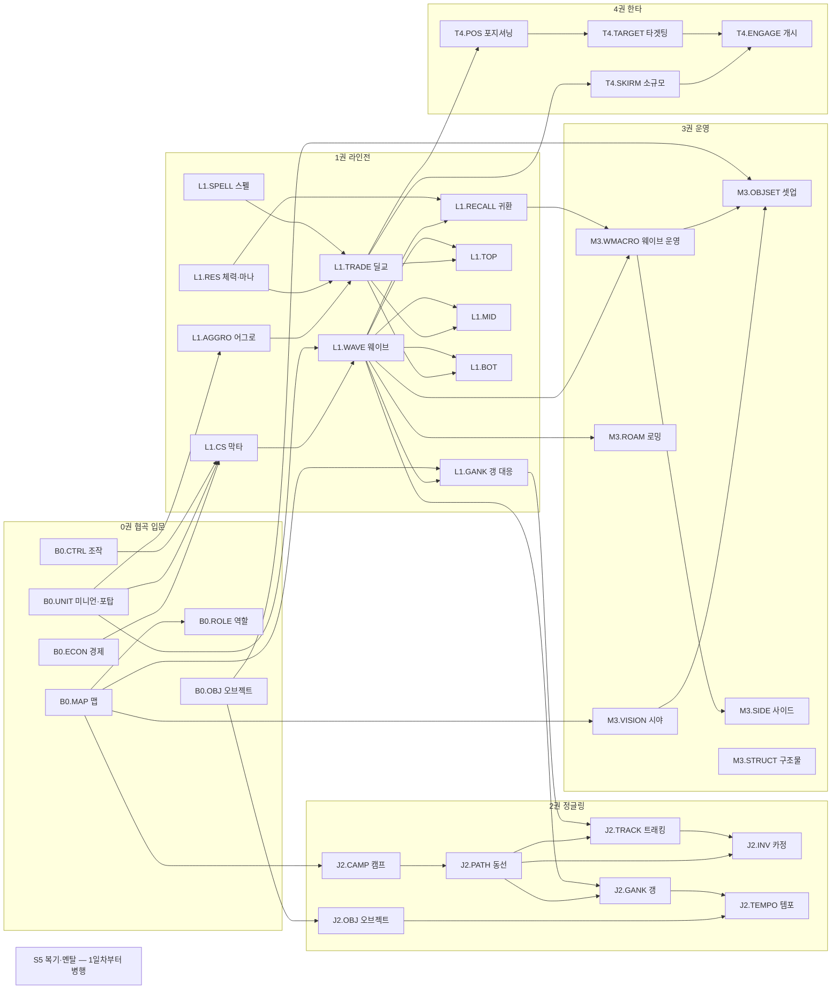
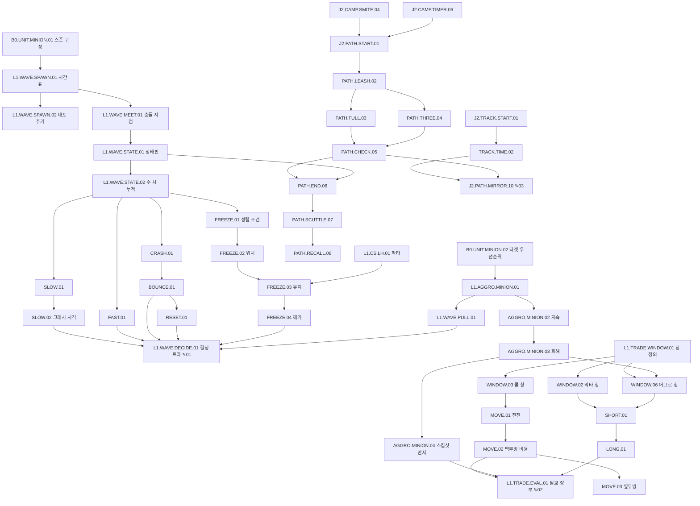

# GRIMOIRE 마도서(Codex) 커리큘럼 설계서

> 작성: 교과서 설계자(curriculum) · 기준일 2026-11-02 · 기준 패치 **26.21** (2026-10-21 적용, 26.22는 11월 초 예정으로 보도됨)
> 짝 문서: `team/brief.md`(공통 전제) · `team/plan.md`(기획, 해상도 등급 R0~R4·숙련 5단계·레슨 블록) · `team/engine.md`(지표 산식, 작성 중) · `team/research.md`(사실 시트, 작성 중)
> 샘플 레슨: `team/lessons/01-wave-states.md` · `02-trading-anatomy.md` · `03-jungle-first-clear.md`

## 0. 이 문서를 읽는 법

| 항목 | 내용 |
|---|---|
| 이 문서가 정본인 것 | 원자 ID 체계, 원자 표준 템플릿, 마도서 전체 목차(원자 목록), 학습 경로, 레슨 형식, 용어집, 콘텐츠 제작·패치 갱신 절차 |
| 정본이 아닌 것 | 지표 산식·기준선·통계 판정(→ engine.md), 맵·오브젝트 사실 시트와 정책(→ research.md), 기능·화면(→ plan.md, design.md) |
| 용어 맞춤 | plan.md의 "부·장·원자"는 이 문서의 **권(Volume)·장(Chapter)·원자(Atom)**와 같다. plan.md 6.2의 은유 매핑("부·장 = 권·장")을 따른다. plan.md의 "1부 기초"는 이 문서의 **0권 협곡 입문**이다. |
| 표기 | `[P26.01]` = 이 수치는 패치 26.01에서 들어오거나 바뀌었고, 26.21까지 바뀐 기록을 찾지 못했다(LoL Wiki 패치 이력·riftpatchnotes 기준, 2026-11-02 확인). `[검증 필요]` = 출처로 확정 못 한 값. `[가설]` = 운영하며 조정할 기획 수치. `{N}`·`{Δ}` = 엔진이 채울 자리표시자. |

### 0.1 2026 시즌이 교과서에 주는 영향 (설계 전제)

26.01에서 초반 시간표가 통째로 당겨졌다. 교과서는 이것을 "원리는 그대로, 수치만 이동"의 대표 사례로 쓴다.

| 항목 | 25시즌 | 26.01 이후 | 출처 |
|---|---|---|---|
| 첫 미니언 웨이브 | 1:05 | **0:30** | [Riot 2026 시즌 프리뷰](https://www.leagueoflegends.com/en-us/news/dev/dev-2026-season-one-gameplay-preview/), [LoL Wiki 미니언](https://wiki.leagueoflegends.com/en-us/Minion_(League_of_Legends)) |
| 푸른 파수꾼·붉은 덩굴정령·어스름 늑대·칼날부리 첫 스폰 | 1:30 | **0:55** | [riftpatchnotes 정글](https://www.riftpatchnotes.com/lol/system/jungle) |
| 심술두꺼비·돌거북 첫 스폰 | 1:42 | **1:07** | 같음 |
| 바위게 첫 스폰 | 3:30 | **2:55** | 같음 |
| 첫 대포 미니언 | 4번째 웨이브 | **3번째 웨이브(1:30)** | [riftpatchnotes 미니언](https://www.riftpatchnotes.com/lol/system/minions) |
| 아타칸·피의 장미 | 있음 | **삭제** | Riot 2026 시즌 프리뷰 |
| 내셔 남작 | 25:00 | **20:00** | 같음 |
| 역할 퀘스트 | 정글·서폿만 | 5개 포지션 전체(탑 해방된 순간이동·레벨 상한 20, 미드 전용 3단계 신발, 바텀 골드·신발 칸, 정글 원시 강타·캠프 보상, 서폿 제어 와드 칸) | 같음, [LoL Wiki 역할 퀘스트](https://wiki.leagueoflegends.com/en-us/Role_Quest), research.md D-3 ⑥ |

**결론**: 미니언과 정글 캠프가 **똑같이 35초** 당겨졌다. 그래서 "리쉬하면 라이너가 첫 웨이브에 늦는다", "풀캠이 끝날 즈음 바위게가 나온다" 같은 **상대 시간 관계(원리)**는 그대로이고, 절대 시각(수치)만 바뀌었다. 원리 블록과 수치 블록을 따로 저장해야 하는 이유를 이 표가 보여 준다.

---

## a. '나노 분해' 방법론

### a.1 네 개의 층위

| 층위 | 정의 | 크기 | 예 |
|---|---|---|---|
| **권 (Volume)** | 게임 국면 또는 역할 하나 | 20~95개 원자 | 1권 라인전 |
| **장 (Chapter)** | 한 가지 메커니즘 묶음. 학습 단위이자 '장 완료' 단위(plan.md 6.4) | 3~17개 원자 | 1권 1장 웨이브 역학 (`L1.WAVE`) |
| **절 (Section)** | 같은 현상을 다른 각도에서 본 원자 묶음 | 1~5개 원자 | 프리징 절 (`L1.WAVE.FREEZE`) |
| **원자 (Atom)** | **더 쪼개면 판단이 사라지는 최소 단위.** 원자 하나 = 판단 규칙 하나 + 측정 지표 하나 | 레슨 5~8분 | `L1.WAVE.FREEZE.03` 프리징 유지 |

**원자 분해 판정법 (3문항 테스트)**. 셋 다 "예"여야 원자로 인정한다.
1. **판단 하나인가?** 이 원자를 익힌 사람이 게임 중 내리는 결정이 하나로 말해지는가? ("프리징을 유지할지 말지"는 하나. "웨이브 관리"는 여러 개라 장이다.)
2. **측정 하나인가?** 엔진이 이 원자만의 지표 하나로 잘함·못함을 가를 수 있는가? 둘 이상이 필요하면 원자를 나눈다.
3. **처방 하나인가?** 이 원자가 약점으로 나왔을 때 줄 레슨·드릴이 하나로 정해지는가?

거꾸로 **너무 잘게 쪼갠 신호**: 지표가 다른 원자와 똑같다, 판단 없이 사실만 있다(→ 용어집이나 수치표로 보낸다), 단독 레슨이 2분도 안 나온다.

### a.2 원자 ID 규칙

```
{권코드}.{장코드}.{절코드}.{번호}
  L1   . WAVE  . FREEZE . 03
```

| 권코드 | 권 | 장 코드 예 |
|---|---|---|
| `B0` | 0권 협곡 입문 (Basics) | MAP, ROLE, ECON, UNIT, OBJ, CTRL |
| `L1` | 1권 라인전 (Lane) | WAVE, CS, TRADE, AGGRO, RES, RECALL, SPELL, GANK, TOP, MID, BOT |
| `J2` | 2권 정글링 (Jungle) | CAMP, PATH, GANK, INV, TRACK, OBJ, TEMPO |
| `M3` | 3권 운영 (Macro) | SIDE, VISION, ROAM, OBJSET, WMACRO, STRUCT |
| `T4` | 4권 한타 (Teamfight) | POS, TARGET, ENGAGE, SKIRM |
| `S5` | 5권 학습법·멘탈 (Self) | REVIEW, POOL, MENTAL |

- 번호는 절 안에서 01부터. 한 번 발행한 ID는 **바꾸지 않는다**(엔진 기록·사용자 숙련 기록의 키). 원자를 합치거나 나누면 옛 ID는 `deprecated → 새 ID`로 리디렉션한다.
- 포지션 트랙은 원자를 새로 만들지 않고 **기존 원자의 순서 목록**이다(c.3).
- **ID 표기 확정 (3단계 리뷰 R-03, 모든 문서 공통 정본)**

| 대상 | 형식 | 예 |
|---|---|---|
| 원자 | `{권}.{장}.{절}.{nn}` | `L1.WAVE.FREEZE.03` |
| 대표 지표 | `METRIC.{원자ID}` — 원자↔지표 1:1이 이름만으로 보장된다 | `METRIC.L1.WAVE.FREEZE.03` |
| 보조 지표 | `METRIC.{원자ID}:{snake_case}` | `METRIC.L1.TRADE.WINDOW.03:entry_delay_s` |
| R2 대리 지표 | `METRIC.{원자ID}:r2p` | `METRIC.L1.WAVE.DECIDE.01:r2p` |
| 실수 패턴 | `ERR.{원자ID}.{a|b|c…}` — 피드백 카드 한 장 = 실수 패턴 하나 | `ERR.L1.TRADE.MOVE.02.a` |
| 정석 카드 | `CANON.{원자ID}.{nn}`이 **기본 키**. 엔진의 서술형 ID(예: `MID-MAGEvMAGE-ENEMYKEYCD`)는 카드의 `context_slug` 필드로 둔다 | `CANON.L1.TRADE.WINDOW.03.01` |
| 드릴 | `DRILL.{원자ID}.{유형}` | `DRILL.L1.WAVE.FREEZE.03.practice` |

engine.md의 임시 ID(`LANE.*`·`JG.*`·`MAP.*`·`TF.*`·`DEATH.*`)는 g절 대응표대로 치환한다. 사용자 화면에는 원자 ID 대신 원자 이름을 보여 준다.

### a.3 데이터 해상도 표기 (plan.md 3.1 등급을 그대로 쓴다)

| 표기 | 뜻 | 데이터 |
|---|---|---|
| `R1` | 경기 요약만으로 측정 | Match-V5 경기 정보 (게임당 1회 값) |
| `R2` | **분 단위 공개 API로 측정 가능** | Match-V5 타임라인: 60초 간격 참가자 프레임(위치·골드·레벨·CS) + ms 타임스탬프 이벤트(킬·와드·구매·레벨업·포탑 방패). **와드 이벤트에는 위치가 없고**(시각·설치자·종류만), 바위게 처치 이벤트는 없다(리뷰 1.4) |
| `R2~R4` | R2로 **추정**, R4로 **확정** | 피드백 카드 신뢰도: R2면 '추정', R4면 '확실' 배지 |
| `R3~R4` | 내 PC 라이브 클라이언트(R3)로 일부, 리플레이(R4)로 전부 | |
| `R4` | **초 단위 리플레이 분석 필수** | 10명 위치·체력·스킬 사용, 미니언 위치 |

원칙: R2 원자의 지표는 MVP에서 바로 쓴다. R4 원자도 **레슨·퀴즈·드릴은 MVP부터 제공**하고, 게임 측정만 컴패니언(V1 α~V2) 이후에 켠다. 이때 R2로 쓸 수 있는 대리 지표(`:r2p`)가 있으면 '추정' 배지로 먼저 보여 준다.

### a.4 원자 표준 템플릿

모든 원자는 아래 필드를 채워야 발행된다(빈 필드가 있으면 CMS가 발행 버튼을 막는다). **원리 블록**(패치에 안 바뀜)과 **수치 블록**(패치 태그 필수)은 저장소를 따로 쓴다.

```yaml
id: L1.WAVE.FREEZE.03            # 불변 키
name: 프리징 유지
volume_chapter_section: 1권 > 웨이브 역학 > 프리징
version: 1.2                     # 원리 블록이 바뀔 때만 올린다
patch_tags: [P26.01, P26.09]     # 이 원자가 의존하는 수치의 패치 태그
core: true                       # 장 핵심 원자 여부 (plan.md 6.4 '장 완료' 조건)

# ── 원리 블록 (패치 불변) ──
definition: >                    # 한두 문장, 초보가 읽어도 되는 말
mechanism: >                     # 왜 승패에 연결되는가: 자원(골드·XP·체력·시간·시야) 흐름으로 설명
variables:                       # 구성 변수(입력). 엔진이 관측하거나 추정해야 하는 것
  - {name: 미니언 수 차, unit: 마리, source: R4}
decision_rules:                  # if-then. 위에서부터 먼저 맞는 규칙을 적용
  - if: ... then: ...
exceptions:                      # 정석이 깨지는 조건. 적어도 2개
common_mistakes:                 # 흔한 실수 패턴. 각 패턴 = 탐지 규칙 + 피드백 문장 틀
  - id: ERR.L1.WAVE.FREEZE.03.a
    pattern: >
    detect: >
    feedback_template: "{t} — ... → {손실} ... 정석: ..."
canon:                           # 상위권 행동 기준(정석). 근거 카드 링크 필수 (f절 형식)
  behavior: >
  evidence_card: CANON.L1.WAVE.FREEZE.03.01   # 기본 키. 엔진 서술형 ID는 카드의 context_slug
prerequisites: [L1.WAVE.FREEZE.01, L1.WAVE.FREEZE.02, L1.CS.LH.01]
drills: [DRILL.L1.WAVE.FREEZE.03.practice, DRILL.L1.WAVE.FREEZE.03.quiz]

# ── 수치 블록 (패치 태그 필수, Fact Store 참조) ──
facts:
  - key: MINION.GOLD.MELEE       # Fact Store 키. 패치가 바뀌면 이 키를 가진 원자가 자동으로 '갱신 대상'이 된다
    value: 20
    tag: P26.01
    source: https://wiki.leagueoflegends.com/en-us/Minion_(League_of_Legends)

# ── 측정 블록 (engine.md와 공동 소유) ──
metric:
  id: METRIC.L1.WAVE.FREEZE.03
  name: 프리징 유지 시간
  unit: 초
  formula: >                     # 산식 초안. 정본은 engine.md
  detection: >                   # 어떤 데이터에서 어떻게 탐지하나
  resolution: R4                 # 최소 해상도
  r2_proxy: METRIC.L1.WAVE.FREEZE.03:r2p   # 없으면 null
  baseline: 같은 포지션·티어 상위 25% (→ engine.md)
  mastery_threshold: "{engine}"  # plan.md 6.3 숙련 기준값, 티어별

# ── 레슨 블록 (d절 형식) ──
lesson: {reading_min: 5~8, diagram: 1~2, minimap_anim: 0~1, clip: 1~2, quiz: 3~5}
```

### a.5 원자 품질 체크리스트 (발행 전 통과 조건, Definition of Done)

1. 3문항 테스트(a.1)를 통과한다.
2. `mechanism`이 골드·경험치·체력·시간·시야 중 무엇이 어디로 이동하는지 말한다. "좋다/중요하다"로 끝나면 반려.
3. `decision_rules`가 관측 가능한 변수로만 쓰였다. "상황을 봐서"는 금지, "상대 정글이 마지막으로 보인 곳이 반대편 라인이고 40초 이내면"처럼 쓴다.
4. 예외가 2개 이상이다.
5. 모든 수치에 패치 태그와 출처가 있다. 출처가 없으면 `[검증 필요]`.
6. 지표가 있고, 해상도가 적혀 있고, R4라면 R2 대리 지표 유무가 적혀 있다.
7. 정석에 근거 카드(f절) 자리가 있다. 수치가 아직 없으면 자리표시자와 '가설' 배지로 둔다.
8. 퀴즈 3문항 이상, 각 문항에 해설과 연결 원자 ID가 있다.

---

## b. 마도서 전체 목차 (원자 목록)

> 표기: ★ = 장 핵심 원자(plan.md 6.4 '장 완료' 조건) · ◆ = MVP 원자(c.3) · ✎01/✎02/✎03 = 샘플 레슨 수록
> 측정 지표 ID는 모두 `METRIC.{원자ID}`이며, 표에는 지표의 요지만 쓴다. 해상도는 a.3 표기.

### 0권 협곡 입문 (B0) — 31개

| ID | 이름 | 한 줄 요약 | 측정 지표 요지 | 해상도 | 표시 |
|---|---|---|---|---|---|
| **B0.MAP** | **맵 구조** |  | | | |
| B0.MAP.LANE.01 | 세 라인·강·정글 | 3개 라인과 대각선 강, 4개 정글 구역이 맵을 나눈다 | 첫 10분 맡은 구역 이탈 시간 비율 | R2 | ★ ◆ |
| B0.MAP.FOG.02 | 전장의 안개 | 안 보이는 적은 '있다'고 가정한다 | 사망 직전 60초 아군 와드 설치 수(위치 없음)·근처 아군 수 — R2는 '추정' 전용, 시야 판단은 R4 | R2~R4 | ◆ |
| B0.MAP.BRUSH.03 | 수풀 | 수풀은 시야를 끊고 기습·회피 지점이 된다 | 수풀 근처 기습 데스 수 | R2~R4 | |
| B0.MAP.TRAVEL.04 | 이동 시간 감각 | 라인 간·오브젝트까지 걸리는 초를 안다 | 교전·오브젝트 합류 지연(초) | R2~R4 | |
| B0.MAP.SIDE.05 | 블루·레드 진영 차이 | 진영에 따라 버프 위치·카메라 시야·용 접근성이 다르다 | 진영별 정석 동선 일치율 (와드 위치 부분은 R4) | R2 | |
| **B0.ROLE** | **역할** |  | | | |
| B0.ROLE.POS.01 | 다섯 포지션의 일 | 탑·정글·미드·원딜·서폿은 자원을 나눠 먹고 일을 나눈다 | 포지션별 핵심 자원 점유율(CS·캠프·시야) | R1 | ★ |
| B0.ROLE.QUEST.02 | 역할 퀘스트 [P26.01] | 맡은 라인에서 퀘스트가 빨리 차고 포지션별 보상이 다르다 | 퀘스트 완료 추정 시각 [검증 필요: 타임라인 이벤트 존재 여부 → engine.md] | R2 | |
| B0.ROLE.CLASS.03 | 챔피언 클래스 | 탱커·브루저·암살자·메이지·원딜·서폿의 강약과 할 일 | 클래스별 기대 행동(받은 피해·킬관여 등) 일치율 | R1 | |
| B0.ROLE.WINCON.04 | 승리 조건은 넥서스 | 킬은 수단, 구조물과 오브젝트가 목적이다 | 킬 대비 구조물·오브젝트 관여율 | R1 | |
| **B0.ECON** | **골드·경험치 경제** |  | | | |
| B0.ECON.GOLD.01 | 골드의 출처 | CS·킬·포탑·오브젝트·패시브 중 CS가 가장 크고 꾸준하다 | 골드 구성비 | R1~R2 | ★ |
| B0.ECON.XP.02 | 경험치 범위와 공유 | 미니언이 죽을 때 1500 유닛 안에 있어야 XP를 받고, 인원수로 나눈다(100/65/43.3%) [P26.01] | 웨이브 사망 시 XP 범위 이탈로 잃은 XP | R2~R4 | |
| B0.ECON.LEVEL.03 | 레벨 곡선 | 2·3·4·5·6레벨에 280/380/480/580/680 XP가 필요하고 레벨 1 차이가 교전을 바꾼다 | 분당 레벨 격차 | R2 | ◆ |
| B0.ECON.CSVAL.04 | CS 한 개의 가치 | 근거리 20·원거리 14·대포 50+골드 [P26.01], 웨이브 하나 평균 약 119골드 | 10분 골드 중 CS 비중 | R2 | |
| B0.ECON.BOUNTY.05 | 첫 킬·첫 포탑·현상금 | 첫 킬 100·첫 포탑 300골드 [P26.01], 연속 킬 현상금 | 현상금 걸린 상태의 데스 수 | R2 | |
| B0.ECON.ITEM.06 | 아이템 구매와 효율 | 골드는 쓰기 전까지 힘이 아니다 | 귀환 시 미사용 골드 | R2 | |
| **B0.UNIT** | **미니언·포탑** |  | | | |
| B0.UNIT.MINION.01 | 미니언 스폰과 구성 | 0:30부터 30초마다 근거리3·원거리3, 3웨이브마다 대포 [P26.01] | 첫 웨이브 라인 도착 지연 | R2~R3 | ★ |
| B0.UNIT.MINION.02 | 미니언 타겟 우선순위 | 미니언은 '우리 챔피언을 때린 적 챔피언'을 1순위로 친다 | 챔피언 공격 직후 받은 미니언 피해 | R4 | |
| B0.UNIT.TURRET.03 | 포탑 어그로 | 포탑 사거리 안에서 적 챔피언을 치면 포탑이 나를 노린다 | 포탑 사거리 안 교전 후 포탑 피해 | R4 | |
| B0.UNIT.TURRET.04 | 포탑 방패(플레이트) | 외곽 포탑 방패 5개·개당 120골드, 14:00에 사라지지 않고 2·3차 포탑에도 생긴다 [P26.01] | 방패 획득·허용 수 (`TURRET_PLATE_DESTROYED`) | R2 | ◆ |
| B0.UNIT.INHIB.05 | 억제기와 슈퍼 미니언 | 억제기가 깨진 라인에는 매 웨이브 슈퍼 미니언이 온다 | 억제기 파괴 후 사이드 미처리로 잃은 구조물 | R2 | |
| **B0.OBJ** | **오브젝트 기본** |  | | | |
| B0.OBJ.DRAKE.01 | 원소 드래곤 | 5:00 첫 스폰, 처치 후 5분 뒤 재생, 4마리째 영혼, 장로 6분 (리뷰 1.4 확인) | 용 스폰 시 근처 아군 수·생존 | R2 | ★ |
| B0.OBJ.GRUB.02 | 공허 유충 | 8:00 3마리 한 번만, 14:45 퇴장 [P25.09] | 유충 시각 탑 사이드 인원 | R2 | |
| B0.OBJ.HERALD.03 | 협곡의 전령 | 15:00 스폰 [P25.09], 포탑 철거용 | 전령 사용 후 포탑 피해 | R2 | |
| B0.OBJ.BARON.04 | 내셔 남작 | 20:00 스폰 [P26.01] | 바론 버프 후 구조물 획득 | R2 | |
| B0.OBJ.SCUTTLE.05 | 바위게 | 2:55 위·아래 강에 한 마리씩 [P26.01], 둘 다 죽으면 2:30 뒤 한 마리 | 첫 바위게 획득 추정(처치 이벤트가 없어 2:55~3:59 프레임의 정글 CS·골드 증가와 위치로 추정) | R2 | |
| B0.OBJ.TIMER.06 | 오브젝트 타이머 읽기 | 모든 캠프 타이머가 표시되고 시야로 정확해진다 [P25.18] — 타이머를 계획으로 바꾼다 | 스폰 60초 전 위치 준비율 | R2 | |
| **B0.CTRL** | **조작 기본** |  | | | |
| B0.CTRL.ATKMOVE.01 | 어택땅 | 공격 이동으로 가장 가까운 대상을 정확히 친다 | 의도와 다른 대상 공격 횟수 | R4 | |
| B0.CTRL.MINIMAP.02 | 미니맵 확인 습관 | 3~5초마다 미니맵을 본다 | 적 정글 노출 → 내 후퇴 시작까지의 반응 시간 | R4 | ★ |
| B0.CTRL.KITE.03 | 무빙샷 | 평타 후딜을 이동으로 끊어 공격 간 공백을 줄인다 | 평타 사이 정지 시간 비율 | R4 | |
| B0.CTRL.HUD.04 | 체력바·막타 표시기 | 막타 표시기 [P26.05]와 체력바 눈금으로 막타 타이밍을 읽는다 | 막타 실패율 | R2~R4 | |
| B0.CTRL.AIM.05 | 스킬샷 예측 조준 | 상대 이동 방향과 투사체 속도로 '갈 곳'을 쏜다 | 스킬샷 적중률 (R1 `skillshotsHit` 집계, R4 시전별) | R1~R4 | |

### 1권 라인전 (L1) — 93개

| ID | 이름 | 한 줄 요약 | 측정 지표 요지 | 해상도 | 표시 |
|---|---|---|---|---|---|
| **L1.WAVE** | **웨이브 역학** | (✎01) | | | |
| L1.WAVE.SPAWN.01 | 웨이브 시간표 | 0:30 첫 스폰, 14:00 전까지 30초 간격 [P26.01] — 귀환·복귀를 시간표에 맞춘다 | 귀환 후 복귀까지 놓친 웨이브 수 | R2~R4 | ✎01 |
| L1.WAVE.SPAWN.02 | 대포 웨이브 주기 | 1:30부터 3웨이브마다, 14:00부터 2웨이브마다, 25:00부터 매 웨이브 [P26.01] | 놓친 대포 미니언 수 | R4 | ✎01 |
| L1.WAVE.MEET.01 | 충돌 지점 | 양쪽 웨이브의 도착 시차와 전투력 차가 충돌 지점을 정한다 | 충돌 지점의 라인 정규화 좌표 | R4 | ✎01 |
| L1.WAVE.STATE.01 | 웨이브 상태 분류 | 위치(3구역) × 수 차(3단계) = 9칸 상태판으로 읽는다 | 상태 분포·전환 기록 | R4 | ★ ✎01 |
| L1.WAVE.STATE.02 | 수 차의 누적 | 살아남은 미니언이 다음 웨이브에 붙어 차이가 커진다 | 웨이브당 수 차 변화량 | R4 | ✎01 |
| L1.WAVE.SLOW.01 | 슬로우 푸시 원리 | 상대 원거리 미니언만 정리해 2~3웨이브를 쌓는다 | 슬로우 푸시 구간의 수 차 증가율 | R4 | ✎01 |
| L1.WAVE.SLOW.02 | 크래시 시각 맞추기 | 쌓은 웨이브가 귀환·오브젝트 시각에 포탑에 닿게 한다 | 크래시 시각과 목표 시각의 오차(초) | R4 | ✎01 |
| L1.WAVE.FAST.01 | 패스트 푸시 | 스킬로 웨이브를 즉시 지워 시간을 산다 | 웨이브 정리 시간(초) | R4 | ✎01 |
| L1.WAVE.CRASH.01 | 크래시 | 큰 웨이브를 상대 포탑에 박아 방패·시간·상대 CS 손실을 만든다 | 크래시 시 아군 미니언 수·방패 획득 | R2~R4 | ✎01 |
| L1.WAVE.BOUNCE.01 | 바운스 | 크래시 뒤 웨이브는 우리 쪽으로 되돌아온다 | 크래시 후 30초 안 귀환 비율·바운스 구간 CS 손실 | R4 | ✎01 |
| L1.WAVE.FREEZE.01 | 프리징 성립 조건 | 상대 웨이브가 '조금' 더 크고 충돌 지점이 내 포탑 사거리 바로 밖일 때 성립 | 프리징 진입 횟수 | R4 | ★ ✎01 |
| L1.WAVE.FREEZE.02 | 프리징 위치 | 내 포탑 사거리 밖 + 상대 정글 진입로에서 먼 곳 | 프리징 지점 좌표의 정석 구간 일치율 | R4 | ✎01 |
| L1.WAVE.FREEZE.03 | 프리징 유지 | 막타 순간에만 치고, 넘치면 미니언을 몸으로 받는다 | 프리징 유지 시간(초) | R4 | ★ ✎01 |
| L1.WAVE.FREEZE.04 | 프리징 깨기 | 당한 쪽은 정글 호출·스킬 정리·귀환 리셋으로 푼다 | 프리징 당한 구간의 분당 CS 손실 | R4 | ✎01 |
| L1.WAVE.PULL.01 | 웨이브 당기기 | 상대 챔피언을 쳐 미니언 어그로로 충돌 지점을 끌어온다 [P26.10 제약] | 당기기 후 충돌 지점 이동량 | R4 | ✎01 |
| L1.WAVE.RESET.01 | 웨이브 리셋 | 크래시 → 귀환으로 다음 웨이브를 중립으로 되돌린다 | 귀환 직전 웨이브 상태 | R2~R4 | ✎01 |
| L1.WAVE.DECIDE.01 | 상태 선택 결정 트리 | 체력·정글 위치·다음 할 일로 다섯 상태 중 하나를 고른다 | 결정 트리 정석 일치율 | R4 | ★ ✎01 |
| **L1.CS** | **막타** |  | | | |
| L1.CS.LH.01 | 막타의 원리 | 평타 선딜 + 투사체 비행 시간만큼 미리 친다 | 막타 시도 실패율 | R2~R4 | ★ |
| L1.CS.LH.02 | 미니언 피해 예측 | 아군 미니언이 다음에 칠 대상을 보고 막타를 뺏기지 않는다 | 아군 미니언이 먼저 처치한 '경쟁 막타' 손실 | R4 | |
| L1.CS.MELEE.01 | 근거리 미니언 막타 | 체력이 높고 늦게 죽는다 — 원거리 다음 순서 | 근거리 놓친 비율 | R4 | |
| L1.CS.CASTER.01 | 원거리 미니언 막타 | 체력이 낮아 먼저 죽으므로 먼저 챙긴다 | 원거리 놓친 비율 | R4 | |
| L1.CS.CANNON.01 | 대포 미니언 막타 | 골드 50+ [P26.01], 한 웨이브 골드의 3분의 1 | 놓친 대포 수 | R4 | |
| L1.CS.TURRET.01 | 포탑 아래 막타 | 근거리는 포탑 2방 + 평타(막타), 원거리는 평타 1 → 포탑 1 → 평타 1(막타) [검증 필요: 26.01 포탑 피해·26.09 미니언 체력 변경 후 재확인] | 포탑 구간 CS 손실 | R2~R4 | ★ |
| L1.CS.PRESSURE.01 | 압박 속 막타 | 딜교 위협 속에서 '꼭 먹을 CS'만 고른다 | 상대 근접 시 CS 손실률 | R4 | |
| L1.CS.SKILL.01 | 스킬 막타와 마나 | 놓칠 CS만 스킬로, 마나는 딜교용으로 남긴다 | 스킬 막타 비율 vs 마나 잔량 | R4 | |
| L1.CS.BENCH.01 | 10분 CS 기준 | 내 티어 상위 25% 기준선과 비교한다 | 10분 CS | R2 | ◆ |
| **L1.TRADE** | **딜교환** | (✎02) | | | |
| L1.TRADE.WINDOW.01 | 딜교 창의 정의 | 상대가 제대로 반격할 수 없는 시간 구간이 '창'이다 | 탐지된 창 중 진입한 비율 | R4 | ★ ✎02 |
| L1.TRADE.WINDOW.02 | 막타 창 | 상대가 막타 평타 선딜에 묶인 순간 | 막타 창 진입률 | R4 | ✎02 |
| L1.TRADE.WINDOW.03 | 스킬 쿨다운 창 | 상대 핵심 스킬이 빠진 동안 | 쿨 창 진입률·진입 지연(초) | R4 | ★ ✎02 |
| L1.TRADE.WINDOW.04 | 자원 창 | 상대 마나·기력이 콤보 비용보다 적을 때 | 자원 창 진입률 | R4 | |
| L1.TRADE.WINDOW.05 | 레벨 창 | 2·3·6레벨을 먼저 찍은 직후 몇 초 | 레벨 선점 후 10초 안 교전 여부 | R2~R4 | |
| L1.TRADE.WINDOW.06 | 어그로 창 | 상대 미니언이 적거나 다른 대상을 칠 때 교환 비용이 싸다 | 교환 중 받은 미니언 피해 | R4 | ✎02 |
| L1.TRADE.SHORT.01 | 짧은 딜교 | 1~2타 후 상대 반격 전에 빠진다 | 짧은 딜교 체력 교환량(ΔHP) | R4 | ✎02 |
| L1.TRADE.LONG.01 | 긴 딜교 | 지속 피해·회복 우위가 있을 때 오래 붙는다 | 긴 딜교 ΔHP | R4 | ✎02 |
| L1.TRADE.ALLIN.01 | 올인 계산 | 콤보+점화+평타 ≥ 상대 체력+보호막+회복이면 들어간다 | 올인 시도 성공률 | R2~R4 | |
| L1.TRADE.MOVE.01 | 전진 무빙 | 창 안에서는 사거리를 유지하려고 앞으로 간다 | 창 안 전진 이동 비율 | R4 | ✎02 |
| L1.TRADE.MOVE.02 | 백무빙의 비용 | 창 안 후퇴 1회 = 왕복 시간만큼 창이 줄어든다 | 창 안 후퇴 횟수·그로 인한 손실 교환량 | R4 | ★ ✎02 |
| L1.TRADE.MOVE.03 | 옆무빙 | 사거리를 유지한 채 스킬샷 궤적에서 빠진다 | 스킬샷 피격률 | R4 | ✎02 |
| L1.TRADE.SPACING.01 | 사거리 차 스페이싱 | 내 사거리 끝, 상대 사거리 밖에 선다 | 평타 교환 비대칭 | R4 | |
| L1.TRADE.EVAL.01 | 딜교 장부 | ΔHP만이 아니라 CS·웨이브·쿨다운·스펠까지 회계한다 | 교환 장부(ΔHP·ΔCS·Δ쿨) | R2~R4 | ★ ✎02 |
| L1.TRADE.MATCHUP.01 | 매치업 파워 커브 | 레벨·아이템 구간별로 누가 센지 안다 | 내 강세 구간 교전 비율 | R2~R4 | |
| **L1.AGGRO** | **어그로** | (✎02) | | | |
| L1.AGGRO.MINION.01 | 미니언 어그로 발동 | 평타·대부분의 지정형 스킬로 적 챔피언을 치면 근처 적 미니언이 나를 노린다 | 딜교 중 어그로 발동 비율 | R4 | ★ ✎02 |
| L1.AGGRO.MINION.02 | 어그로 지속과 재평가 | 미니언은 공격 사이사이 대상을 다시 고른다 — 지속 시간은 [검증 필요] | 어그로 지속 실측·어그로 중 추가 교전 | R4 | ✎02 |
| L1.AGGRO.MINION.03 | 어그로 피해 산정 | 미니언 수·종류·업그레이드 단계로 받는 피해가 정해진다 | 어그로 피해량 | R4 | ✎02 |
| L1.AGGRO.MINION.04 | 스킬샷 먼저, 평타는 나중 | 스킬샷·광역기는 대개 어그로를 부르지 않는다 [검증 필요: 챔피언별 예외] | 교환 첫 타격 수단 분포 | R4 | ✎02 |
| L1.AGGRO.TURRET.01 | 포탑 어그로 회피 | 상대 포탑 사거리 안에서는 챔피언 공격 = 포탑 피해 | 포탑 어그로 피해 | R4 | |
| L1.AGGRO.TURRET.02 | 포탑 어그로 넘기기 | 다이브 때 단단한 아군이 먼저 맞고 빠진다 | 다이브 시 포탑 피해 분배 | R4 | |
| **L1.RES** | **체력·마나 경제** |  | | | |
| L1.RES.HP.01 | 체력은 화폐 | 체력은 라인에 머무를 수 있는 시간과 킬각 저항이다 | 체력 50% 이하 체류 시간 | R2~R4 | |
| L1.RES.HP.02 | 회복 수단 운용 | 물약·도란·룬 회복을 웨이브 사이 빈 시간에 쓴다 | 회복 아이템 사용 시점 [검증 필요: 소모품 이벤트 → engine.md] | R2~R4 | |
| L1.RES.MANA.01 | 마나 예산 | 귀환까지 남은 시간 동안 쓸 스킬 수를 정한다 | 마나 20% 이하 체류 시간 | R2~R4 | |
| L1.RES.KILLRANGE.01 | 킬각 체력선 | 상대 콤보+점화 피해 이하 체력으로는 라인에 서지 않는다 | 킬각 체력선 안 체류 시간 | R4 | ★ |
| L1.RES.SUSTAIN.01 | 소모전 비교 | 회복량 차이로 긴 라인전의 승자를 예측한다 | 분당 체력 회복 순이익 | R2~R4 | |
| L1.RES.ENERGY.01 | 기력·무자원 챔피언 | 기력은 빨리 차고, 무자원은 체력이 곧 자원이다 | 자원 고갈 상태 교전 수 | R4 | |
| **L1.RECALL** | **귀환** |  | | | |
| L1.RECALL.WHEN.01 | 귀환 3조건 | 웨이브 상태·보유 골드·체력/마나 중 둘이 맞으면 간다 | 귀환 시점의 3조건 충족 수 | R2~R4 | ★ |
| L1.RECALL.GOLD.02 | 아이템 스파이크 골드 | 다음 핵심 부품 가격에 맞춰 귀환한다 | 귀환 시 보유 골드 vs 목표 부품 가격 | R2 | ◆ |
| L1.RECALL.WAVE.03 | 크래시 후 귀환 | 웨이브를 박고 가면 잃는 CS가 거의 없다 | 귀환 중 놓친 CS | R2~R4 | |
| L1.RECALL.SYNC.04 | 상대와 귀환 맞추기 | 상대보다 늦게 오래 남지 않는다 | 상대 대비 귀환 시각 차 | R2 | ◆ |
| L1.RECALL.TP.05 | 순간이동 복귀 | 탑은 역할 퀘스트로 TP를 받는다 [P26.01] — TP 복귀로 라인 손실을 줄인다 | TP 복귀 후 라인 손실 | R2 | |
| L1.RECALL.FORCED.06 | 강제 귀환의 비용 | 딜교 패배로 쫓겨난 귀환이 잃은 CS·XP를 계산한다 | 강제 귀환 1회당 손실 CS·XP | R2 | |
| L1.RECALL.HOMEGUARD.07 | 귀환 신속 구간 | 귀환 후 이동속도 버프가 고정 시간이 아니라 '외곽 포탑이 서 있는 동안 내 라인 구간'에서 유지된다 [P26.01] | 귀환 후 라인 복귀 시간 | R2 | |
| **L1.SPELL** | **소환사 주문 경제** |  | | | |
| L1.SPELL.FLASH.01 | 점멸의 가치 | 점멸 한 번은 데스 한 번 또는 킬 한 번의 값이다 | 점멸 사용 결과 분류(생존·킬·낭비) | R1~R4 | ★ |
| L1.SPELL.TRACK.02 | 상대 스펠 추적 | 상대 점멸이 빠진 시각을 기록해 둔다 | 상대 점멸 쿨 중 교전 비율 | R4 | |
| L1.SPELL.IGNITE.03 | 점화·탈진 | 킬각을 앞당기거나 상대 올인을 꺾는다 | 점화 사용 후 킬 전환율 | R1~R4 | |
| L1.SPELL.TP.04 | 순간이동 합류 | TP는 라인 복귀와 합류의 선택이다 | TP 합류 후 교전 결과 | R2 | |
| L1.SPELL.LEVERAGE.05 | 스펠 우위 레버리지 | 상대 점멸이 없으면 딜교 강도를 한 단계 올린다 | 스펠 우위 구간 교전 빈도 | R4 | |
| **L1.GANK** | **갱 대응** |  | | | |
| L1.GANK.TRACK.01 | 상대 정글 위치 추론 | 첫 동선·등장 정보로 3분대 갱 방향을 예측한다 (J2.TRACK 공유) | 갱 데스 중 예측 가능했던 비율 | R2 | ★ ◆ |
| L1.GANK.WARD.02 | 라인전 와드 타이밍 | 첫 갱 예상 시각 직전에 와드를 둔다 | 첫 와드 설치 시각·설치 간격(R2, 위치는 기록되지 않음) / 위치(R4) | R2~R4 | ◆ |
| L1.GANK.WAVE.03 | 웨이브 위치와 갱 위험 | 내가 밀고 있으면 노출 시간이 길어진다 | 상대 진영 쪽 위치에서의 갱 데스 | R2 | ◆ |
| L1.GANK.ESCAPE.04 | 갱 회피 동선 | 벽·수풀·포탑 방향으로 미리 빠질 길을 정한다 | 갱 노출 후 생존율 | R4 | |
| L1.GANK.COUNTER.05 | 맞갱 조건 | 아군 정글이 가깝고 웨이브가 유리하면 싸운다 | 갱 교전 수적 균형과 결과 | R2 | |
| L1.GANK.MIA.06 | 미아 신호 | 상대 라이너가 사라지면 즉시 핑을 찍고 물러선다 | 상대 로밍 데스 전 경고 여부 | R4 | |
| L1.GANK.PRIO.07 | 정글에 우선권 주기 | 아군 정글이 강에 들어갈 때 라인을 먼저 밀어 둔다 | 아군 정글 교전 시 합류율 | R2 | |
| **L1.TOP** | **탑 (1:1, 긴 라인)** |  | | | |
| L1.TOP.ISLAND.01 | 고립된 긴 라인 | 지원이 멀어 1:1 결과가 그대로 쌓인다 | 탑 1:1 교전 승률 | R2 | ★ |
| L1.TOP.TP.02 | 탑 TP 운영 | 퀘스트 보상 '해방된 순간이동'(쿨 390초) [P26.01]을 라인용·합류용 중 어디에 쓰는가 | TP 용도 분포와 결과 | R2 | |
| L1.TOP.FREEZE.03 | 탑 프리징의 위력 | 긴 라인이라 프리징의 노출 효과가 가장 크다 | 탑 프리징 유지 시간 | R4 | |
| L1.TOP.LEVEL.04 | 탑 레벨 우위 | 탑 퀘스트 추가 경험치 [P26.01]로 레벨 격차가 생긴다 | 레벨 격차 추이 | R2 | |
| L1.TOP.GRUB.05 | 유충 앞 라인 우선권 | 8:00 유충 [P25.09] 전에 탑 웨이브를 민다 | 7:30~8:00 탑 웨이브 상태 | R2~R4 | |
| L1.TOP.MATCHUP.06 | 탑 매치업 유형 | 탱커·브루저·원거리 탑의 상성 구조 | 유형별 라인전 결과 | R2 | |
| **L1.MID** | **미드 (짧은 라인, 양방향)** |  | | | |
| L1.MID.SHORT.01 | 짧은 라인 | 웨이브가 먼저 오고, 갱 길이 양쪽에서 열린다 | 미드 갱 데스 진입 방향 분포 | R2 | |
| L1.MID.PRIO.02 | 미드 우선권 = 정글 주도권 | 미드가 밀고 있어야 아군 정글이 강에서 싸울 수 있다 | 아군 정글 교전 시 미드 웨이브 상태 | R2~R4 | ★ |
| L1.MID.ROAM.03 | 라인전 중 로밍 | 웨이브를 밀어 두고 움직인다 | 로밍 성공률·로밍 비용(CS·XP) | R2 | ◆ |
| L1.MID.SKIRM.04 | 정글 교전 합류 | 강 교전에 먼저 도착하는 쪽이 이긴다 | 근처 정글 교전 합류율·도착 순서 | R2 | |
| L1.MID.LV2.05 | 미드 2레벨 선점 | 첫 웨이브 + 1마리 [P26.01 XP 기준]로 2레벨 | 2레벨 선점 여부 | R2 | ◆ |
| L1.MID.WARD.06 | 미드 와드 | 양쪽 강 입구 시야로 갱을 미리 본다 | 3분 전 강 입구 와드 여부 | R2 | |
| **L1.BOT** | **바텀 (2:2)** |  | | | |
| L1.BOT.LV2.01 | 2레벨 싸움 | 첫 웨이브 + 두 번째 웨이브 근거리 3마리에서 2레벨 [P26.01 XP 기준 계산] | 2레벨 선점 여부·직후 교전 | R2 | ★ |
| L1.BOT.LV3.02 | 3레벨 싸움 | 3레벨 선점 순간 스킬 하나 차이를 쓴다 | 3레벨 선점 여부 | R2 | |
| L1.BOT.DUO.03 | 2:2 타겟 선택 | 원딜을 칠지 서폿을 칠지: 사거리·위협·킬각 | 2:2 타겟 분포와 결과 | R4 | |
| L1.BOT.BRUSH.04 | 수풀 장악 | 바텀 수풀을 가진 쪽이 시야와 기습을 가진다 | 수풀 점유 시간 | R4 | |
| L1.BOT.SUPPOS.05 | 서폿 위치 | 원딜과 각을 벌려 서고, 상대 스킬샷 경로에서 비켜 선다 | 서폿-원딜 상대 위치 분포 | R4 | |
| L1.BOT.ENGAGE.06 | 서폿 이니시 조건 | 상대 핵심 스펠·스킬이 빠지고 아군 원딜이 따라올 때 | 이니시 성공률 | R2~R4 | |
| L1.BOT.DRAKE.07 | 용 앞 라인 우선권 | 4:30~5:00에 바텀이 밀고 있어야 첫 용이 열린다 | 용 스폰 전 바텀 웨이브 상태 | R2~R4 | |
| L1.BOT.ROAM.08 | 서폿 이탈 타이밍 | 웨이브를 박은 뒤에만 와딩·로밍을 나간다 | 서폿 이탈 시 원딜 데스 여부 | R2 | |
| L1.BOT.GOLD.09 | 원딜 퀘스트와 골드 | 원딜 퀘스트 골드·장화 칸 [P26.01] — CS 손실이 더 아프다 | 원딜 CS 손실의 골드 환산 | R2 | |

### 2권 정글링 (J2) — 48개

| ID | 이름 | 한 줄 요약 | 측정 지표 요지 | 해상도 | 표시 |
|---|---|---|---|---|---|
| **J2.CAMP** | **캠프 처치** |  | | | |
| J2.CAMP.KIT.01 | 캠프별 특성 | 캠프마다 체력·피해·처치 요령이 다르다 | 캠프별 처치 시간 | R3~R4 | |
| J2.CAMP.KITE.02 | 캠프 카이팅 | 몬스터 공격 사이에 움직여 받는 피해를 줄인다 | 클리어 후 잔여 체력 | R2~R4 | |
| J2.CAMP.LEASH.03 | 리쉬 범위와 인내심 | 범위(푸른 파수꾼 650) 밖으로 끌면 몬스터가 회복하고 돌아간다 | 캠프 리셋 발생 수 | R4 | |
| J2.CAMP.SMITE.04 | 강타 운용 | 600 피해 시작, 0:48부터 충전, 최대 2회 [P26.01] — 충전을 놀리지 않는다 | 강타 2회 충전 상태 방치 시간 | R4 | ★ ✎03 |
| J2.CAMP.PET.05 | 정글 펫 진화 | 간식 15개·35개에서 강타가 강해진다 | 펫 진화 시각 [검증 필요: 이벤트 유무] | R2 | |
| J2.CAMP.TIMER.06 | 캠프 재생 시간 | 버프 5:00, 작은 캠프 2:15, 바위게 2:30 | 재생 후 방치 시간 | R2~R4 | ✎03 |
| J2.CAMP.QUEST.07 | 정글 역할 퀘스트 | 초반 클리어가 느려지고, 퀘스트로 대형 몬스터 보상이 커진다 [P26.01] | 퀘스트 완료 추정 시각 | R2 | |
| **J2.PATH** | **동선 설계** | (✎03) | | | |
| J2.PATH.START.01 | 시작 캠프 선택 | 첫 갱 방향과 끝낼 위치에서 거꾸로 시작점을 정한다 | 시작 위치와 계획 동선 일치 | R2 | ✎03 |
| J2.PATH.LEASH.02 | 리쉬 요청과 비용 | 리쉬는 정글 시간을 사고 라이너 첫 웨이브를 판다 | 리쉬 라이너의 첫 웨이브 CS·XP 손실 | R2~R4 | ✎03 |
| J2.PATH.FULL.03 | 풀캠 동선 | 6캠프를 돌고 4레벨로 바위게 시각에 맞춰 끝낸다 [검증 필요: 26.x 레벨] | 풀캠 완료 시각 | R2~R3 | ★ ◆ ✎03 |
| J2.PATH.THREE.04 | 3캠 후 갱 | 3캠프 후 3레벨로 가장 이른 갱을 간다 | 3캠 갱 도착 시각·성공률 | R2 | ◆ ✎03 |
| J2.PATH.CHECK.05 | 레벨·시간 체크포인트 | 정해진 시각에 레벨·CS·위치가 기준 안인지 본다 | 체크포인트별 레벨·정글 CS 편차 | R2 | ★ ◆ ✎03 |
| J2.PATH.END.06 | 동선 종착점 | 끝나는 위치가 다음 행동(바위게·갱·인베)을 정한다 | 3:00 위치 vs 우선권 라인 쪽 일치 | R2 | ✎03 |
| J2.PATH.SCUTTLE.07 | 첫 바위게 판단 | 2:55 [P26.01] 바위게를 갈지: 라인 우선권과 상대 위치로 정한다 | 바위게 교전 결과 | R2 | ✎03 |
| J2.PATH.RECALL.08 | 첫 귀환 | 골드·체력·다음 리젠 시각으로 첫 귀환을 정한다 | 첫 귀환 시각·보유 골드 | R2 | ◆ ✎03 |
| J2.PATH.SECOND.09 | 두 번째 동선 | 캠프 재생 시각에 맞춰 다시 들어온다 | 재생 후 처치 지연 | R2~R4 | |
| J2.PATH.MIRROR.10 | 상대 동선 역산 | 상대 첫 등장 시각·위치·레벨로 남은 캠프와 다음 위치를 계산한다 | 역산 후 60초 안 대응 행동 | R2 | ★ ✎03 ◆ |
| **J2.GANK** | **갱 판단** |  | | | |
| J2.GANK.COND.01 | 갱 성공 조건 | 웨이브 위치·CC·상대 체력·상대 점멸로 성공 확률을 본다 | 갱 성공률 | R2 | ★ |
| J2.GANK.ANGLE.02 | 진입 각도 | 상대 퇴로 쪽에서 들어간다 | 진입 방향과 결과 | R2~R4 | |
| J2.GANK.TIMING.03 | 진입 순간 | 상대 이동기·점멸이 빠진 뒤, 아군 라이너 CC와 맞춘다 | 상대 이동기 쿨 중 진입 비율 | R4 | |
| J2.GANK.LANE.04 | 라인 상태별 갱 | 상대가 밀고 들어온(당겨진) 라인이 갱각이다 | 갱 시점 웨이브 위치 | R2~R4 | |
| J2.GANK.DIVE.05 | 다이브 | 포탑 어그로 순서와 남은 포탑 공격 횟수를 계산한다 | 다이브 성공률·데스 교환 | R2~R4 | |
| J2.GANK.ABORT.06 | 갱 포기 | 각이 사라지면 빨리 접고 캠프로 돌아간다 | 갱 시도 시간 대비 획득 자원 | R2 | |
| J2.GANK.COUNTERG.07 | 맞갱 | 상대 정글 갱 위치를 예측해 반대로 덮친다 | 맞갱 교전 결과 | R2 | |
| J2.GANK.EV.08 | 갱 기대값 | 성공 확률 × 보상 − 놓친 캠프·시간 | 갱 기대값 대비 실제 선택 | R2 | |
| **J2.INV** | **카운터 정글링** |  | | | |
| J2.INV.LV1.01 | 1레벨 인베 | 팀 단위 1레벨 싸움의 조건과 위험 | 1레벨 교전 결과 | R2 | |
| J2.INV.STEAL.02 | 캠프 뺏기 | 상대가 반대편에 있을 때 상대 캠프를 먹는다 | 적 정글 몬스터 처치 수 | R1 | ★ |
| J2.INV.BUFF.03 | 버프 스틸 | 상대 버프 재생 시각(5:00)을 맞춰 뺏는다 | 버프 스틸 성공 수 | R2 | |
| J2.INV.PRIO.04 | 카정의 전제 | 인접 라인 우선권 없이 들어가지 않는다 | 카정 중 데스 비율 | R2~R4 | |
| J2.INV.TRADE.05 | 맞교환 | 상대가 갱을 가면 반대편 상대 정글을 먹는다 | 상대 갱 시 반대편 자원 획득 | R2 | |
| **J2.TRACK** | **트래킹** |  | | | |
| J2.TRACK.START.01 | 시작 위치 추론 | 리쉬한 라이너가 늦게 오는 쪽이 상대 시작점이다 | 시작 위치 추론 적중(정답은 경기 후 R2) | R2 | ✎03 |
| J2.TRACK.TIME.02 | 시간 기반 위치 예측 | 캠프 처치 시간을 더해 지금 위치를 계산한다 | 예측 위치와 실제 위치 오차 | R2 | ✎03 |
| J2.TRACK.CAMP.03 | 캠프 흔적 추적 | 비어 있는 캠프·타이머 [P25.18]로 동선을 읽는다 | 정보 획득 후 대응 행동 | R4 | |
| J2.TRACK.SCUTTLE.04 | 바위게로 추적 | 바위게를 누가 언제 먹었는지로 위치를 고정한다 | 바위게 정보 후 대응 | R2 | |
| J2.TRACK.WARD.05 | 트래킹 와드 | 상대 동선 길목 와드 | 상대 정글 진입로 와드 설치 (R2는 설치 시각만, 위치는 R4) | R2~R4 | |
| J2.TRACK.SHARE.06 | 정보 공유 | 본 것을 핑으로 라이너에게 넘긴다 | 정보 후 아군 라이너 데스 감소 | R4 | |
| **J2.OBJ** | **오브젝트 타이밍** |  | | | |
| J2.OBJ.DRAKE.01 | 첫 용 | 5:00 첫 용을 바텀·미드 우선권과 묶어 계획한다 | 첫 용 획득·교전 결과 | R2 | |
| J2.OBJ.GRUB.02 | 공허 유충 | 8:00 유충 [P25.09]은 탑·미드 우선권과 묶는다 | 유충 획득 수 | R2 | |
| J2.OBJ.HERALD.03 | 전령 | 15:00 [P25.09] 전령으로 포탑 방패를 바꾼다 | 전령 사용 결과 | R2 | |
| J2.OBJ.TRADE.04 | 오브젝트 교환 | 동시에 못 먹으면 반대편을 확실히 먹는다 | 교환 시 자원 순이익 | R2 | |
| J2.OBJ.SMITE.05 | 강타 싸움 | 강타 피해선(600/1000/1400)을 계산해 스틸을 막는다 | 오브젝트 스틸 허용률 | R2 | |
| J2.OBJ.SETUP.06 | 60초 전 셋업 | 스폰 60초 전에 귀환·시야·라인을 맞춘다 | 스폰 60초 전 프레임의 근처 아군 수·체력 + 그 60초 와드 설치 수(위치 없음) | R2 | ★ ◆ |
| **J2.TEMPO** | **템포** |  | | | |
| J2.TEMPO.DEF.01 | 템포의 정의 | 템포 = 시간당 얻는 자원(골드+XP+오브젝트) | 분당 골드+XP | R2 | ★ |
| J2.TEMPO.EFF.02 | 캠프 vs 갱 효율 | 갱 한 번의 기대값을 캠프 몇 개와 비교한다 | 갱·캠프 시간 배분 효율 | R2 | |
| J2.TEMPO.SYNC.03 | 라인과 템포 맞추기 | 라인이 밀리는 시각에 맞춰 근처에 있는다 | 우선권 라인 근처 체류 비율 | R2~R4 | |
| J2.TEMPO.STYLE.04 | 파밍형 vs 갱형 | 챔피언·조합이 정하는 기본 템포 | 스타일 대비 자원 획득 | R2 | |
| J2.TEMPO.RESET.05 | 템포 리셋 | 귀환·구매로 다음 리젠 주기에 맞춘다 | 귀환 후 첫 캠프까지 시간 | R2 | |
| J2.TEMPO.CATCHUP.06 | 뒤처진 정글의 복구 | 싸움을 피하고 캠프·따라잡기 경험치로 회복한다 | 레벨 격차 회복 시간 | R2 | |

### 3권 운영 (M3) — 29개

| ID | 이름 | 한 줄 요약 | 측정 지표 요지 | 해상도 | 표시 |
|---|---|---|---|---|---|
| **M3.SIDE** | **사이드 관리** |  | | | |
| M3.SIDE.END.01 | 라인전 종료 신호 | 첫 포탑 파괴·로밍 증가가 라인전 끝이다 | 첫 포탑 후 포지션 이동 패턴 | R2 | |
| M3.SIDE.CATCH.02 | 사이드 웨이브 받기 | 안전한 사이드 웨이브부터 받는다 | 중반 사이드 CS 획득률 | R2~R4 | ★ |
| M3.SIDE.SPLIT.03 | 스플릿 푸시 조건 | 1:1 우위·텔·시야가 있을 때만 | 스플릿 중 데스·구조물 획득 | R2 | |
| M3.SIDE.FORM.04 | 1-3-1과 1-4 | 사이드 배치로 상대를 둘로 가른다 | 배치별 구조물 결과 | R2 | |
| M3.SIDE.DANGER.05 | 위험 지역 판단 | 시야 없는 깊은 사이드는 상대 4명이 안 보일 때 금지 | 깊은 사이드 데스 | R2 | |
| **M3.VISION** | **시야** |  | | | |
| M3.VISION.WARD.01 | 와드 종류와 용도 | 투명 와드·제어 와드·렌즈·망원형의 쓰임 | 와드 종류별 설치·제거 | R1~R2 | |
| M3.VISION.TIMING.02 | 와드 타이밍 | 정보가 필요해지기 30~60초 전에 둔다 | 오브젝트·갱 예측 시각 대비 와드 시각 | R2 | ★ |
| M3.VISION.DENY.03 | 시야 지우기 | 상대 와드를 지워 정보를 끊는다 | 와드 제거 수 (`WARD_KILL`, 위치 없음) | R2 | |
| M3.VISION.OBJ.04 | 오브젝트 시야 장악 | 오브젝트 주변 입구를 먼저 밝힌다 | R2: 스폰 전 60초 와드 설치·제거 수(위치 없음) / R4: 오브젝트 반경 내 시야 우위 | R2~R4 | |
| M3.VISION.ENTRY.05 | 시야 우위 진입 | 밝힌 곳으로만 들어간다 | R2: 사망 직전 60초 아군 와드 설치 수(추정) / R4: 시야 없는 구역 진입 후 데스 | R2~R4 | |
| M3.VISION.SUP.06 | 서폿 제어 와드 칸 | 서폿 퀘스트 제어 와드 칸·할인 [P26.01] | 제어 와드 유지 시간 | R2 | |
| M3.VISION.BLOOM.07 | 예지 꽃 | 예지 꽃 재생 200~260초 [P26.01], 15:00 추가 꽃 | 예지 꽃 사용 후 정보 활용 | R2~R4 | |
| **M3.ROAM** | **로밍** |  | | | |
| M3.ROAM.COND.01 | 로밍 조건 | 내 웨이브를 밀었고, 목적지에 킬각·오브젝트가 있을 때 | 로밍 결과(킬·오브젝트·헛걸음) | R2 | ★ |
| M3.ROAM.COST.02 | 로밍 비용 | 잃는 CS·XP·포탑 방패를 계산한다 | 로밍 1회 손실 자원 | R2 | |
| M3.ROAM.PATH.03 | 로밍 경로 | 시야 없는 길로 돌아 들어간다 | 로밍 중 발각 여부 | R2~R4 | |
| M3.ROAM.RECALL.04 | 귀환 겸 로밍 | 귀환 후 라인 복귀 길에 들른다 | 귀환 후 첫 행동 분류 | R2 | |
| **M3.OBJSET** | **오브젝트 셋업** |  | | | |
| M3.OBJSET.START.01 | 셋업 시작 시점 | 스폰 60~90초 전에 귀환·구매를 끝낸다 | 스폰 시점 체력·골드 준비율 | R2 | ★ |
| M3.OBJSET.PUSH.02 | 라인 먼저 밀기 | 오브젝트 쪽 라인을 밀어 상대 라이너를 묶는다 | 셋업 시 웨이브 상태 | R2~R4 | |
| M3.OBJSET.TRADE.03 | 교환 판단 | 상대가 먼저 잡으면 반대편 오브젝트·포탑으로 받는다 | 교환 자원 순이익 | R2 | |
| M3.OBJSET.SOUL.04 | 용 영혼 대응 | 상대 영혼 직전 용은 싸움 각을 미리 만든다 | 영혼 용 교전 결과 | R2 | |
| M3.OBJSET.BARON.05 | 바론 셋업 | 20:00 [P26.01] 이후 바론은 사이드 웨이브와 시야로 연다 | 바론 시도 결과 | R2 | |
| **M3.WMACRO** | **웨이브 기반 운영** |  | | | |
| M3.WMACRO.CROSS.01 | 크로스맵 웨이브 | 반대편에서 싸울 때 내 라인 웨이브를 먼저 처리한다 | 교전 중 방치된 웨이브 손실 | R2~R4 | |
| M3.WMACRO.PRIO.02 | 웨이브 우선권 = 오브젝트 우선권 | 근처 라인을 민 팀이 먼저 오브젝트에 도착한다 | 오브젝트 시 근처 웨이브 상태 | R2~R4 | ★ |
| M3.WMACRO.NUM.03 | 사이드 압박 = 수적 우위 | 사이드 웨이브가 상대 한 명을 묶는다 | 교전 인원 수 비교 | R2 | |
| M3.WMACRO.PLATE.04 | 방패 운영 | 방패가 영구 [P26.01]라 크래시마다 방패를 노린다 | 크래시당 방패 획득 | R2 | |
| M3.WMACRO.SUPER.05 | 슈퍼 미니언 운영 | 억제기 파괴 후 사이드 압박으로 넥서스까지 | 억제기 파괴 후 승리까지 시간 | R2 | |
| **M3.STRUCT** | **구조물** |  | | | |
| M3.STRUCT.ORDER.01 | 포탑 철거 순서 | 다음 오브젝트에 가까운 포탑부터 | 포탑 철거 순서와 이후 오브젝트 | R2 | |
| M3.STRUCT.CRYSTAL.02 | 결정질 과성장 | 포탑에 자란 수정을 다음 공격으로 터뜨려 최대 체력 비례 고정 피해를 낸다 [P26.01] — 활성 시점 90초(게임 시각 1:40, 두 표기는 같은 값) | 과성장 활용 피해 | R4 | |
| M3.STRUCT.INHIB.03 | 억제기 재생 관리 | 억제기 재생 전에 다음 압박을 계획한다 | 억제기 재생 전 압박 여부 | R2 | |

### 4권 한타 (T4) — 20개

| ID | 이름 | 한 줄 요약 | 측정 지표 요지 | 해상도 | 표시 |
|---|---|---|---|---|---|
| **T4.POS** | **포지셔닝** |  | | | |
| T4.POS.RANGE.01 | 위협 사거리 지도 | 상대 핵심 스킬 사거리의 경계선에 선다 | 교전 중 위협 사거리 안 체류 시간 | R4 | ★ |
| T4.POS.LINE.02 | 앞라인·뒷라인 간격 | 앞라인과 너무 붙지도 떨어지지도 않는다 | 아군 앞라인과의 거리 분포 | R4 | |
| T4.POS.FOG.03 | 시야 밖 자리 | 상대가 내 위치를 모르게 한다 | 교전 전 노출 시간 | R4 | |
| T4.POS.FLANK.04 | 측면 각 | 정면이 아닌 옆에서 들어간다 | 진입 각도 분포 | R4 | |
| T4.POS.EXIT.05 | 탈출로 확보 | 빠질 길을 등에 두고 선다 | 교전 이탈 성공률 | R4 | |
| T4.POS.BAIT.06 | 시선 끌기 | 단단한 챔피언이 앞에서 스킬을 받아 준다 | 상대 핵심 스킬 흡수 | R4 | |
| **T4.TARGET** | **타겟팅** |  | | | |
| T4.TARGET.REACH.01 | 닿는 최선의 대상 | 가장 위험한 대상이 아니라 '지금 닿는' 대상 중 최선 | 피해 분배의 대상 우선순위 | R4 | ★ |
| T4.TARGET.FRONT.02 | 앞라인 vs 뒷라인 | 뒷라인에 못 닿으면 앞라인을 친다 | 공격 공백 시간 | R4 | |
| T4.TARGET.PEEL.03 | 보호(필) | 아군 캐리에게 붙은 적을 먼저 뗀다 | 아군 캐리 생존 시간 | R4 | |
| T4.TARGET.THREAT.04 | 위협 제거 순서 | 궁극기·CC를 가진 적을 먼저 무력화한다 | 핵심 위협 무력화 시각 | R4 | |
| T4.TARGET.FOCUS.05 | 포커스 신호 | 핑과 이니시 대상에 피해를 모은다 | 팀 피해 집중도 | R4 | |
| **T4.ENGAGE** | **교전 개시** |  | | | |
| T4.ENGAGE.COND.01 | 개시 조건 | 인원·스펠·궁극기·아이템 중 우위 2개 이상일 때 연다 | 개시 교전 승률 | R2~R4 | ★ |
| T4.ENGAGE.OBJ.02 | 오브젝트 교전 | 오브젝트를 미끼로 상대를 불리한 지형에 부른다 | 오브젝트 교전 결과 | R2 | |
| T4.ENGAGE.COUNTER.03 | 반격 이니시 | 상대가 스킬을 쓴 뒤에 들어간다 | 반격 개시 비율·결과 | R4 | |
| T4.ENGAGE.ULT.04 | 궁극기 수 세기 | 양 팀 궁극기 사용 가능 수로 싸움을 정한다 | 궁 열세 교전 빈도 | R4 | |
| T4.ENGAGE.DISENGAGE.05 | 이탈 판단 | 이길 수 없는 싸움에서 빨리 빠진다 | 불리 교전 손실 최소화 | R2~R4 | |
| T4.ENGAGE.CHOKE.06 | 좁은 길 활용 | 정글 통로에서 광역기의 가치가 커진다 | 지형별 교전 결과 | R4 | |
| **T4.SKIRM** | **소규모 교전** |  | | | |
| T4.SKIRM.SMALL.01 | 2:2·3:3 교전 | 합류 순서가 승패를 가른다 | 소규모 교전 승률 | R2~R4 | |
| T4.SKIRM.OUTNUM.02 | 수적 열세 이탈 | 안 보이는 적까지 세고, 수가 밀리면 싸우지 않는다 | 수적 열세 교전 데스 | R2 | ★ ◆ |
| T4.SKIRM.PICK.03 | 잘라먹기 | 혼자 있는 적을 시야로 찾아 끊는다 | 픽 성공 수 | R2 | |

### 5권 학습법·멘탈 (S5) — 12개

| ID | 이름 | 한 줄 요약 | 측정 지표 요지 | 해상도 | 표시 |
|---|---|---|---|---|---|
| **S5.REVIEW** | **복기** |  | | | |
| S5.REVIEW.DEATH.01 | 데스 4질문 | 무엇을 몰랐나·무엇을 봤어야 했나·어디 있었어야 했나·다음엔 무엇을 하나 | 같은 원인 데스 재발률 | R2 | ★ ◆ |
| S5.REVIEW.ONE.02 | 게임 후 1분 복기 | 진단서 Top 1만 보고 다음 판 목표 하나를 고른다 | 다음 판 목표 달성률 | R2 | |
| S5.REVIEW.REPLAY.03 | 리플레이 관찰 포인트 | 미니맵·웨이브·쿨다운 세 가지만 본다 | 처방 원자 지표 개선 속도 | R2 | |
| S5.REVIEW.ATOM.04 | 원자 진단 읽기 | 결과 지표가 아닌 원자 지표로 원인을 찾는다 | 처방 원자 개선률 | R2 | |
| S5.REVIEW.COMPARE.05 | 상위권과 비교 | 같은 상황 상위권 선택 분포와 내 선택을 놓고 본다 | 정석 일치율 추이 | R2 | |
| **S5.POOL** | **챔피언 폭** |  | | | |
| S5.POOL.SIZE.01 | 챔피언 폭 | 학습 단계에선 포지션당 1~3개로 좁힌다 | 챔피언별로 본 처방 원자 지표들의 개별 차이 (합산 점수 없음) | R1 | ★ |
| S5.POOL.MATCHUP.02 | 매치업 학습 순서 | 자주 만나는 상대부터 익힌다 | 빈출 매치업 라인전 결과 | R1~R2 | |
| S5.POOL.PATCH.03 | 패치 대응 | 패치 후 바뀐 수치 원자만 복습한다 | 패치 후 처방 원자 지표 각각이 이전 수준으로 돌아오는 시간 (합산 없음) | R1~R2 | |
| **S5.MENTAL** | **멘탈** |  | | | |
| S5.MENTAL.TILT.01 | 틸트 신호 | 데스 간격이 짧아지고 무리한 교전이 늘면 틸트다 | 게임 내 데스 간격 축소, 연패 뒤 처방 원자 지표 각각의 하락 | R1~R2 | ★ |
| S5.MENTAL.COMMS.02 | 소통과 뮤트 | 비난 대신 정보 핑만 쓴다 | 핑 종류 분포 | R1 | |
| S5.MENTAL.STOP.03 | 중단 규칙 | 2연패 + 처방 원자 지표 2개 이상이 내 기준선 아래로 내려가면 쉰다 | 규칙 준수 후 다음 세션의 처방 원자 지표 각각의 변화 (합산 없음) | R1 | |
| S5.MENTAL.GOAL.04 | 목표 하나 원칙 | 한 판에 고칠 것은 하나 | 다음 게임 목표 달성률 | R2 | |

### b.1 원자 수 집계

| 권 | 장 수 | 원자 수 | ★ 핵심 | R2로 측정 가능(R1·R2·R2~R4 포함) | R4 필수(R3~R4 포함) |
|---|---|---|---|---|---|
| 0권 협곡 입문 | 6 | 31 | 6 | 26 | 5 |
| 1권 라인전 | 11 | 93 | 18 | 46 | 47 |
| 2권 정글링 | 7 | 48 | 8 | 42 | 6 |
| 3권 운영 | 6 | 29 | 5 | 28 | 1 |
| 4권 한타 | 4 | 20 | 4 | 6 | 14 |
| 5권 학습법·멘탈 | 3 | 12 | 3 | 12 | 0 |
| **합계** | **37** | **233** | **44** | **160** | **73** |

**읽을거리**: 라인전의 절반(웨이브·딜교·어그로)과 한타 대부분이 R4에서만 측정된다. 이것이 plan.md 7장 "R2로 루프를 먼저 증명하고 R4로 해상도를 올린다" 순서의 근거다. 정글·운영은 R2만으로도 대부분 잴 수 있어 MVP의 측정 주력이다. (집계는 표의 행을 스크립트로 세어 확인했다. 원자 ID 중복 0건.)

---

## c. 학습 경로 그래프

### c.1 장 단위 선수 관계

화살표 = "앞 장의 ★ 원자가 '해독' 이상이면 뒤 장의 실전 과제가 열린다"(plan.md 6.4 해금 규칙). 본문은 처음부터 모두 열려 있다.



### c.2 핵심 원자 선수 그래프 (샘플 레슨 3편의 주변)



### c.3 MVP 원자 20개 — R2 산식과 측정 강도 (3단계 리뷰 R-01 반영)

> 이 표는 engine.md 10.5로 옮겨 **정본**으로 삼는다(리뷰 R-01). 옮긴 뒤에는 이 절은 engine.md 10.5를 참조하는 요약으로 바꾼다.

선정 기준: ① R2(Match-V5 경기 + 타임라인)만으로 잰다 ② 초보 패배 원인 상위(데스·CS·귀환·레벨) ③ 미드·정글 루프를 각각 닫는다(plan.md Q5) ④ engine.md 10.5 MVP 탐지기(DET-05·07·09·10·12·13) 또는 프레임·이벤트 직접 계산으로 끝난다.

**측정 강도**
- **강**: 원자 판단의 결과를 이벤트(ms 시각) 또는 프레임 값이 직접 담는다. 재측정 판정에 쓴다.
- **중**: 값은 정확하지만 원자와 잇는 데 추론(1분 간격 위치, 분류 규칙)이 낀다. 판정에 쓰되 카드에 '추정' 배지.
- **약**: 원자의 핵심 변수(웨이브 상태·와드 위치·교전 시도)가 R2에 없다. **MVP에서는 레슨·퀴즈만 주고 재측정 판정에서 뺀다.**

R2 데이터 이름: 프레임(60초) `position` `level` `xp` `minionsKilled` `jungleMinionsKilled` `currentGold` `championStats.health` / 이벤트 `CHAMPION_KILL`(위치·킬러·어시스트·받은 피해) `LEVEL_UP` `ITEM_PURCHASED` `WARD_PLACED`(**위치 없음**, `creatorId`·`wardType`·시각만) `TURRET_PLATE_DESTROYED`(위치·라인). 바위게 처치 이벤트는 없다(리뷰 1.4).

| # | 원자 | R2 산식 | 측정 강도 | 탐지기 (engine.md 10.5) | 기준선 집계 | 재측정 판정 |
|---|---|---|---|---|---|---|
| 1 | B0.MAP.LANE.01 맡은 라인 이탈 | 1:00~10:00 프레임 10개 중 `position`이 내 포지션 구역 밖인 프레임 수. 귀환(직전 60초 안 `ITEM_PURCHASED`)·사망 대기 프레임은 뺀다 | 강 | 프레임 직접 (구역 분류 함수 신규) | 가능 | ○ |
| 2 | B0.MAP.FOG.02 시야 없는 곳 데스 (재정의) | 내 사망 직전 60초 동안 아군 `WARD_PLACED` 수(위치는 기록되지 않음) + 직전 프레임 기준 사망 위치 1500 안 아군 수 | **약** | DET-12 보조 필드 | 가능 | × — 데스 해부 카드의 '추정' 보조 정보로만 |
| 3 | B0.ECON.LEVEL.03 레벨 격차 (← `L1.TRADE.WINDOW.05` 교체) | `LEVEL_UP`으로 2·3·6레벨 도달 시각 − 맞라이너 도달 시각, 5:00·10:00 프레임 `level` 차 | 강 | 이벤트·프레임 직접 | 가능 | ○ |
| 4 | B0.UNIT.TURRET.04 포탑 방패 | 14:00까지 내 라인 `TURRET_PLATE_DESTROYED` 획득 수 − 허용 수 | 강 | DET-15 중 방패 집계(R2 부분)만 | 가능 | ○ |
| 5 | L1.CS.BENCH.01 10분 CS | 10:00 프레임 `minionsKilled` | 강 | DET-05(분) | 가능 | ○ |
| 6 | L1.RECALL.GOLD.02 귀환 골드 | 귀환마다(`ITEM_PURCHASED` 묶음, 이벤트 간격 30초 미만 [가설]) 직전 보유 골드 추정(직전 프레임 `currentGold` + 수입 보간) vs 그때 산 핵심 부품 가격 | 중 | DET-07(R2) | 가능 | ○ |
| 7 | L1.RECALL.SYNC.04 상대와 귀환 맞추기 (← `L1.MID.PRIO.02` 교체) | 라인전(14:00 전) 귀환마다 내 첫 구매 시각 − 맞라이너 첫 구매 시각 | 강 | DET-07(양측) | 가능 | ○ |
| 8 | L1.GANK.TRACK.01 상대 정글 위치 추론 | 상대 정글이 관여한 내 라인전 데스 중, 직전 프레임에 상대 정글이 내 라인 쪽 사분면에 있었던 비율('예측 가능했던 갱 데스') | 중 | DET-12 + 프레임(경기 후). DET-08 R2판은 필요 없음 | 가능 | ○ |
| 9 | L1.GANK.WARD.02 라인전 와드 타이밍 | 첫 `WARD_PLACED`(내가 설치) 시각이 2:30 [가설] 전인가, 3~10분 설치 간격. **위치는 판정하지 않는다** | 중 | DET-10(시각·개수) | 가능 | ○ |
| 10 | L1.GANK.WAVE.03 밀린 라인 갱 데스 | 라인전 데스 중 사망 위치(이벤트 `position`)가 내 라인의 상대 쪽 절반이고 상대 정글이 관여한 수 | 강 | DET-12 | 가능 | ○ |
| 11 | L1.MID.LV2.05 미드 2레벨 선점 (← `L1.CS.TURRET.01` 교체) | 내 2레벨 `LEVEL_UP` 시각 < 맞라이너 2레벨 시각 | 강 | 이벤트 직접 | 가능 | ○ |
| 12 | L1.MID.ROAM.03 라인전 중 로밍 | 미드 구역 밖 프레임 다음 60초 안 그 지역 킬·어시스트 관여(성공) + 그 1~2분 `minionsKilled` 증가 결손(비용) | 중 | DET-12 + 프레임. DET-15는 필요 없음 | 가능 | ○ |
| 13 | J2.PATH.FULL.03 풀캠 동선 | 2:00·3:00 프레임 `jungleMinionsKilled`·`xp`·위치로 경로 복원 → 풀캠 여부·완료 추정 시각 | 중 | DET-09 | 가능 | ○ |
| 14 | J2.PATH.THREE.04 3캠 후 갱 | 2:00·3:00 프레임 정글러 위치가 라인 구역 + 3:00 전 `CHAMPION_KILL` 관여 → 첫 갱 시각(분 단위)·결과(킬 관여만 보임) | 중 | DET-09 + DET-12 | 가능 | ○ |
| 15 | J2.PATH.CHECK.05 레벨·시간 체크포인트 | 2:00·3:00 프레임 `level`·`jungleMinionsKilled`·`xp`의 기준선 편차 | 강 | 프레임 직접 (DET-09 보조) | 가능 | ○ |
| 16 | J2.PATH.RECALL.08 첫 귀환 | 첫 `ITEM_PURCHASED` 시각 + 직전 보유 골드 추정 | 강 | DET-07 | 가능 | ○ |
| 17 | J2.PATH.MIRROR.10 상대 동선 역산 (← `J2.GANK.COND.01` 교체) | 2:00·3:00·4:00 프레임의 상대 정글 사분면 vs 내 다음 프레임 사분면·정글 CS 증가 → 같은 쪽 맞갱 / 반대쪽 맞교환 / 유지로 분류해 정석 일치율. 보조: R1 적 정글 몬스터 처치 수 [검증 필요: 필드명] | 중 | DET-09(양측) | 가능 | ○ |
| 18 | J2.OBJ.SETUP.06 60초 전 셋업 | 첫 용(5:00) 기준 4:00 프레임 아군 위치(용 둥지 반경 안 인원 [반경은 가설])·체력 + 4:00~5:00 아군 `WARD_PLACED` 수(위치 없음) | 중 | DET-10 | 가능 | ○ |
| 19 | T4.SKIRM.OUTNUM.02 수적 열세 이탈 | 내 사망 이벤트의 킬러+어시스트 수 vs 직전 프레임 사망 위치 1500 안 아군 수 | 중 | DET-12 | 가능 | ○ |
| 20 | S5.REVIEW.DEATH.01 데스 4질문 | DET-12 원인 분류별 데스 수의 다음 5판 변화(같은 원인 재발률) | 중 | DET-12 | 가능 | ○ (DET-12 분류 정확도 감사 통과 후) |

**집계**: 강 9 · 중 10 · 약 1 → 재측정 판정에 쓰는 원자 **19개**.

**MVP에서 뺀 원자 (레슨·퀴즈는 MVP부터 제공, 측정은 R4 이후)**

| 뺀 원자 | 이유 (R2에 없는 것) | 대신 들어온 원자 |
|---|---|---|
| L1.WAVE.SPAWN.01 | 귀환 뒤 놓친 웨이브를 CS 결손으로만 볼 수 있어 원인이 섞인다 | B0.MAP.LANE.01 |
| L1.CS.TURRET.01 | '포탑 아래 구간'을 가르려면 웨이브 위치가 필요하다 | L1.MID.LV2.05 |
| L1.TRADE.WINDOW.05 | 살아남은 교전은 타임라인에 없어 '선점 후 교전'은 킬이 난 경우만 보인다 | B0.ECON.LEVEL.03 |
| L1.RECALL.WHEN.01 | 웨이브 조건은 R4, 체력은 최대 59초 전 프레임 값이다 | B0.UNIT.TURRET.04 |
| L1.MID.PRIO.02 | 웨이브 상태(R4)가 핵심이고 R2 대리 지표가 약하다. 방패·레벨 쪽은 #4·#11이 나눠 맡는다 | L1.RECALL.SYNC.04 |
| J2.GANK.COND.01 | 실패한 갱이 이벤트로 남지 않아 '시도' 분모를 셀 수 없다 | J2.PATH.MIRROR.10 |

**engine.md 10.5에 넘기는 요구**: DET-05·07·09·10·12 + 프레임·이벤트 직접 계산 4개(#1·#3·#11·#15) + DET-15의 방패 집계(R2 부분). DET-08과 DET-15의 웨이브 부분은 MVP에 필요 없다.

샘플 레슨 3편의 원자(웨이브·딜교는 대부분 R4)는 **MVP에서 본문·퀴즈·드릴로만** 제공하고, 게임 측정은 컴패니언(R4) 단계에서 켠다. 레슨 안 "내 장면" 슬롯은 그때까지 대표 예시로 채운다(plan.md CX-01).

### c.4 초보 첫 30일 추천 경로 (포지션 미정 아이언~골드, 하루 20~30분 [가설])

| 일 | 새로 배울 원자 | 수련 | 다음 게임 목표 | 판정 데이터 |
|---|---|---|---|---|
| 1 | B0.MAP.LANE.01, B0.ROLE.POS.01 | 맵 구역 퀴즈 | 1:00~10:00 프레임 중 맡은 라인 밖 0개(귀환·사망 제외) | 프레임(위치) |
| 2 | B0.ECON.GOLD.01, B0.ECON.CSVAL.04 | 골드 가치 계산 퀴즈 | 10분 CS 기록(기준 측정만) | 프레임(10:00 CS) |
| 3 | B0.UNIT.MINION.01 | 웨이브 시간표 퀴즈 | 1:00 프레임에 내 라인 위치에 있다 | 프레임(1:00 위치) |
| 4 | L1.CS.LH.01 | 연습모드 막타 5분 | 10분 CS 3일차 대비 +5 | 프레임(10:00 CS) |
| 5 | B0.CTRL.MINIMAP.02 | 미니맵 5초 습관 드릴 | 갱 데스 1회 이하(상대 정글 관여 데스) | 이벤트(사망·관여자) |
| 6 | B0.MAP.FOG.02 | 시야 상황 판단 5문항 | 강에서 죽은 횟수 0 | 이벤트(사망 위치) |
| 7 | (복습) S5.REVIEW.DEATH.01 소개 | 간격 반복 큐 | 주간 리포트 확인 | 앱 기록(게임 판정 없음) |
| 8 | L1.CS.CASTER.01, L1.CS.CANNON.01 | 대포 우선 드릴 | 10분 CS +5 유지 | 프레임(10:00 CS) |
| 9 | L1.CS.TURRET.01 | 연습모드 포탑 막타 | (관찰 과제) 포탑 아래에서 놓친 막타를 스스로 세기 | 판정 불가(R4) |
| 10 | L1.WAVE.SPAWN.01, L1.WAVE.SPAWN.02 | 대포 웨이브 시각 맞추기 | 귀환(구매) 뒤 다음 프레임에 내 라인에 있다 | 이벤트(구매)+프레임(위치) |
| 11 | L1.WAVE.MEET.01, L1.WAVE.STATE.01 | 상태판 9칸 분류 퀴즈 | (관찰 과제) | 판정 불가(R4) |
| 12 | L1.WAVE.STATE.02, L1.WAVE.SLOW.01 | 슬로우 푸시 연습모드 | (관찰 과제) | 판정 불가(R4) |
| 13 | L1.WAVE.CRASH.01, L1.WAVE.BOUNCE.01 | 크래시→귀환 시뮬 | 14:00 전 포탑 방패 1장 이상 획득 | 이벤트(`TURRET_PLATE_DESTROYED`) |
| 14 | (복습 + 재측정) | 2주 차 판정 | — | — |
| 15 | L1.RECALL.WHEN.01, L1.RECALL.SYNC.04 | 귀환 3조건 시뮬 | 라인전 귀환 중 맞라이너보다 60초 넘게 늦은 귀환 0회 | 이벤트(양측 구매) |
| 16 | L1.RECALL.GOLD.02, B0.ECON.ITEM.06 | 첫 귀환 골드 퀴즈 | 첫 귀환 보유 골드가 목표 부품 가격 ±150 [가설] | 이벤트(구매)+프레임(골드 추정) |
| 17 | B0.UNIT.MINION.02, L1.AGGRO.MINION.01 | 어그로 판정 퀴즈 | (관찰 과제) | 판정 불가(R4) |
| 18 | L1.TRADE.WINDOW.01, L1.TRADE.WINDOW.02 | 창 포착 10문항 | (관찰 과제) | 판정 불가(R4) |
| 19 | L1.TRADE.WINDOW.03, L1.TRADE.SHORT.01 | 쿨 창 타이밍 탭 드릴 | 라인전(14:00 전) 데스 1회 이하 | 이벤트(사망) |
| 20 | L1.RES.KILLRANGE.01 | 킬각 체력선 계산 퀴즈 | 라인전 프레임 중 체력 30% 이하로 라인에 있던 프레임 0개 | 프레임(체력·위치, 1분 간격이라 추정) |
| 21 | (복습 + 재측정) | 3주 차 판정 | — | — |
| 22 | L1.GANK.WAVE.03 | 노출 위치 퀴즈 | 라인 상대 쪽 절반에서 상대 정글이 관여한 데스 0 | 이벤트(사망 위치·관여자) |
| 23 | L1.GANK.TRACK.01, J2.TRACK.TIME.02(읽기) | 정글 위치 역산 5문항 | 2:30~4:30 상대 정글 관여 데스 0 | 이벤트(사망·관여자) |
| 24 | L1.GANK.WARD.02 | 와드 타이밍 퀴즈 | 2:30 전 첫 와드 설치(위치는 판정 안 함) | 이벤트(`WARD_PLACED` 시각) |
| 25 | L1.WAVE.FREEZE.01, L1.WAVE.FREEZE.02 | 프리징 조건 퀴즈 | (관찰 과제) | 판정 불가(R4) |
| 26 | L1.WAVE.FREEZE.03 | 연습모드 프리징 2분 유지 | (관찰 과제) | 판정 불가(R4) |
| 27 | B0.OBJ.DRAKE.01, B0.OBJ.GRUB.02, B0.OBJ.TIMER.06 | 오브젝트 시간표 퀴즈 | 5:00(첫 용 스폰)에 살아 있다 | 이벤트(사망 시각 + 사망 대기 시간) |
| 28 | (복습 + 재측정) | 4주 차 판정 | — | — |
| 29 | L1.WAVE.DECIDE.01 | 결정 트리 시뮬 10문항 | (관찰 과제) | 판정 불가(R4) |
| 30 | S5.REVIEW.DEATH.01 | 30일 리포트, 포지션 트랙 선택 | 같은 원인 데스 재발 감소 | 이벤트(DET-12 원인 분류) |

30일 동안 새 원자 35개. '판정 데이터'가 '판정 불가(R4)'인 날은 관찰 과제다(plan.md RC-08 ① "목표는 R2 이하로 자동 판정 가능한 것만"). 이날은 다음 판 목표를 그 주의 R2 원자에서 고른다. 와드 목표는 설치 **시각·개수**만 판정한다(`WARD_PLACED`에 위치 없음, 리뷰 R-02).

### c.5 포지션별 트랙

공통 코어 `C0` = B0.MAP.LANE.01 → B0.ROLE.POS.01 → B0.ECON.GOLD.01 → B0.UNIT.MINION.01 → B0.CTRL.MINIMAP.02 → B0.MAP.FOG.02 → B0.OBJ.DRAKE.01 → L1.CS.LH.01 → S5.REVIEW.DEATH.01. 포지션 트랙은 C0 뒤에 이어지며, 이미 '해독'한 원자는 건너뛴다(plan.md CX-02 배치 퀴즈).

| 트랙 | 단계 1: 라인·캠프 생존 (1~3주) | 단계 2: 라인전 주도 (4~7주) | 단계 3: 라인전 이후 (8주~) |
|---|---|---|---|
| **탑** | L1.CS.CASTER·CANNON·TURRET·BENCH → L1.WAVE.SPAWN.01~STATE.02 → L1.TOP.ISLAND.01 → L1.AGGRO.MINION.01~04 → L1.RES.HP.01·KILLRANGE.01 → L1.GANK.TRACK·WARD·WAVE·ESCAPE | L1.TRADE.WINDOW.01~03·SHORT·LONG → L1.WAVE.FREEZE.01~04 → L1.TOP.FREEZE.03 → L1.WAVE.CRASH·BOUNCE·RESET → L1.RECALL.WHEN·GOLD·TP.05 → L1.TOP.TP.02·LEVEL.04·MATCHUP.06·GRUB.05 → L1.TRADE.MOVE.01~03·EVAL.01 | M3.SIDE.* → M3.WMACRO.PLATE.04·NUM.03 → L1.SPELL.TP.04 → T4.POS.FLANK.04 → T4.ENGAGE.COND.01 |
| **정글** | J2.CAMP.KIT·KITE·LEASH.03·SMITE·TIMER·PET·QUEST → J2.PATH.START~CHECK.05 → L1.WAVE.STATE.01(라인 읽기) | J2.PATH.END~MIRROR.10 → J2.GANK.COND·LANE·ANGLE·TIMING·ABORT → J2.TRACK.* → J2.INV.* → J2.OBJ.* | J2.TEMPO.* → J2.GANK.DIVE·COUNTERG·EV → M3.VISION.TIMING·OBJ → M3.OBJSET.* → T4.ENGAGE.* |
| **미드** | L1.CS.* → L1.WAVE.SPAWN~FAST·CRASH → L1.MID.SHORT·LV2·WARD → L1.GANK.TRACK·WARD·WAVE | L1.AGGRO.MINION.* → L1.TRADE.WINDOW.*·SHORT·MOVE.*·EVAL → L1.MID.PRIO·SKIRM·ROAM → L1.RECALL.* → L1.WAVE.FREEZE.* | M3.ROAM.* → J2.OBJ.DRAKE·GRUB(우선권 연계) → M3.WMACRO.PRIO.02 → T4.POS.RANGE.01 → T4.TARGET.* |
| **원딜** | L1.CS.*(특히 TURRET) → L1.BOT.LV2·LV3 → L1.WAVE.SPAWN~CRASH·BOUNCE → B0.CTRL.KITE.03 | L1.AGGRO.* → L1.TRADE.WINDOW.02·SPACING·MOVE.* → L1.WAVE.FREEZE.01~03 → L1.BOT.DUO·BRUSH·DRAKE·GOLD → L1.RECALL.* → L1.GANK.* | M3.SIDE.CATCH.02 → T4.POS.* → T4.TARGET.REACH·FRONT → T4.SKIRM.OUTNUM.02 |
| **서폿** | L1.BOT.LV2·LV3·BRUSH·SUPPOS → L1.AGGRO.MINION.01~04 → M3.VISION.WARD·TIMING | L1.TRADE.WINDOW.01~03·SHORT → L1.BOT.ENGAGE·DUO·ROAM.08·DRAKE → L1.WAVE.STATE.01·CRASH(원딜과 웨이브 합의) → L1.GANK.MIA.06 → J2.TRACK.TIME·WARD·SHARE | M3.VISION.*(전부) → M3.ROAM.* → M3.OBJSET.* → T4.TARGET.PEEL.03 → T4.ENGAGE.* |

---

## d. 콘텐츠 형식 가이드

> **화면 문구 규칙**: 화면에 나가는 말은 쉬운 말 사전을 따른다 → `team/plain-language.md` (2026-11-03 사용자 피드백 반영). A 작전판 화면별 문구와 판타지 말 새 이름(마도서 → 교과서, 숙련 4단계)은 `team/copy-v2.md`를 따른다.

### d.1 원자 레슨 한 편의 구성 (5~8분)

plan.md CX-01의 레슨 블록 5종(원리·수치표·내 장면·예외·퀴즈)을 아래 11칸으로 펼친다. ●는 필수.

| 순서 | 블록 | 형식 | 분량 | 필수 |
|---|---|---|---|---|
| 1 | 한 줄 요약 | 카드 1장, 25자 안팎 | 10초 | ● |
| 2 | 원리 (왜 이기나) | 텍스트 + 인터랙티브 다이어그램 1 | 본문 600~1,000자 | ● |
| 3 | 수치표 | 표, 모든 값에 패치 태그 | 3~8행 | ● (수치 없는 원자는 생략) |
| 4 | 미니맵 재구성 애니메이션 | 2D 재생, 0.1초 키프레임 | 15~30초 | 해상도 R4 원자는 ● |
| 5 | 상위권 사례 | 재구성 장면 1~2 + 정석 근거 카드(f절) | 장면당 10~25초 | ● |
| 6 | 내 장면 | 진단에서 들어오면 내 게임 타임스탬프, 직접 들어오면 대표 예시 | 1장면 | ● |
| 7 | 판단 규칙 | if-then 카드 3~6장, 결정 트리 클릭형 | 300~500자 | ● |
| 8 | 예외 | "이럴 땐 정석이 깨진다" 2~4개 | 200~400자 | ● |
| 9 | 흔한 실수 | 실수 패턴 2~4개 (내 패턴이면 강조 표시) | 200~400자 | ● |
| 10 | 드릴 | 연습모드 과제 또는 상황 판단 시뮬 | 3~5분 | ● 1개 이상 |
| 11 | 퀴즈 + 다음 게임 목표 | 퀴즈 3~5, 측정 지표 설명, [다음 게임 목표로 설정] | 2~3분 | ● |

- 원자 레슨 하나의 텍스트 총량: **1,500~2,500자**(한국어 읽기 속도 분당 약 500자 가정 [가설] → 읽기 3~5분 + 상호작용 2~3분).
- 장(Chapter) 도입 레슨: 장의 원자 지도와 장 핵심 원자(★)를 2분 안에 보여 주는 개관. 원자 수에 넣지 않는다.

### d.2 인터랙티브 다이어그램 4종

| 이름 | 하는 일 | 쓰는 원자 예 |
|---|---|---|
| 웨이브 상태판 | 미니언 수 차·충돌 위치 슬라이더를 움직이면 웨이브가 어디로 밀리는지 보여 준다 | L1.WAVE.* |
| 0.1초 타임라인 스크러버 | 두 챔피언의 거리·쿨다운·피해를 0.1초 눈금으로 넘겨 보고, "여기서 들어간다"를 직접 탭한다 | L1.TRADE.*, L1.AGGRO.* |
| 사거리·반경 오버레이 | 평타·스킬 사거리, 미니언 어그로 반경, 포탑 사거리, XP 범위 원을 겹쳐 본다 | L1.TRADE.SPACING.01, B0.ECON.XP.02 |
| 클릭형 결정 트리 | 상황 변수를 고르면 정석 행동과 근거 카드가 나온다 | L1.WAVE.DECIDE.01, J2.PATH.MIRROR.10 |

### d.3 미니맵 재구성 애니메이션 규격

- 원천: R4 상태 복원(engine.md 3장) 또는 편집자가 찍은 키프레임. **방송·타인 VOD를 쓰지 않는다**(research.md C-7: 팬 콘텐츠 정책은 e스포츠·타인 VOD 재사용을 경계, 권고는 "데이터로 다시 그린 2D 재구성"). 
- 키프레임 0.1초, 재생 속도 0.25× / 0.5× / 1×. 각 장면 첫 화면에 "티어·패치·게임 시각·원자 ID" 메타 표시.
- 표현: 챔피언 = 원 + 초상, 미니언 = 점(근거리 ●, 원거리 ▲, 대포 ■ — 색만으로 구분하지 않는다), 사거리 = 반투명 원, 쿨다운 = 초상 둘레 게이지. 색 체계는 design.md에 맡긴다.
- 사용자 장면도 같은 렌더러를 쓴다(R4일 때). R2 장면은 1분 간격 점 위치만 보여 주고 "분 단위 데이터라 경로는 추정"이라고 적는다.

### d.4 상위권 사례 장면 규칙

1. 출처는 **동의한 상위권 기여자가 자기 PC에서 처리해 올린 파생 데이터**(engine.md 6.2)와 공개 API 타임라인뿐이다. 리플레이 대량 수집(26.21부터 시간당 10회 제한)은 하지 않는다.
2. 소환사명은 가린다. 기여자가 공개를 원하면 표시(동의 기록 필수, → research.md B-8).
3. 사례 하나에 정석 판정 하나: "정석대로 한 장면" 또는 "예외 조건이 성립해 정석과 다르게 한 장면". 후자가 예외 블록의 핵심 재료다.
4. 프로 경기는 공식 채널 링크·임베드 + 타임스탬프만 쓴다(research.md C-7 권고).

### d.5 퀴즈 구성 규칙

| 유형 | 예 | 쓰임 |
|---|---|---|
| 4지선다 | "이 웨이브 상태는?" | 개념 확인 |
| 이미지·미니맵 선택 | "어느 위치에서 프리징이 성립하나?" | 위치 판단 |
| 타이밍 탭 | 0.1초 스크러버에서 "진입" 순간 탭, 정답 구간 ±0.2초 [가설] | 창 포착 |
| 순서 맞추기 | 3캠 갱 동선 캠프 순서 | 절차 기억 |
| 계산형 | "웨이브 3개를 쌓으면 대포 웨이브는 몇 시 몇 분에 포탑에 닿나" | 수치 감각 |

- 원자당 3~5문항, 난이도 기초·응용·실전 각 1개 이상.
- **해설 필수 구조**: 정답 이유(메커니즘으로) → 오답마다 "왜 그럴듯해 보이고 왜 틀렸나" → 연결 원자 ID.
- 수치를 외우게 하는 문항은 원자당 1개 이하. 패치마다 정답이 바뀌는 문항은 `facts` 키를 참조해 자동 갱신한다.

### d.6 톤앤매너

- 학습자 본문은 **해요체**, 한 문장 50자 안팎. 순서는 늘 "현상 → 원리 → 규칙 → 예외".
- "무조건", "절대", "100%"는 쓰지 않는다. 정석은 확률이다: "상위권 {p}%가 이렇게 한다", "이 조건에서는 기대값이 {Δ} 높다".
- 수치 뒤에는 패치 태그를 붙이고, 출처가 약한 값은 본문에서도 `[검증 필요]` 배지를 보인다.
- 실수 설명은 사람이 아니라 **행동**을 주어로 쓴다: "당신이 못했다"(×) → "이 백무빙 1회가 창 0.8초 중 0.6초를 썼어요"(○).
- 롤 커뮤니티 용어를 그대로 쓴다(plan.md 6.1: "딜교"를 "마력 교환"처럼 바꾸지 않는다). 판타지 톤은 장 제목·연출에만.
- 키보드·마우스 조작을 전제한 문장을 피한다. 26.09부터 랭크에서 WASD 이동이 허용됐다(research.md D-2). "우클릭 뒤로"가 아니라 "뒤로 이동 입력"이라고 쓴다.

### d.7 용어집 규칙

1. 표제어는 **커뮤니티 용어**(초보가 실제로 듣는 말). 첫 등장 때 `딜교(피해 교환 · trade)`처럼 정식 용어·영어를 함께 쓴다.
2. 표기 통일: 프리징(○)/프리즈, 크래시(○)/박기, 백무빙(○)/뒷무빙, 칼날부리(○)/칼부. 통일 표기는 이 표가 정본이다.
3. 게임 안 정식 이름이 확인되지 않은 것은 `[검증 필요]`로 둔다(한국어 클라이언트 문자열 대조 필요).
4. 용어 탭 → 툴팁(정의 1문장 + 관련 원자 1개). 같은 레슨 안에서는 첫 등장에만 밑줄.

### d.8 핵심 용어집 (57개)

| 커뮤니티 용어 | 정식 용어 | 영어 | 뜻 (한 줄) | 관련 원자 |
|---|---|---|---|---|
| 딜교(딜교환) | 피해 교환 | trade | 서로 체력을 깎는 짧은 교전 | L1.TRADE.* |
| 딜교 창 | 교환 기회 구간 | trade window | 상대가 제대로 반격할 수 없는 시간 | L1.TRADE.WINDOW.01 |
| 짧은 딜교 / 긴 딜교 | — | short / extended trade | 1~2타 후 이탈 / 지속 교전 | L1.TRADE.SHORT.01 |
| 올인 | 전면 교전 | all-in | 킬을 노리고 모든 자원을 쓰는 교전 | L1.TRADE.ALLIN.01 |
| 킬각 | 처치 가능 구간 | kill threat | 콤보로 죽일 수 있는 체력·상황 | L1.RES.KILLRANGE.01 |
| 백무빙 | 후퇴 이동 | backstep | 위협 반대 방향으로 짧게 물러나는 이동 | L1.TRADE.MOVE.02 |
| 옆무빙 | 측면 이동 | side-step, strafe | 사거리를 유지하며 옆으로 비키는 이동 | L1.TRADE.MOVE.03 |
| 무빙샷 | 공격 사이 이동 | orb-walking, kiting | 평타 후딜을 이동으로 끊는 조작 | B0.CTRL.KITE.03 |
| 어택땅 | 공격 이동 | attack-move | 가장 가까운 대상을 치며 이동 | B0.CTRL.ATKMOVE.01 |
| 스페이싱 | 거리 유지 | spacing | 내 사거리 끝, 상대 사거리 밖 | L1.TRADE.SPACING.01 |
| 막타 | 마지막 타격 | last hit | 미니언을 마지막으로 쳐 골드를 얻는 것 | L1.CS.LH.01 |
| CS | 처치한 미니언·몬스터 수 | creep score | 막타로 얻은 처치 수 | L1.CS.BENCH.01 |
| 웨이브 | 미니언 웨이브 | minion wave | 한 번에 나오는 미니언 무리 | L1.WAVE.* |
| 대포 | 공성 미니언 | siege(cannon) minion | 체력·골드가 큰 미니언 | L1.CS.CANNON.01 |
| 슈퍼 미니언 | 슈퍼 미니언 | super minion | 억제기 파괴 후 나오는 강한 미니언 | B0.UNIT.INHIB.05 |
| 슬로우 푸시 | 점진적 누적 | slow push | 웨이브를 조금씩 키우며 미는 것 | L1.WAVE.SLOW.01 |
| 패스트 푸시(칼푸시) | 빠른 정리 | fast push, hard shove | 웨이브를 즉시 지우는 것 | L1.WAVE.FAST.01 |
| 크래시(박기) | 포탑 충돌 | crash | 웨이브를 상대 포탑에 닿게 하는 것 | L1.WAVE.CRASH.01 |
| 바운스 | 웨이브 반동 | bounce | 크래시 뒤 웨이브가 되돌아오는 현상 | L1.WAVE.BOUNCE.01 |
| 프리징 | 웨이브 고정 | freeze | 내 포탑 앞에 웨이브를 붙잡아 두는 것 | L1.WAVE.FREEZE.* |
| 라인 당기기 | 웨이브 당기기 | pull | 충돌 지점을 우리 쪽으로 옮기는 것 | L1.WAVE.PULL.01 |
| 라인 리셋 | 웨이브 리셋 | reset | 크래시 후 귀환으로 웨이브를 중립화 | L1.WAVE.RESET.01 |
| 라인 주도권 / 프리오 | 라인 우선권 | lane priority | 먼저 움직일 수 있는 웨이브 상태 | L1.MID.PRIO.02 |
| 어그로 | 공격 대상 지정 | aggro | 미니언·포탑이 나를 노리는 상태 | L1.AGGRO.* |
| 미니언 어그로 | 지원 요청 반응 | call for help | 적 챔피언을 치면 미니언이 나를 노림 | L1.AGGRO.MINION.01 |
| 포탑 어그로 | 포탑 대상 전환 | turret aggro | 포탑 사거리 안 공격 시 포탑이 나를 노림 | L1.AGGRO.TURRET.01 |
| 다이브 | 포탑 다이브 | tower dive | 상대 포탑 아래로 들어가 처치 | J2.GANK.DIVE.05 |
| 귀환(집, 리콜) | 귀환 | recall, back | 기지로 돌아가는 것 | L1.RECALL.* |
| 텔(텔포) | 순간이동 | Teleport | 아군 구조물·와드 등으로 이동하는 주문 | L1.SPELL.TP.04 |
| 플(점멸) | 점멸 | Flash | 짧은 순간 이동 주문 | L1.SPELL.FLASH.01 |
| 점화 / 탈진 | 점화 / 탈진 | Ignite / Exhaust | 고정 피해·치유 감소 / 둔화·피해 감소 | L1.SPELL.IGNITE.03 |
| 강타 | 강타 | Smite | 몬스터에 고정 피해, 정글 필수 주문 | J2.CAMP.SMITE.04 |
| 정글 펫 | 정글 동료 | jungle pet(companion) | 간식으로 진화하는 정글 아이템 펫 | J2.CAMP.PET.05 |
| 블루 / 레드 | 푸른 파수꾼 / 붉은 덩굴정령 | Blue Sentinel / Red Brambleback | 버프를 주는 대형 몬스터 | J2.CAMP.KIT.01 |
| 두꺼비 | 심술두꺼비 | Gromp | 정글 캠프 | J2.CAMP.KIT.01 |
| 늑대 | 어스름 늑대 | Murk Wolves | 정글 캠프 | J2.CAMP.KIT.01 |
| 칼날부리 | 칼날부리 | Raptors | 정글 캠프 | J2.CAMP.KIT.01 |
| 돌거북 | 고대 돌거북 | Krugs | 정글 캠프(죽으면 분열) | J2.CAMP.KIT.01 |
| 바위게 | 협곡 바위게 | Rift Scuttler | 강 몬스터, 신속의 성소·시야 | B0.OBJ.SCUTTLE.05 |
| 유충 | 공허 유충 | Voidgrubs | 8:00 탑 강 오브젝트 | B0.OBJ.GRUB.02 |
| 전령 | 협곡의 전령 | Rift Herald | 15:00 포탑 철거용 오브젝트 | B0.OBJ.HERALD.03 |
| 용 | 원소 드래곤 | Elemental Drake | 5:00 하단 강 오브젝트 | B0.OBJ.DRAKE.01 |
| 장로 | 장로 드래곤 | Elder Dragon | 영혼 이후 나오는 드래곤 | B0.OBJ.DRAKE.01 |
| 바론 | 내셔 남작 | Baron Nashor | 20:00 상단 강 오브젝트 | B0.OBJ.BARON.04 |
| 리쉬 | 첫 캠프 지원 | leash | 라이너가 정글 첫 캠프를 함께 침 | J2.PATH.LEASH.02 |
| 풀캠 | 전 캠프 처치 | full clear | 정글 6캠프를 모두 도는 동선 | J2.PATH.FULL.03 |
| 3캠 갱 | 3캠프 후 갱 | three-camp gank | 3캠프 후 3레벨로 가는 갱 | J2.PATH.THREE.04 |
| 동선 | 정글 경로 | jungle path(route) | 캠프·갱·귀환의 순서 | J2.PATH.* |
| 인베 / 카정 | 침입 / 카운터 정글링 | invade / counter-jungling | 상대 정글에 들어가 자원을 뺏는 것 | J2.INV.* |
| 갱 / 맞갱 | 기습 / 반격 기습 | gank / counter-gank | 다른 라인을 덮침 / 그 갱을 되받음 | J2.GANK.*, L1.GANK.* |
| 미아 | 실종 | MIA(missing) | 상대가 시야에서 사라짐 | L1.GANK.MIA.06 |
| 와드 / 핑와 | 투명 와드 / 제어 와드 | Stealth Ward / Control Ward | 시야 도구 | M3.VISION.WARD.01 |
| 렌즈(스윕) | 예언자의 렌즈 [검증 필요] | Oracle Lens | 상대 와드를 찾는 장신구 | M3.VISION.DENY.03 |
| 포탑 방패 | 포탑 방패 | turret plating | 외곽 포탑의 골드 방패 5장 | B0.UNIT.TURRET.04 |
| 스플릿 | 스플릿 푸시 | split push | 사이드 라인을 혼자 미는 운영 | M3.SIDE.SPLIT.03 |
| 이니시 | 교전 개시 | engage, initiate | 싸움을 먼저 거는 것 | T4.ENGAGE.COND.01 |
| 템포 | 템포 | tempo | 시간당 얻는 자원의 속도 | J2.TEMPO.DEF.01 |

---

## e. 콘텐츠 제작·검수 파이프라인

### e.1 역할

| 역할 | 자격 [가설] | 하는 일 | 1편당 시간 [가설] |
|---|---|---|---|
| 원자 설계자 | 이 문서 담당(도메인 마스터) | 원자 정의서(a.4 YAML의 원리·측정 블록 초안) | 1시간 |
| 집필자 | 해당 포지션 마스터 이상 또는 코치 경력 | 레슨 본문·예외·실수 패턴·퀴즈 | 4~6시간 |
| 도메인 감수자 | 그랜드마스터~챌린저 현역 또는 전·현직 프로·코치, 포지션별 1명 이상 | 원리·판단 규칙·예외의 정확성, 정석 근거 카드의 해석 | 1~1.5시간 |
| 데이터 검수자 | 엔진팀 분석가 | 지표 정의가 엔진 산식과 같은지, 근거 카드 자리표시자 연결, 해상도 표기 | 1시간 |
| 교육 편집자 | 학습 설계 경험자 | 초보 이해도 테스트(실버 이하 테스터 5명 [가설]: 퀴즈 정답률 70% 미만이면 반려), 톤·분량 | 1~2시간 |
| 편집장 | 1명 | 발행 승인, 패치 갱신 우선순위 | 15분 |

> 사람 감수자 인건비는 비용이 드는 일이다. 규모·계약은 리더·사용자 결정 사항이다(plan.md Q6 컨시어지 트랙과 같은 성격).

### e.2 상태 흐름

```text
[원자 정의서] → [초안] → [도메인 감수] → [데이터 검수] → [초보 테스트] → [발행]
       ↑                 │ 반려            │ 지표 불일치      │ 정답률 < 70%      │
       └─────────────────┴─────────────────┴──────────────────┘                  ↓
                                                                          [모니터링] → [개정]
모니터링 지표: 퀴즈 문항별 정답률(30% 미만 또는 95% 초과 → 문항 재작성),
              레슨 이탈 지점, 피드백 이의 제기율(plan.md RC-09),
              처방 후 재측정 '개선' 비율(레슨 효과, 원자 지표 기준)
```

### e.3 패치 갱신 절차

모든 수치는 **Fact Store**(키·값·패치 태그·출처)에 한 번만 저장하고 레슨·퀴즈·근거 카드는 키로 참조한다.

| 시점 | 할 일 | 담당 |
|---|---|---|
| D-6 전후 (PBE·프리뷰 공개) | 변경 예정 목록 → 영향 원자 예비 목록 | 원자 설계자 |
| D0 (패치 노트 공개, 보통 적용 전날) | 패치 노트 + Data Dragon 차분 → Fact Store 변경 후보 → 키를 참조하는 원자 자동 목록 | 자동 + 데이터 검수자 |
| D0~D+1 | 영향 분류 (아래 A/B/C) | 원자 설계자 |
| D+1~D+2 | **A형**: 수치 블록 갱신, 패치 태그 교체, 퀴즈 자동 갱신 | 집필자 |
| D+3~D+7 | **B형**: 원리 블록 재작성, 도메인 감수 필수. 그동안 레슨 상단에 "이번 패치에서 규칙이 바뀌었어요" 배너 | 집필자 + 감수자 |
| D+7~D+14 | **C형**: 엔진이 새 패치 표본으로 근거 카드 재집계. 표본이 모일 때까지 "재집계 중" 배지(engine.md 6.7) | 엔진 + 데이터 검수자 |

| 분류 | 정의 | 실제 사례 |
|---|---|---|
| A형 수치 변경 | 메커니즘은 같고 값만 바뀜 | 26.01 첫 웨이브 1:05→0:30, 캠프 1:30→0:55 (상대 시간 관계 유지 → 원리 블록 그대로) |
| B형 메커니즘 변경 | 판단 규칙이 바뀜 | 26.10 "적 챔피언이 아군 미니언을 쳐도 미니언 어그로 목록에 오르지 않음" → `L1.AGGRO.MINION.01`·`L1.WAVE.PULL.01` 원리 재작성 |
| C형 메타 변화 | 규칙은 같아도 정석의 근거 수치가 달라짐 | 26.01 초반 정글 클리어 속도 하향 → 3캠 갱 vs 풀캠 근거 카드 재집계 |

- 복귀 사용자(plan.md P4)를 위해 원자마다 **변경 이력**("26.01: 첫 스폰 0:30으로 이동, 원리 동일")을 보여 준다.
- 원자 `version`은 원리 블록이 바뀔 때만 올린다. 숙련 기록은 version이 바뀌어도 유지하되, B형 변경이면 해당 원자를 '복습 권장'으로 표시한다(plan.md 6.3 각인 규칙과 같은 방식).

### e.4 제작 일정표와 패치당 유지 시간 (3단계 리뷰 R-10 반영, 모두 [가설])

**원자 1개 제작 시간** = e.1 합계 8.25~11.75시간 + 자산(R2 원자: 드릴 1~2시간 / R4 원자: 드릴 1~2 + 미니맵 재구성 애니메이션 2~4시간) → **R2 원자 9.25~13.75시간, R4 원자 11.25~17.75시간**. 샘플 레슨처럼 초안이 있는 원자는 감수·검수·편집만 2.5~4시간.

| 단계 | 범위 | 원자 수 (R2 / R4) | 합계 시간 | 인력 · 기간 |
|---|---|---|---|---|
| **MVP** | c.3 MVP 원자 20개 전체 제작 + 샘플 레슨 3편을 장 레슨으로 발행(초안 있음, MVP와 겹치는 5개 제외 39개) + MVP 정석 카드 20장 편집(f.4) | 20 (20/0) + 39(감수만) | 185~275 + 98~156 + 20~40 = **303~471시간** | 콘텐츠 2명(plan.md 7.5) + 포지션별 감수자 2명(파트타임) · **6~8주** |
| **V1** | 0~3권 나머지 전부 (샘플 레슨 원자는 장 레슨 → 원자 레슨으로 분할) | 181 (122/59) | 1,129~1,678 + 664~1,047 − 샘플 초안 절감 약 117 = **약 1,680~2,610시간** | 집필 4명 + 감수자 3명(탑·정글·미드/바텀) · **4~5개월** |
| **V2** | 4·5권 + R4 원자 73개의 측정 연결 재검수(컴패니언 출시 때) | 32 (18/14) + 재검수 73 | 325~497 + 73~146 = **약 400~640시간** | 집필 2명 + 데이터 검수 1명 · **2개월** |
| **합계** | 233개 | | **약 2,380~3,720시간** | (리뷰어 계산 1,920~2,740시간은 자산 제작 제외 값) |

기간 환산: 1인 월 실작업 140시간, 집필·설계·편집이 전체의 약 75%를 차지하고 감수·검수는 병렬로 돈다고 가정했다. **사람 비용 집행은 사용자 결정 사항**이다(plan.md D3로 올라갈 항목).

**패치당 유지 시간**

| 패치 종류 | 할 일 | 시간 |
|---|---|---|
| 일반 패치 (연 약 21회) | Fact Store 차분 확인 2~4 + A형 영향 원자 5~15개 × 0.5~1 + B형 0~2개 × 6~10 + C형 근거 카드 5~10장 검토 × 0.5 | **7~44시간** |
| 시즌 시작 패치 (연 약 3회: 2026년은 26.01·26.09·26.15) | 시간표·경제 수치가 한꺼번에 바뀜(예: 26.01은 0권·1권·2권 시간 관련 원자 대부분이 A형, 역할 퀘스트 원자 B형) | **40~120시간** |
| **연간** | 21 × 7~44 + 3 × 40~120 | **약 270~1,280시간 = 0.16~0.76명** (1인 연 1,680시간 기준) |

'영향 원자 수'는 Fact Store 키 의존 관계(a.4 `facts.key`)로 패치마다 자동 집계되므로, 첫 3개월 운영 뒤 이 표를 실측값으로 바꾼다.

---

## f. 정석과 '근거 데이터' 연결 형식

### f.1 사용자에게 보이는 근거 문장 (템플릿)

> **{티어 구간} {N_games}게임 · {패치 범위} · {서버}**에서 이 상황(`{상황 정의 요약}`)이 **{N_situations}회** 나왔고, **{행동 X}**를 고른 경우 **{비교 행동 Y}** 대비 **15분 골드 격차 {Δ_gold15}G (95% CI {lo}~{hi})**, **승률 {Δ_wr}%p (95% CI {lo}~{hi})**였어요. 상위권의 {share_X}%가 X를 골랐어요. [신뢰도 배지]
> ⓘ 이 수치는 '같은 상황에서 함께 나타난 결과'예요. 다른 조건을 보정했지만 인과를 보장하지는 않아요.

- `{…}`는 **모두 엔진이 채우는 자리표시자**다. 교과서 집필자는 숫자를 직접 쓰지 않는다. 엔진 값이 없으면 문장 대신 "근거 집계 전 · 가설" 배지만 보인다.
- 결과 지표 선택 규칙: 라인전 원자 = 15분 골드 격차(필요하면 XP 격차) + 승률. 정글 원자 = 15분 골드+XP 격차 + 첫 오브젝트 획득률 + 승률. 한타 원자 = 교전 결과(골드 환산 순이익) + 승률. 원자별 결과 지표는 a.4 `canon` 블록에 적는다.

### f.2 근거 카드 필드 ↔ engine.md 6.6 정석 카드 스키마

| 레슨 표시 항목 | engine.md 필드 | 비고 |
|---|---|---|
| 상황 정의 | `context` | 교과서는 `decision_rules`의 if 조건을 그대로 `context`로 넘긴다. 같은 말로 상황을 정의해야 엔진이 같은 장면을 모은다 |
| 행동 X·Y와 분포 | `actions[].action`, `actions[].share` | 행동 이름은 엔진 기동 분류(DET-02 등)와 같은 어휘 |
| Δ골드·Δ승률·CI | `effect.adjusted_ge`, `effect.ci95` (+ 승률 필드 추가 요청) | 엔진 카드는 현재 골드 환산 위주 → 승률 Δ 필드 추가를 리뷰 때 요청 |
| 표본·패치·티어 | `sample.*` | 패치 범위는 최근 3개 패치 가중(engine.md 6.7) |
| 예외 | `exceptions[]` | 레슨 '예외' 블록의 근거. 교과서 예외와 엔진 예외가 다르면 감수자가 판정 |
| 신뢰도 배지 | `grade`, `evidence_type` → plan.md 확실/추정/가설 | 엔진 등급(S 등)과 배지의 대응표는 engine.md 정본 |

### f.3 배치 규칙

1. 정석 문장 하나에 근거 카드 하나. 근거 없는 정석은 레슨에서 "코치 합의(데이터 집계 전)" 배지를 달고, 1차 발행 후 엔진 집계가 나오면 교체한다.
2. 근거가 정석을 **반박**하면(예: 상위권 다수가 다른 행동) 레슨을 고친다. 데이터가 교과서를 이긴다. 단, 표본 편향(상위권이라 그 행동이 가능했던 경우)은 감수자가 예외로 분리한다.
3. 샘플 레슨 3편의 근거 카드 자리: `CANON.L1.WAVE.DECIDE.01.*`, `CANON.L1.TRADE.WINDOW.03.*`, `CANON.J2.PATH.MIRROR.10.*`.
4. 정석 카드 ID는 `CANON.{원자ID}.{nn}`이 기본 키다(a.2). engine.md 6.6의 `canon_id`(예: `CANON-MID-MAGEvMAGE-ENEMYKEYCD-0012`)는 `context_slug: MID-MAGEvMAGE-ENEMYKEYCD`로 내리고, `atom_id`에는 마도서 원자 ID를 쓴다.

### f.4 MVP 정석 카드 20장 후보 (R2 근거, 3단계 리뷰 R-27 반영)

R2(C-macro: 분 단위 경기 데이터)로 만들 수 있는 카드만 고른다. engine.md 6장 부록에 같은 목록을 두고, 집계 결과가 나오면 숫자 칸을 채운다. 모든 카드의 결과 지표 수치는 엔진 자리표시자다.

| 카드 ID | 상황 (context) | 비교 X vs Y | 결과 지표 | R2 데이터 |
|---|---|---|---|---|
| CANON.B0.MAP.LANE.01.01 | 라인전 1~10분 | 맡은 라인 밖 프레임 0~1개 vs 3개 이상 | 10분 CS·XP 격차, 승률 | 프레임 위치 |
| CANON.B0.MAP.FOG.02.01 | 라인전 이후 데스 | 사망 직전 60초 아군 와드 설치 0개 vs 1개 이상 | 같은 게임 이후 데스 수, 승률 ('추정' 고정) | `WARD_PLACED` 시각·`CHAMPION_KILL` |
| CANON.B0.ECON.LEVEL.03.01 | 맞라이너와 6레벨 경쟁 | 6레벨 선점 vs 열세 | 이후 3분 라인 데스율, 15분 골드 격차 | `LEVEL_UP`·`CHAMPION_KILL` |
| CANON.B0.UNIT.TURRET.04.01 | 14:00까지 내 라인 | 방패 순획득 +2 이상 vs −2 이하 | 15분 골드 격차, 첫 포탑 획득률 | `TURRET_PLATE_DESTROYED` |
| CANON.L1.CS.BENCH.01.01 | 같은 챔피언·티어 | 10분 CS 상위 25% vs 하위 25% | 15분 골드 격차, 승률 | 10:00 프레임 |
| CANON.L1.RECALL.GOLD.02.01 | 첫 귀환 | 보유 골드 ≥ 핵심 부품 가격 vs 미만 | 귀환 후 3분 CS·데스, 15분 골드 격차 | `ITEM_PURCHASED`·프레임 골드 |
| CANON.L1.RECALL.SYNC.04.01 | 라인전 귀환 | 맞라이너보다 60초 넘게 늦음 vs 30초 이내 | 그 뒤 2분 CS 손실, 방패 허용 | 양측 `ITEM_PURCHASED` |
| CANON.L1.GANK.TRACK.01.01 | 직전 프레임 상대 정글이 내 라인 쪽 사분면 | 내 위치가 라인 상대 쪽 절반 vs 내 쪽 절반 | 다음 1분 데스율 | 양측 프레임·`CHAMPION_KILL` |
| CANON.L1.GANK.WARD.02.01 | 라인전 초반 | 첫 와드 2:30 전 vs 후 | 3~6분 상대 정글 관여 데스율 | `WARD_PLACED` 시각 |
| CANON.L1.GANK.WAVE.03.01 | 상대 정글 마지막 프레임 위치가 같은 쪽 | 상대 쪽 절반 체류 프레임 0 vs 1 이상 | 라인전 갱 데스 수 | 프레임·`CHAMPION_KILL` |
| CANON.L1.MID.LV2.05.01 | 미드 첫 2분 | 2레벨 선점 vs 열세 | 3분 CS 격차, 첫 데스 시각 | `LEVEL_UP`·프레임 |
| CANON.L1.MID.ROAM.03.01 | 미드 구역 밖 프레임 발생 | 직전 1분 미드 방패 획득 있음 vs 없음 | 로밍 킬 관여율, 로밍 1회 CS 비용 | 프레임·방패·킬 이벤트 |
| CANON.J2.PATH.FULL.03.01 | 같은 챔피언·진영 첫 동선 | 풀캠 vs 3캠 갱 | 15분 골드+XP 격차, 첫 용 획득률 (C형 재집계 대상) | 2·3분 프레임·킬 이벤트 |
| CANON.J2.PATH.THREE.04.01 | 3캠 갱 | 대상 라인 맞라이너가 2:00 프레임에 상대 쪽 절반 vs 아님 | 갱 킬 관여율 | 프레임·`CHAMPION_KILL` |
| CANON.J2.PATH.CHECK.05.01 | 3:00 정글 CS 기준 미달 | 3~4분 강 위치(바위게 교전) vs 정글 안(캠프 우선) | 4~6분 데스율, 6분 골드+XP 격차 | 3·4분 프레임·킬 이벤트 |
| CANON.J2.PATH.RECALL.08.01 | 첫 귀환 | 첫 귀환 시각 구간·보유 골드 구간별 | 5:00 용 교전 결과, 6분 격차 | `ITEM_PURCHASED`·`ELITE_MONSTER_KILL` |
| CANON.J2.PATH.MIRROR.10.01 | 상대 정글 첫 위치 확인(경기 후 프레임) | 반대쪽 맞교환 vs 같은 쪽 추격 vs 유지 | 15분 골드+XP 격차, 승률 | 양측 프레임 |
| CANON.J2.OBJ.SETUP.06.01 | 첫 용 스폰 60초 전(4:00 프레임) | 용 둥지 반경 안 아군 수 우위 vs 열세 | 첫 용 획득률 | 4:00 프레임·`ELITE_MONSTER_KILL` |
| CANON.T4.SKIRM.OUTNUM.02.01 | 직전 프레임 기준 수적 열세 교전 | 사망 vs 생존 이탈 | 다음 2분 자원 손실 | `CHAMPION_KILL`·프레임 |
| CANON.S5.REVIEW.DEATH.01.01 | 라인전 데스 | 원인 분류별 데스 1회당 평균 골드 손실 | '가장 비싼 데스 원인' 순위 | DET-12 분류 |

---

## g. 엔진 ID ↔ 마도서 원자 ID 대응표 (리뷰 단계 통합용)

engine.md는 plan.md 예시 형식(`LANE.TRADE.CD_WINDOW`)을 임시로 썼고 "curriculum.md 정본으로 일괄 치환"한다고 했다(engine.md 0.2). 지표 표기는 a.2 표(리뷰 R-03 확정)를 따른다: 대표 `METRIC.{원자ID}`, 보조 `METRIC.{원자ID}:{snake_case}`, R2 대리 `METRIC.{원자ID}:r2p`. 예: `METRIC.L1.TRADE.WINDOW.03:entry_delay_s`. 리뷰어 스크립트 대조로 engine 임시 ID 28개는 모두 아래 표에 대응이 있다(빠진 것 0).

| engine.md 임시 ID (지표) | 마도서 원자 ID | 비고 |
|---|---|---|
| `LANE.TRADE.CD_WINDOW` (`entry_rate`, `entry_delay_s`) | L1.TRADE.WINDOW.03 | 상위 개념은 L1.TRADE.WINDOW.01 |
| `LANE.MOVE.BACKSTEP_COST` (`backstep_in_window_rate`, `cost_ge`) | L1.TRADE.MOVE.02 | |
| `LANE.MOVE.SPACING` | L1.TRADE.SPACING.01 | |
| `LANE.TRADE.NET_VALUE` (`tv_ge`, `hp_net`) | L1.TRADE.EVAL.01 | |
| `LANE.TRADE.MINION_AGGRO` (`aggro_dmg_taken`) | L1.AGGRO.MINION.03 | 발동 여부는 L1.AGGRO.MINION.01 |
| `LANE.CS.PER_MIN_10` (`cs10`) | L1.CS.BENCH.01 | |
| `LANE.CS.UNDER_TURRET` (`turret_cs_lost`) | L1.CS.TURRET.01 | |
| `LANE.CS.LAST_HIT_TIMING` | L1.CS.LH.01 | |
| `LANE.WAVE.FREEZE` (`freeze_hold_s`, `freeze_break_count`) | L1.WAVE.FREEZE.03 | 당한 쪽 지표는 L1.WAVE.FREEZE.04 |
| `LANE.WAVE.SLOW_PUSH` | L1.WAVE.SLOW.01 | |
| `LANE.RECALL.TIMING` (`wave_loss_cs`) | L1.RECALL.WAVE.03 | 3조건 판정은 L1.RECALL.WHEN.01 |
| `LANE.RECALL.GOLD_FLOAT` (`float_s`) | B0.ECON.ITEM.06 | 목표 부품 기준은 L1.RECALL.GOLD.02 |
| `LANE.SAFETY.GANK_EXPOSURE` (`exposed_s`) | L1.GANK.WAVE.03 | |
| `LANE.SUSTAIN.MANA` / `LANE.SUSTAIN.HP` | L1.RES.MANA.01 / L1.RES.HP.01 | |
| `LANE.MECH.SKILLSHOT_HIT` / `LANE.MECH.DODGE` | B0.CTRL.AIM.05 / L1.TRADE.MOVE.03 | AIM.05는 이 대응을 위해 추가 |
| `LANE.PRIO.PLATES` | L1.WAVE.CRASH.01 | 중반 이후는 M3.WMACRO.PLATE.04 |
| `MAP.ROAM.PRIO` | L1.MID.ROAM.03 | 라인전 이후는 M3.ROAM.COND.01 |
| `JG.PATH.FIRST_CLEAR` (`clear_end_s`) | J2.PATH.FULL.03 | |
| `JG.PATH.FIRST_BACK` | J2.PATH.RECALL.08 | |
| `JG.GANK.TIMING` | J2.PATH.THREE.04 | |
| `JG.CLEAR.EFFICIENCY` | J2.CAMP.KIT.01 | 체력 효율은 J2.CAMP.KITE.02로 분리 |
| `MAP.VISION.OBJ_PREP` (`prep_wards`) | J2.OBJ.SETUP.06 | 라이너 쪽은 M3.OBJSET.START.01 |
| `MAP.OBJ.PRIORITY` / `MAP.OBJ.NUMBERS` | M3.WMACRO.PRIO.02 / M3.WMACRO.NUM.03 | |
| `TF.POS.BACKLINE_SPACING` / `TF.POS.FIRST_DEATH` | T4.POS.LINE.02 / T4.POS.RANGE.01 | |
| `DEATH.NO_VISION` | B0.MAP.FOG.02 | |
| `DEATH.*` (원인별: 갱·솔로 딜교 패배·다이브·추격 과욕·시야 없는 진입·한타 첫 사망·체급 열세) | L1.GANK.WAVE.03 · L1.RES.KILLRANGE.01 · L1.AGGRO.TURRET.02 · T4.ENGAGE.DISENGAGE.05 · M3.VISION.ENTRY.05 · T4.POS.RANGE.01 · L1.TRADE.MATCHUP.01 | 데스 해부(plan.md RC-04)의 분류마다 처방 원자 1개 |

**엔진에 요청할 것 (리뷰 안건)**: ① 승률 Δ 필드를 정석 카드에 추가 ② 원자 233개 중 탐지기가 없는 원자(특히 0권·5권)의 R2 지표 산식 ③ ~~`WARD_PLACED` 위치 필드 유무~~ → 확정: 위치 없음(리뷰 1.4, 현 패치 응답 1건으로 재확인 예정). 와드 관련 원자는 R2에서 시각·개수만 쓴다 ④ 정글 펫 진화가 타임라인 이벤트로 잡히는지(바위게 처치 이벤트는 없음으로 확정).

---

## 변경 이력 — 3단계 리뷰 반영

| R-xx | 처리 | 위치 |
|---|---|---|
| R-01 [치명] | MVP 20원자 표에 'R2 산식'·'측정 강도'·탐지기·기준선·판정 열 추가. 약한 원자 6개 교체: `L1.TRADE.WINDOW.05`→`B0.ECON.LEVEL.03`, `L1.MID.PRIO.02`→`L1.RECALL.SYNC.04`, `L1.WAVE.SPAWN.01`→`B0.MAP.LANE.01`, `L1.CS.TURRET.01`→`L1.MID.LV2.05`, `L1.RECALL.WHEN.01`→`B0.UNIT.TURRET.04`, `J2.GANK.COND.01`→`J2.PATH.MIRROR.10`. `B0.MAP.FOG.02`는 지표 재정의 후 '약'(판정 제외). 결과 강 9·중 10·약 1. engine.md 10.5에 넘길 탐지기 요구 명시 | c.3, b 목록 ◆ 표시 |
| R-02 | 와드 위치 전제 제거: `WARD_PLACED`·`WARD_KILL`은 시각·개수만 쓰고 위치는 R4로. FOG.02·GANK.WARD.02·OBJ.SETUP.06·MAP.SIDE.05·TRACK.WARD.05·VISION.DENY.03·OBJ.04·ENTRY.05 지표 문구 수정 | a.3, b 목록, c.3, g 요청 ③ |
| R-03 | ID 표기 확정표 추가(대표 `METRIC.{원자ID}`, 보조 `:snake_case`, R2 대리 `:r2p`, 정석 카드 `CANON.{원자ID}.{nn}` 기본 키 + `context_slug`). `.R2P` 전부 교체, lessons 01~03의 엔진 임시 ID 괄호 삭제, lesson 03 Fact Store 키 접두사(`JG.`·`LANE.`→`JUNGLE.`·`WAVE.`) 변경 | a.2, a.3, a.4, f.3, g, lessons 01·02·03 |
| R-24 | 30일 경로에 '판정 데이터' 칸 추가. 3일차 "1:00 프레임에 내 라인 위치", 6일차 "강에서 죽은 횟수 0", 9·10·13·15·20·27일차 목표를 R2 판정 가능하게 수정(15일차에 `L1.RECALL.SYNC.04` 추가, 새 원자 35개) | c.4 |
| R-19 | `MINION.DMG_TO_CHAMP` = 55% [P25.S1.1] 확정, 위키 60% 혼동 각주. lesson 02 미니언 피해 32를 55% 기준으로 재계산해 모순 없음 확인 — 값은 리더 결정대로 '설명용 가정치' 각주로 유지 | lesson 01 1절·9절, lesson 02 1절·2.3·3.1 각주·10절 |
| R-18 | lesson 02 1절 26.10 서술을 "지원 요청은 챔피언을 칠 때만, 단 칠 미니언이 없으면 가장 가까운 챔피언(⑥)"으로 보정, 2.3 ③·5.3 판단 규칙 수정. lesson 01 2.4 당기기·2.5 몸으로 받기를 우선순위 ⑥에 연결 | lesson 01 2.4·2.5, lesson 02 1절·2.3·5.3 |
| R-13 | S5 원자 지표에서 '원자 지수' 합산 제거 → "처방 원자 지표 각각의 변화"(SIZE.01·PATCH.03·STOP.03·TILT.01) | b 목록 S5 |
| R-10 | 권별 제작 일정표(MVP 303~471시간 → V1 약 1,680~2,610 → V2 약 400~640)와 패치당 유지 시간(일반 7~44, 시즌 시작 40~120, 연 0.16~0.76명) 추가 | e.4 |
| R-20 | `L1.CS.TURRET.01` 원거리 패턴을 "평타 1 → 포탑 1 → 평타 1(막타)"로 수정, [검증 필요] 유지 | b 목록 |
| R-17 | 해결된 [검증 필요] 해제: 원소 드래곤 5:00, 결정질 과성장 90초 = 1:40, 포탑 사거리 750, 포탑 대상 전환(1400), 바위게 처치 이벤트 없음 | b 목록, lesson 01·02·03 Fact Store·목록 |
| R-27 | MVP 정석 카드 20장 후보(R2 근거) 표 추가 — engine.md 6장 부록과 공유 | f.4 |
| R-35 | 캠프 타이머 태그 `[P25.18]`로 통일(B0.OBJ.TIMER.06·J2.TRACK.CAMP.03), lesson 02 6절 카드 "어그로 안전 위치에서"로 수정, 연습 모드 [검증 필요] 유지 | b 목록, lesson 02 6절 |
| 사용자 피드백 2026-11-03 | d절에 화면 문구 규칙 한 줄 추가: 화면 말은 `team/plain-language.md`의 쉬운 말 사전을 따른다 | d절 머리 |
| 디자인 v2 2026-11-04 | d절 화면 문구 규칙 줄에 `team/copy-v2.md`(A 작전판 화면 문구, 판타지 말 새 이름) 추가. 이 문서 안의 원자 ID와 내부 용어는 그대로 | d절 머리 |
