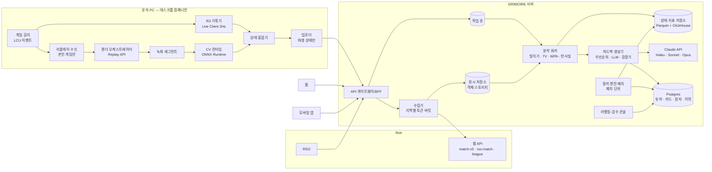

# GRIMOIRE 분석 엔진 설계서 (engine.md)

> 작성: AI·데이터 아키텍트 · 기준일 2026-11-03 · 대상 패치 26.21 · 상태: 3단계 리뷰 반영본(변경 내역은 맨 끝 표) · 7단계 성장 화면 판별 규칙 추가(2026-11-04)
> 이 문서는 "유저 게임을 초 단위로 복원해 '여기서 백무빙 한 번 때문에 딜교 손해'를 말하는 엔진"이 **지금 기술·정책상 어디까지 가능한지**를 정직하게 적는다. 낙관적인 가정은 `[가정]`, 확인 못 한 사실은 `[검증 필요]`로 표시한다.

---

## 0. 요약과 표기 규칙

### 0.1 결론 다섯 줄

1. **초 단위 위치·체력·스킬 사용·무빙은 Riot 공개 API 어디에도 없다.** match-v5 타임라인은 60초 간격 스냅샷과 이벤트뿐이고, Live Client Data API는 '나'의 체력·스탯만 준다. 유일한 경로는 **유저 PC에서 리플레이를 Replay API로 재생·녹화한 뒤 컴퓨터 비전(CV)으로 복원**하는 것이다(1.8).
2. 그래서 엔진은 **R2(분 단위, 서버) → R3(나의 초 단위, 컴패니언) → R4(10명 초 단위, 컴패니언 로컬 CV)** 로 해상도를 올리는 사다리 구조다. 리플레이 렌더링은 Riot 클라이언트가 필요하므로 서버가 아니라 **유저 PC에서만** 할 수 있다(8.4).
3. 2026년 10월 정책 변화 두 건이 설계를 바꿨다. ① 2026-10-06부터 미등록 앱의 **게임 메모리 접근 차단**(등록 앱은 2027년 4월까지 유예) ② 패치 26.21부터 **리플레이 다운로드 시간당 10회 제한**(대량 수집 방지 목적). → 메모리 읽기는 설계에서 완전히 제외하고, "챌린저 리플레이를 수만 개 긁어 학습"하는 방식은 **쓰지 않는다**. 상위권 미시 데이터는 **동의한 상위권 기여자가 자기 게임을 자기 PC에서 처리해 파생 데이터만 올리는 방식**으로 모은다(6.2).
4. "백무빙 때문에 딜교 손해"는 **탐지(백무빙이 있었다)는 높은 정확도로 가능**하고, **평가(얼마 손해였다)와 반사실(대신 전진했으면 얼마 이득이었다)은 '추정'**이다. 반사실은 결정론적 전투 계산(짧은 구간) + 상위권 데이터로 학습한 상대 반응 모델의 조합으로 만들고, 신뢰구간과 함께 보여준다. 근거가 약하면 말하지 않는다(abstain).
5. LLM(Claude)은 **문장만 쓴다.** 수치·시각·챔피언명은 구조화된 근거에서 템플릿으로 삽입하고, 출력 검증기가 근거에 없는 숫자를 하나라도 찾으면 카드를 버리고 순수 템플릿 문장으로 대체한다(7.3).

### 0.2 표기 규칙 (다른 문서와의 정합)

| 항목 | 이 문서의 규칙 | 근거·비고 |
|---|---|---|
| 데이터 등급 | **plan.md의 R0~R4를 정본으로 채택**한다. R0 정적 지식 · R1 경기 요약 · R2 타임라인 · R3 라이브 클라이언트 · R4 리플레이 CV | plan.md 3.1이 "등급 이름과 경계는 engine.md가 정본"이라 했고, 그 정의가 이 문서의 조사 결과와 맞는다. 경계 정밀화는 1.8·2장 |
| 해상도 사다리 | 작업 지시의 L0~L3는 **'사다리 단계 L0~L3'** 로만 쓴다. L0 = R0+R1+R2, L1 = +R3, L2 = +R4, L3 = 상위권 대규모 학습(정석 엔진의 근거 규모) | 원자 ID 접두사(`L1.TRADE.*` 형태)와 혼동을 피하려고 탐지기·카드에는 R등급만 쓴다 |
| 원자 ID | **curriculum.md 정본 `{권}.{장}.{절}.{nn}`**. 예: `L1.TRADE.WINDOW.03`(스킬 쿨다운 창), `L1.TRADE.MOVE.02`(백무빙의 비용) | 1단계에 쓴 plan.md 예시 형식의 임시 ID 28개는 curriculum.md g표대로 전부 치환했다(R-03). 옛 ID ↔ 정본 대응은 curriculum.md g표가 유일한 기록이다 |
| 지표 ID | 대표 지표 **`METRIC.{원자ID}`** · 보조 지표 **`METRIC.{원자ID}:{snake_case}`** · R2 대리 지표 **`METRIC.{원자ID}:r2p`**. 예: `METRIC.L1.TRADE.WINDOW.03`(= 진입률) · `METRIC.L1.TRADE.WINDOW.03:entry_delay_s` | 대표 지표는 원자당 정확히 1개(1:1 규칙). 표에서는 지면을 아끼려고 `METRIC.` 접두사를 빼고 `L1.TRADE.WINDOW.03` · `:entry_delay_s`처럼 쓴다. 괄호 안 이름(예: 진입률 `entry_rate`)은 대표 지표의 계산 정의 이름이며 ID가 아니다 |
| 실수 패턴 · 정석 카드 ID | 실수 패턴 `ERR.{원자ID}.{a…}` · 정석 카드 **`CANON.{원자ID}.{nn}`**(기본 키). 엔진이 쓰던 서술형 ID(`MID-MAGEvMAGE-ENEMYKEYCD-0012`)는 `context_slug` 필드로 내린다 | curriculum.md a.2·f.3과 같은 체계. 사용자 화면에는 ID 대신 레슨·카드 제목을 보이고, ID는 링크 대상으로만 쓴다 |
| 시간 | 게임 시간 `mm:ss.s`. 내부 저장은 게임 시작 기준 초(float) | 타임라인의 `timestamp`(ms)와 같은 기준 |
| 좌표 | 소환사의 협곡 게임 좌표(대략 0~15,000, 원점은 블루 진영 쪽 좌하단) `[검증 필요: 정확한 경계값]` | 타임라인 `position{x,y}`와 같은 좌표계 |
| 수치 | 쿨다운·피해량 등 패치 의존 값은 `[패치 26.21, 예시]` 또는 `[검증 필요]`. 워크스루 수치는 **설명용 가정치** | brief 패치 대응 원칙 |

### 0.3 2026년 10월 정책 변화가 설계에 미친 영향

| 날짜 | 변화 | 엔진 설계 결정 |
|---|---|---|
| 2025-03-13 | 적 궁극기 쿨다운을 보여주는 서드파티 앱 차단. 적 스킬·소환사 주문 쿨다운 추적, 상태 기반 행동 지시 알림 금지 [S12][S13] | 적 쿨다운 추정은 **게임이 끝난 뒤 복기에서만** 쓴다. 게임 중에는 아무것도 표시하지 않는다 |
| 2026-10-06 | 미등록 서드파티 앱의 게임 메모리 접근을 기본 차단. 등록 앱은 2027년 4월까지 유예 후 공식 API로 이전해야 함. "공식 API가 게임 데이터를 얻는 유일한 허용 수단" [S9] | 메모리 읽기·패킷 해석 경로를 **아키텍처에서 제거**. 공식 API(웹 API, Live Client Data, Replay API)와 화면 기반 CV만 쓴다 |
| 2026-10-06 → 10-20 | 처음엔 "자기가 뛴 경기 리플레이만 다운로드"로 제한하려다 반발로 철회. 패치 26.21부터 **다운로드 시간당 10회** 제한. 이유: 대량 스크래핑 방지 [S10][S11] | 컴패니언은 **유저 본인의 최근 게임만** 받는다(보통 시간당 1~3개라 한도 안). 서버가 남의 리플레이를 대량 수집하는 설계는 금지 |

---

## 1. 데이터 소스 매트릭스

### 1.1 한눈에 보기

| 소스 | 얻는 정보 | 시간 해상도 | 정확도 | 정책 리스크 | 비용 | 우리 용도 |
|---|---|---|---|---|---|---|
| **match-v5 경기**(R1) | 최종 스탯, 아이템, 룬, 포지션(`teamPosition`), `challenges` 집계(예: `skillshotsHit`, `skillshotsDodged`, `laneMinionsFirst10Minutes`, `maxCsAdvantageOnLaneOpponent`, `turretPlatesTaken`, `enemyMissingPings`) [S5] | 게임당 1회 | 공식값(확실) | 낮음. 프로덕션 키·앱 등록 필요 | 무료(호출 한도 내) | 기준선, 진단 보조, 정석 매크로 |
| **match-v5 타임라인**(R2) | 프레임: 참가자별 `position{x,y}`, `championStats`(체력·최대체력·자원·스킬가속 등 25개), `damageStats`, `currentGold`, `totalGold`, `xp`, `level`, `minionsKilled`, `jungleMinionsKilled`. 이벤트: 처치·와드·아이템·스킬 레벨업·오브젝트·포탑 방패 등 [S5][S7] | 프레임 **60초**(`frameInterval: 60000`), 이벤트는 ms 타임스탬프 | 스냅샷 시점은 확실, 사이 구간은 모름 | 낮음 | 무료 | **MVP 분석의 주력**, 상태 복원의 '닻(anchor)' |
| **rso-match-v1**(R1~R2) | RSO로 로그인한 유저의 매치 ID·경기·타임라인. **커스텀 게임 포함** [S6] | 위와 동일 | 위와 동일 | RSO 승인 필요 | 무료 | 계정 연동 유저의 수집(연습 커스텀 포함) |
| **Live Client Data API**(R3) | 게임 중 로컬 `https://127.0.0.1:2999/liveclientdata/`. `activeplayer`(내 `championStats`·`currentGold`·`level`·룬), `playerlist`(10명의 아이템·레벨·스코어·사망 여부·부활 타이머·소환사 주문), `eventdata`, `gamestats` [S3] | 폴링 주기 마음대로(2Hz 권장 `[가정]`) | 나의 값은 확실. 남은 체력·위치 없음 | 낮음(공식). 단 **게임 중 행동 지시 표시 금지** | 무료(로컬) | 나의 체력·마나·골드 초 단위 곡선, 이벤트 정밀 시각 |
| **Replay API**(R4 입력) | 리플레이 재생 제어: `/replay/playback`(`time`·`speed`·`paused`), `/replay/render`(카메라 위치·회전·시야각, `fogOfWar`, `interfaceAll`·`interfaceMinimap`·체력바 표시, `selectionName`, `floatingText` 등), `/replay/recording`(`startTime`·`endTime`·`framesPerSecond`·`width`·`height`·`codec`·`path`), `/replay/sequence`(키프레임 카메라) [S3][S8] | 프레임 단위(녹화 fps 지정) | **영상**만 준다. 수치는 CV로 읽어야 함 | 낮음~중간(공식 기능이지만 `game.cfg`에 `EnableReplayApi=1` 설정 필요) | 유저 PC 자원 | **R4의 유일한 원천** |
| **LCU API**(보조) | 리플레이 다운로드·재생 실행, 로그인 계정 확인 | — | — | 중간. Riot이 "서드파티 사용을 공식 지원하지 않음"이라 명시, 사용 엔드포인트를 포털에 등록하라고 요구 [S3] | 무료 | 유저 본인 리플레이 받기·열기만 |
| **.rofl 파일** | 헤더의 메타데이터 JSON(게임 종료 스탯 등)은 읽을 수 있음. 본문은 암호화·압축된 패킷(커뮤니티 파서가 blowfish+flate2 사용, 하위 호환 기대 불가라고 명시) [S14][S15] | (본문 해석 시) 서버 틱 | 본문 해석은 비공식 역공학 | **높음**(역공학, 메모리 차단 정책 취지와 충돌) | — | **본문 해석 안 함.** 파일은 Replay API 재생 입력으로만 사용 |
| **화면·리플레이 영상 CV**(R4) | 10명 위치, 체력바(체력%), 미니언·포탑·와드, HUD의 쿨다운·레벨, 플로팅 데미지 숫자, 시전·평타 동작 | 10~30Hz | 학습·검증 필요. 라인전 1:1에서 높고 한타 혼잡에서 낮음 | 낮음(리플레이 녹화본 대상). 실시간 화면 분석은 하지 않음 | 유저 PC GPU/CPU | 딜교·무빙·어그로·웨이브 |
| **프로 경기 데이터** | GRID: Riot 독점 공식 e스포츠 데이터 파트너(라이브 게임 데이터·일정·영상 피드) [S16]. Oracle's Elixir: 리그별 경기 단위 CSV(무료) [S17]. Leaguepedia: 경기 기록 위키 | GRID 실시간, 그 외 경기 단위 | 공식/집계 | GRID는 **라이선스 계약 필요**(조건·비용 비공개 `[검증 필요]`). 방송 VOD를 CV로 분석하는 건 **영상 권리 문제** | GRID 협상 필요 | 정석 엔진의 프로 레이어(V3) |
| **게임 메모리 읽기** | (모든 값) | — | — | **금지·차단**(2026-10-06~) [S9] | — | **사용 안 함** |

### 1.2 Riot 웹 API (R1·R2) 세부

- **라우팅**: KR은 `ASIA` 라우팅 값으로 match-v5를 호출한다(ASIA = KR·JP) [S5].
- **호출 한도**: 개발 키 20회/1초·100회/2분 `[검증 필요: research.md B-1에서 출처가 엇갈림]`, 24시간마다 만료, 공개 서비스에 사용 금지(Personal 키도 공개 알파·베타 불가). 프로덕션 키 기본 500회/10초·30,000회/10분, **지역별**로 적용, 실적에 따라 증설 가능 [S1][S2].
- **수집 비용 계산**: 게임 1판 = 매치 ID 목록(사용자당 주기적 1회) + 경기 1회 + 타임라인 1회 ≈ 2~3회. 프로덕션 기본 한도(지속 50회/초)면 한 지역에서 하루 최대 약 140만~200만 판을 받을 수 있다. 사용자 수집과 정석 엔진 수집을 **토큰 버킷 2개로 분리**해 사용자 요청이 밀리지 않게 한다.
- **타임라인 이벤트 중 엔진이 쓰는 것**(공식 DTO 문서에는 `timestamp`·`type`만 나와 있고, 세부 필드는 실제 응답 기준 `[검증 필요: 필드명 패치별 확인]`):

| 이벤트 | 엔진 활용 | 한계 |
|---|---|---|
| `CHAMPION_KILL` | 위치, 처치자·어시스트, **피해자가 받은/준 피해 내역**(`victimDamageReceived`·`victimDamageDealt`: 가해자별 스킬명·물리/마법/고정 피해) → R2만으로 "죽기 전 누가 무엇으로 몇 딜을 넣었나" 복원 | 죽은 경우에만 있음. 살아남은 딜교는 기록 없음 |
| `ITEM_PURCHASED`·`ITEM_SOLD`·`ITEM_UNDO` | 귀환 시각 추정(구매가 몰린 시각), 구매 시점 골드 | 귀환 '출발' 시각·위치는 없음 |
| `SKILL_LEVEL_UP`·`LEVEL_UP` | 스킬 선마·레벨 시각 → 최대 체력·쿨다운 계산 | — |
| `WARD_PLACED`·`WARD_KILL` | 시야 행동 시각·종류·설치자(`creatorId`)·처치자(`killerId`) | **와드 위치 없음(확정)** — Riot 샘플 78건 전부 위치 필드 없음 [S7], 현 패치 실응답 1건으로 재확인 예정 → 위치·시야 판단은 R4 필요(4.1 말미) |
| `ELITE_MONSTER_KILL`·`BUILDING_KILL`·`TURRET_PLATE_DESTROYED` | 오브젝트 시각·위치(`position` 있음)·팀 | **바위게 처치 이벤트는 없다**(2022 샘플 기준). 바위게는 `jungleMinionsKilled` 증가 + 프레임 위치로만 추정 `[추정]`. 공허 유충·전령의 `monsterType` 값은 현 패치 응답으로 확인 `[검증 필요]` |
| `CHAMPION_SPECIAL_KILL`, 오브젝트 현상금 이벤트 등 | 보조 | 시즌별로 이벤트 종류가 바뀜 `[검증 필요]` |

### 1.3 Live Client Data API (R3) 세부

- 게임이 진행 중일 때만 열린다. 엔드포인트: `/allgamedata`, `/activeplayer`, `/activeplayername`, `/activeplayerabilities`, `/activeplayerrunes`, `/playerlist`, `/playerscores`, `/playersummonerspells`, `/playermainrunes`, `/playeritems`(뒤 다섯 개는 `riotId` 인자), `/eventdata`, `/gamestats` [S3].
- **얻는 것**: 나의 `championStats`(현재 체력·최대 체력·자원·공격력·방어력 등), `currentGold`, 레벨. 10명의 아이템·레벨·KDA·CS(`scores`)·`isDead`·`respawnTimer`.
- **못 얻는 것**: 남의 체력, **모든 챔피언의 좌표**(`playerlist`의 `position`은 "MIDDLE" 같은 **역할 문자열(확정, 공식 문서 샘플)**), 스킬 쿨다운 잔여 시간(`activeplayerabilities`는 스킬 레벨·설명 위주 `[검증 필요]`). 나의 현재 체력은 `activeplayer.championStats.currentHealth`·`maxHealth`로 확정 [S3].
- **R3가 주는 결정적 가치**: "8:12~8:20 사이 내 체력이 62%→31%로 떨어졌다"를 **초 단위로 확실하게** 안다. 이게 R4 처리 구간을 고르는 트리거가 되고(8.4), CV 체력바 판독의 **보정용 정답**이 된다(3.5).
- **정책 경계**: 컴패니언은 게임 중 **기록만** 한다. 화면에 띄우는 건 게임 상태와 무관한 '오늘의 목표'(챔피언 선택 전 설정)까지만 `[정책 확인 필요]` [S12].

### 1.4 Replay API (R4 입력) 세부

- 활성화: 게임 설치 폴더 `Config/game.cfg`의 `[General]`에 `EnableReplayApi=1`. 활성화하면 클라이언트가 Swagger/OpenAPI 명세를 제공한다 [S3]. 컴패니언 설치 시 **유저 동의를 받고** 이 한 줄을 넣는다(게임 파일 수정이 아닌 설정 파일 수정).
- 우리가 쓰는 렌더 필드(이름은 커뮤니티 구현 기준 [S8], 실제 명세로 재확인 `[검증 필요]`):
  - 카메라: `cameraMode`, `cameraPosition`, `cameraRotation`, `fieldOfView`, `cameraAttached`, `selectionName`
  - 정보 표시: `fogOfWar`(팀 시야 적용 여부), `interfaceAll`, `interfaceMinimap`, `interfaceScoreboard`, `interfaceFrames`, `interfaceTarget`, `floatingText`, `healthBarChampions`, `healthBarMinions`, `healthBarStructures`, `healthBarWards`
  - 녹화: `startTime`, `endTime`, `framesPerSecond`, `enforceFrameRate`, `replaySpeed`, `width`, `height`, `lossless`, `codec`, `path`
- **핵심 아이디어 — '전술 카메라'**: 카메라 위치·회전·시야각을 우리가 정하므로 화면 픽셀 → 게임 좌표 변환식을 **해석적으로** 안다. 라인전 동안 카메라를 라인 위 높은 곳에 고정하면 양 라이너·웨이브가 한 화면에 들어오고, 좌표 정확도가 추적 카메라보다 훨씬 높다.
- **한계(확정, Riot 리플레이 FAQ·26.21 노트)**: 리플레이는 **패치가 바뀌면 만료**되어 재생할 수 없다. 클라이언트는 **최근 20판**만 보관하고, 다운로드는 **시간당 10회**(본인·타인 공통)다 [S10][S19]. → 패치가 바뀌기 전(약 2주)에 처리해야 하고, 패치 전날 미처리분이 생기지 않게 큐를 운영한다(8.4 큐 정책). 리플레이 재생 중엔 게임 클라이언트가 점유되므로 **게임 세션이 끝난 뒤·취침 시간**에만 돌린다.

### 1.5 화면·영상 CV (R4) 세부

리플레이 녹화본만 분석한다. 라이브 게임 화면 분석은 하지 않는다. 이유는 세 가지다. ① 게임 중 정보 제공 금지 정책과 부딪힌다. ② 실시간 화면 판독 모델은 봇·스크립트에 전용될 수 있다는 의심을 산다. ③ 성능 부담이 게임 플레이를 해친다. 판독 대상과 방법은 3.3에서 다룬다.

### 1.6 프로·상위권 데이터

| 계층 | 소스 | 쓸 수 있는 것 | 상태 |
|---|---|---|---|
| C-macro (상위권 매크로) | match-v5 + 타임라인. 리그 엔드포인트로 챌린저·그랜드마스터·마스터 PUUID를 얻어 수집 | 분 단위 상태·이벤트 대량(패치당 수십만 판) | **지금 가능** |
| C-micro (상위권 미시) | 동의한 마스터+ 기여자의 컴패니언이 **자기 게임을** R4 처리한 파생 상태 | 초 단위 10명 상태 | V2부터, Riot 확인 후. 기여자 모집이 병목. 실패 시 대체 경로는 6.2 |
| C-pro (프로) | GRID 라이선스(상업 계약 전용, LCK는 미디어 한정 — research.md C-6), Oracle's Elixir 경기 단위 CSV | 프로 매크로 패턴, 픽밴 | 기본안은 수집·분석 안 함(VOD 링크 + 편집 해설) `[확정: 사용자 결정 D4, 2026-11-03]` → 6.2 |

### 1.7 하지 않는 것 (명시)

메모리 읽기 · .rofl 본문 복호화 · 남의 리플레이 대량 다운로드 · 게임 중 적 쿨다운·정글 위치·행동 지시 표시 · 서버에서 LoL 클라이언트를 돌려 렌더링(계정·안티치트·약관 문제) · 방송 VOD 무단 분석.

### 1.8 "초 단위 위치·체력·스킬 사용·무빙은 어디서 나오나" — 결론표

| 정보 | R1 | R2 | R3 | R4 (CV) | 최종 출처 |
|---|---|---|---|---|---|
| 나의 위치 | × | 60초 스냅샷 | × | ○ 10Hz | **R4** (R2 스냅샷이 닻) |
| 상대·10명 위치 | × | 60초 스냅샷 | × | ○ 10Hz(전장 시야 범위 내) + 미니맵 1~5Hz | **R4** |
| 나의 체력·마나 | × | 60초 스냅샷 | ○ 폴링(2Hz) | ○ 체력바 | **R3**(정답), R4로 보간 |
| 상대 체력 | × | 60초 스냅샷 | × | ○ 체력바 비율 × 최대 체력 | **R4** |
| 스킬 사용 시각 | × | × (레벨업만) | × | ○ HUD 쿨다운 전환 + 동작 인식 | **R4** |
| 쿨다운 잔여 | × | 스킬가속 값만(분 단위) | × | 선택 챔피언 HUD 판독 / 시전 시각 + 기본 쿨다운 + 스킬가속으로 계산 | **R4 + R0 + R2 융합** |
| 무빙(속도 벡터) | × | × | × | ○ 위치 궤적 미분 | **R4** |
| 평타·막타 | × | 분당 CS | CS 카운트 | ○ 동작 + 미니언 사망 | **R4**(원인), R3(개수) |
| 받은 피해 내역 | × | **사망 시에만** 가해자·스킬별 | × | ○ 체력 하락 + 시전 매칭 + 데미지 숫자 | R2(사망) / R4(생존 딜교) |

---

## 2. 해상도 사다리 (L0 → L3)

| 단계 | 데이터 | 처리 위치 | 지연 | 유저 부담 | 출시(plan.md) |
|---|---|---|---|---|---|
| **L0** 공개 API만 | R0+R1+R2 | 서버 | 게임 종료 후 수 분 `[검증 필요: API 반영 지연]` | 없음(계정 연동만) | MVP |
| **L1** +Live Client | +R3 | 컴패니언 기록 → 서버 분석 | 게임 종료 즉시 | 컴패니언 설치 | V1 실험 |
| **L2** +리플레이 CV | +R4 | 컴패니언 로컬 렌더·CV → 서버 평가 | 그날 게임 세션이 끝난 뒤 보통 30분~1시간(한 판만 하면 게임 후 10~20분, 4판 연속이면 최대 약 1시간 20분). 8.4 큐 정책 | 컴패니언 + PC 자원 | V2 |
| **L3** 상위권 대규모 학습 | C-macro/C-micro/C-pro | 서버 배치 | 패치 단위 | 기여자만 | 매크로는 MVP부터, 미시는 V2~ |

### 2.1 L0 — 공개 API만 (매크로 피드백)

가능한 피드백 예시:
- "**10분 CS 61** — 같은 챔피언·골드 미드 상위 25%는 74. 차이의 절반 이상(7개)이 4~7분 구간에서 벌어졌습니다." (`L1.CS.BENCH.01`)
- "**14:31 사망** — 죽기 직전 받은 피해 1,240 중 71%가 상대 정글(리 신) Q·평타. 사망 위치는 강 아래쪽, 사망 직전 60초 동안 아군 와드 설치 1개(설치 위치는 기록되지 않음). 시야 판단은 컴패니언(R4)에서 할 수 있어요." (`B0.MAP.FOG.02`·`L1.GANK.WAVE.03`, 타임라인 `CHAMPION_KILL` 피해 내역 사용. R2 문장에서는 '와드가 없던 지역'이라고 쓰지 않는다 — R-02)
- "**첫 귀환 6:40** — 4:00 프레임 기준 보유 골드와 분당 수입으로 계산하면 핵심 부품을 살 수 있는 시점보다 약 50초 늦었습니다[추정]." (`J2.PATH.RECALL.08`, 라이너는 `L1.RECALL.WHEN.01`·`L1.RECALL.GOLD.02`)

불가능: 살아남은 딜교, 무빙, 스킬 적중, 웨이브 상태. "12~13분 사이 체력이 줄었다"조차 프레임 두 개의 차이로만 안다.

### 2.2 L1 — +Live Client Data (나의 초 단위)

- "**8:12~8:20** — 8초 동안 체력 62%→31%. 같은 시간 상대 체력은 측정하지 못했습니다(화면 정보 없음). 이 체력으로 8:41 귀환해 웨이브 2개(CS 약 13개)를 놓쳤습니다."
- "**라인전 동안 마나 20% 미만이었던 시간 3분 50초**(라인전의 31%) — 같은 챔피언 상위 25%는 12%." (`L1.RES.MANA.01`)
- "**1,300골드 이상을 들고 있던 시간 2분 10초** — 귀환 타이밍을 놓친 구간이 두 번 있었습니다." (`B0.ECON.ITEM.06`)

불가능: "왜" 체력이 줄었는지(누가 무엇으로), 상대와의 교환비.

### 2.3 L2 — +리플레이 CV (10명 초 단위)

- "**12:42 — 상대 Q가 빠진 0.8초 동안 백무빙 1회로 사거리를 벗어남 → 체력 교환 −180**. 정석: 어그로 안전 위치에서 평타 1회 + Q." (7장 워크스루)
- "**7:05 — 상대 미니언 3기 어그로를 끈 채 평타 2회 교환** — 미니언에게 받은 피해 96 포함 교환 −140." (`L1.AGGRO.MINION.03`)
- "**9:30~10:10 — 프리징 해제** — 근접 미니언 4기 우세였던 웨이브를 평타 2회로 밀어 프리징이 풀렸고, 상대 정글 진입로가 열렸습니다." (`L1.WAVE.FREEZE.03`)

한계: 한타처럼 챔피언 5명 이상이 겹치는 장면은 정확도가 떨어진다 → V2는 **라인전 1:1·2:2**에 집중(plan.md RC-06 범위와 동일).

### 2.4 L3 — 상위권 대규모 학습 (근거의 질)

L3는 유저 데이터의 해상도가 아니라 **"정석"의 근거 규모**다. 같은 카드라도 L3 근거가 붙으면 이렇게 달라진다.
- L0~L2 단독: "상대 핵심 스킬이 빠졌을 때는 들어가는 게 정석입니다."
- +L3: "같은 상황 마스터+ 2,412건 중 58%가 전진했고, 전진했을 때 30초 뒤 라인 가치가 평균 +54G 높았습니다(상태 보정 후, 95% 신뢰구간 +41~+67, 패치 26.19~26.21)."

---

## 3. 게임 상태 복원 (State Reconstruction)

### 3.1 시간 격자

- **상태 틱 10Hz(100ms)**: 무빙 분류·딜교 구간 판정에 충분하다(사람의 미시 판단 주기는 수백 ms).
- **이벤트 검출은 30fps 원본**에서 한다. 쿨다운 HUD 전환, 평타 모션 시작처럼 수십 ms 단위인 것은 원본 프레임에서 잡고, 틱에는 '틱 내 발생 시각'으로 넣는다.
- 저장 단위는 **세그먼트**(기본 20~40초). 게임 전체가 아니라 트리거된 구간만 복원하는 게 기본이다(8.4).

### 3.2 틱 상태 벡터 스키마 (v0)

```jsonc
// state_tick — 10Hz, 세그먼트 단위로 Parquet 저장 (서버), 로컬은 동일 스키마 JSON Lines
{
  "match_id": "KR_7712345678", "patch": "26.21", "t": 762.6,      // 게임 시간(초) = 12:42.6 (7.4 워크스루의 백무빙 도중)
  "seg_id": "seg_0043",
  "units": {
    "P3": {                                     // participantId 기준 키
      "team": 100, "champion": "Ahri", "role": "MIDDLE", "is_user": true,
      "alive": true, "state": "moving",          // moving|attacking|casting|channeling|recalling|dead|unknown
      "pos":  {"x": 6855, "y": 6990, "sigma": 28, "src": "cv.tactical_cam"},
      "vel":  {"x": -250, "y": -246, "speed": 351},                 // 게임 단위/초
      "hp":   {"cur": 1124, "max": 1402, "sigma": 4, "src": "lcd"}, // R3가 있으면 정답
      "res":  {"cur": 577, "max": 890, "sigma": 9, "src": "lcd"},
      "level": 10, "ms": 351, "ar": 62, "mr": 44,                  // R2 프레임 + 레벨업 이벤트로 보간
      "cd": {                                    // 남은 쿨다운(초). null = 모름
        "Q": {"ready_at": 761.9, "sigma": 0.05, "src": "cv.hud"},  // 선택 챔피언 HUD 판독
        "W": {"ready_at": 766.2, "sigma": 0.05, "src": "cv.hud"},
        "E": {"ready_at": 758.0, "sigma": 0.05, "src": "cv.hud"},
        "R": {"ready_at": null, "learned": true, "src": "unknown"},
        "S1": {"spell": "Flash", "ready_at": 0, "src": "cv.scoreboard"}
      },
      "action": {"type": "move", "target": null, "since": 762.5},
      "aggro_from": [],                          // 이 유닛을 노리는 적 미니언·포탑 ID
      "in_bush": false, "visible_to_enemy": true, "visible_to_user_team": true,
      "gold": {"cur": 846, "src": "lcd"}, "cs": 95
    },
    "P8": { "team": 200, "champion": "Syndra", "visible_to_user_team": true, "...": "..." },
    // visible_to_user_team: 그 틱에 '유저 팀 시야'로 보였는가. 패스 A′(유저 팀 안개) 또는 미니맵 판독에서 채운다.
    // 판단 평가 탐지기(4.1 말미 규칙)는 이 값이 true인 관측만 쓴다. false인 유닛의 pos는 정답 장부용이다
    "M200_07": {"type": "minion_caster", "team": 200, "pos": {"x": 7310, "y": 7420}, "hp_ratio": 0.35,
                "target": "M100_03", "src": "cv.hpbar"}
  },
  "lanes": {"MID": {"wave_front": 0.47, "count": {"100": 4, "200": 5}, "state": "neutral",
                    "src": "derived"}},       // wave_front: 0=블루 포탑, 1=레드 포탑
  "vision": {"enemy_jungler": {"last_seen_t": 731.0, "last_pos": {"x": 9800, "y": 4400},
                               "est_side": "bot", "basis": "user_team", "src": "cv.minimap+derived"}},
                               // basis: user_team = 유저 팀이 본 것만으로 만든 믿음(판단 평가용) / truth = 안개 끈 정답
  "quality": {"frame_coverage": 0.98, "fused_conf": 0.91, "flags": []}
}
```

원칙: **모든 수치 필드에 `src`와 불확실성(`sigma` 또는 `conf`)** 을 붙인다. 모르는 값은 `null`이며, 탐지기는 `null`을 추정값으로 메우지 않는다.

### 3.3 CV 파이프라인

```
[V0 렌더 계획] → [V1 녹화] → [V2 UI 요소 검출] → [V3 정체성 결합] → [V4 미니맵 파서]
      → [V5 HUD·OCR] → [V6 동작·투사체 인식] → [V7 미니언 타깃] → [V8 추적·평활] → 융합(3.4)
```

| 단계 | 하는 일 | 방법 (제안) | 왜 이렇게 |
|---|---|---|---|
| V0 렌더 계획 | R2/R3 트리거로 세그먼트 선정 → 패스별 카메라·UI 설정 | Replay API `render`/`playback`/`recording` 조합 | 게임 전체를 돌리면 PC 부담이 크다 |
| V1 녹화 | **패스 A 전술 카메라**(라인 상공 고정, 시야각 넓게, **안개 끔** `fogOfWar: false` → 정답 위치·체력) / **패스 A′ 유저 팀 시야**(같은 카메라, 유저 팀 안개 적용 → `visible_to_user_team` 판정. `fogOfWar`가 팀을 고를 수 없으면 대신 패스 B의 미니맵을 판독) / **패스 B 유저 추적**(`selectionName`=유저, HUD·미니맵 표시) / **패스 C 상대 추적**(상대 HUD, 필요할 때만) | 1080p, 30fps | A는 정답 좌표, A′는 판단 평가용 시야(R-09), B·C는 쿨다운 판독용. `fogOfWar` 팀 선택 가능 여부는 POC ⑥(10.5) |
| V2 UI 요소 검출 | 챔피언·미니언·포탑 **체력바** 검출 → 막대 채움 비율(체력%), 팀 색, 레벨 숫자 | 경량 1단계 검출기(ONNX) + 색 분할 보정 | 체력바는 스킨과 무관한 고정 UI → **스킨 문제를 피한다**. 챔피언 몸체 인식보다 훨씬 강건 |
| V3 정체성 결합 | 체력바 ↔ 참가자 ID 매칭 | 추적 카메라 패스의 화면 중앙 = 선택 챔피언, 미니맵 아이콘, R2 위치 닻, 연속 추적 | 같은 팀 근접 챔피언 혼동 방지 |
| V4 미니맵 파서 | 10명 전체 위치(시야 내), 와드·포탑 | 챔피언 아이콘 템플릿 매칭(Data Dragon 아이콘) | 전술 카메라 밖 위치(정글러 등) 확보. 정밀도 약 ±150 단위 `[가정]` |
| V5 HUD·OCR | 선택 챔피언의 스킬 쿨다운(회색 원형 오버레이 + 숫자), 스코어보드의 레벨·소환사 주문, `floatingText` 데미지 숫자 | 고정 위치 크롭 + 소형 OCR | 데미지 숫자는 딜교 피해량의 **직접 관측값** |
| V6 동작·투사체 | 평타 시작, Q/W/E/R 시전, 스킬샷 투사체 궤적·적중 | 챔피언 크롭 시퀀스 분류기(짧은 클립 시간 모델) + 투사체 검출 | HUD가 없는 상대의 시전 시각을 얻는 주 수단 |
| V7 미니언 타깃 | 미니언이 누구를 치는지(어그로) | 미니언 공격 모션·투사체 방향 + 피격 대상 체력 하락 | 어그로 탐지(4장) 입력 |
| V8 추적·평활 | 프레임 관측 → 틱 상태 | 다중 객체 추적 + 칼만/RTS 평활(이동속도 상한 = `ms`) | 순간 오검출 제거 |

**학습 데이터 자동 라벨링** (사람 라벨 비용을 줄이는 핵심): 같은 구간을 카메라만 바꿔 여러 번 렌더하면, 추적 카메라 패스에서는 "화면 중앙에 있는 것이 `selectionName` 챔피언"이라는 정답이 생긴다. 카메라 파라미터를 알고 있으니 R2 프레임 위치를 화면에 투영해 좌표 정답도 만든다. R3가 있는 게임에서는 유저 체력이 정답이라 체력바 판독기를 보정할 수 있다. → 사람 라벨은 **검증셋**(9장)과 어려운 사례에만 쓴다.

**어려운 사례**: 은신(이블린·트위치 등), 분신·복제(르블랑·샤코·니코 등), 변신, 체력바가 없는 상태, 5명 이상 겹침, **쿨다운 환급·초기화가 있는 챔피언**(적중·처치·특정 조건에서 쿨다운이 줄거나 초기화되는 스킬. 시전 시각 + 기본 쿨다운 계산이 틀어진다). → **특수 규칙 챔피언 목록**을 엔진 규칙 팩에 두고, 해당 장면은 탐지기가 판단을 보류한다(abstain). 쿨다운 환급 챔피언이 상대일 때는 HUD 직접 판독(패스 C)이 없으면 DET-03을 보류한다(R-25). 목록의 챔피언·스킬은 패치마다 R0에서 갱신한다 `[검증 필요: 패치 26.21 기준 목록 작성]`.

### 3.4 API 이벤트와 CV의 융합

우선순위(충돌 시 위가 이긴다): **① R2 하드 제약**(프레임 스냅샷, 처치·레벨업·구매 이벤트) → **② R3 나의 값** → **③ CV HUD·OCR(숫자를 직접 읽은 값)** → **④ CV 체력바·위치** → **⑤ CV 동작 인식** → **⑥ 운동·규칙 사전확률**.

| 융합 규칙 | 내용 |
|---|---|
| 위치 | 인자 그래프 평활: CV 관측 + 이동속도 상한 + 1분 프레임 위치(제약) + 처치 이벤트 위치. 시야 밖 구간은 '마지막 관측 + 도달 가능 영역'으로 두고 점 추정을 하지 않는다 |
| 체력 | 상대 체력 = CV 체력바 비율 × 최대 체력(R2 `healthMax` + 레벨업 이벤트 + 아이템 구매로 보간). 나의 체력은 R3로 CV 판독기의 편향을 보정한 뒤 같은 보정을 상대 판독에도 적용 |
| 피해 귀속 | 체력 하락 Δ를 '그 직전 상대의 평타·시전 + 투사체 도착 시각'에 배정. `floatingText` 숫자가 있으면 우선. 사망으로 끝난 구간은 R2 `victimDamageReceived`로 **정답 대조** |
| 쿨다운 | HUD 판독 > (시전 시각 + 기본 쿨다운(R0, Data Dragon) × 스킬가속 보정(R2 `abilityHaste`, 분 단위)). 후자는 `sigma`로 스킬가속 변화 가능성 반영 |
| 일관성 검사 | (a) 1분 동안 막타 탐지 수 = 프레임 간 `minionsKilled` 증가량 (b) 1분간 귀속한 챔피언 피해 합 ≈ `damageStats.totalDamageDoneToChampions` 증가량(±15% `[가정]`) (c) 사망 시각에 체력 0 → 어긋나면 해당 세그먼트 `quality.flags`에 기록 |

### 3.5 오차·누락 처리

- **필드 단위**: `sigma`/`conf`/`src` 필수. 모르면 `null`.
- **세그먼트 단위 품질 점수** `Q_seg = 프레임 커버리지 × 정체성 확신도 × 일관성 검사 통과율`. 탐지기마다 최소 `Q_seg`를 둔다(예: 딜교 평가 ≥ 0.80).
- **판단 보류(abstain)**: 필수 입력이 `null`이거나 품질 미달이면 카드를 만들지 않는다. "말하지 않는 것"이 "틀리게 말하는 것"보다 낫다(신뢰가 제품의 핵심이라서).
- **카드에 품질 노출**: R4 카드에는 "이 장면 데이터 품질 0.93"처럼 표시하고, 0.80~0.90 구간은 plan.md 배지 체계의 '추정'으로 강등한다(배지 기준은 6.4 주장 단위 대응표가 정본).
- **보정 루프**: R3 정답이 있는 게임에서 판독 오차를 계속 측정해(체력 MAE, 위치 오차) 패치·UI 변경 시 성능 하락을 자동으로 감지한다(9.4).

---

## 4. 미시 이벤트 탐지기 카탈로그

### 4.1 카탈로그

> 원자 ID는 curriculum.md 정본(g표로 치환 완료). 지표 열 표기: 원자 ID 자체가 대표 지표 `METRIC.{원자ID}`이고 괄호 안은 그 계산 정의 이름, `:이름`은 보조 지표다. 원자당 대표 지표는 1개다.

| ID | 탐지기 | 입력 | 로직/모델 | 출력 | 원자 ID · 지표 | 최소 등급 |
|---|---|---|---|---|---|---|
| DET-01 | 딜교 세그먼트 탐지·평가 | 틱 상태(체력·시전·평타·피해 귀속) | 규칙 분할(4.2) + Trade Value 모델(5.1) | 세그먼트, 교환 장부, TV(골드 환산) | `L1.TRADE.EVAL.01`(tv_ge) · `:hp_net` | R4 (R3: 내 체력 하락 구간만) |
| DET-02 | 무빙 분류 | 위치·속도 틱, 위협축, 적 투사체 | 위협축 투영 규칙 + 회피 태그(4.3) | 기동 목록(전진·백무빙·후퇴·횡무빙·카이팅·대기) + 이유 태그 | `L1.TRADE.MOVE.02`(backstep_in_window_rate) · `:cost_ge` · `L1.TRADE.SPACING.01` | R4 |
| DET-03 | 딜교 창 탐지 | 상대 핵심 스킬 쿨다운, 거리, 미니언·포탑·정글 위협 | 조건 교집합 구간(4.4) | 창 목록(길이·유저 반응·진입 지연) | `L1.TRADE.WINDOW.03`(entry_rate) · `:entry_delay_s` | R4 |
| DET-04 | 미니언 어그로 유발 | 챔피언 공격 이벤트, 적 미니언 위치·타깃 | 게임 규칙 예측 + 미니언 타깃 관측(4.5) | 어그로 사건, 미니언에게 받은 피해 | `L1.AGGRO.MINION.03`(aggro_dmg_taken) · 발동 여부 `L1.AGGRO.MINION.01` | R4 |
| DET-05 | 막타 놓침 + 원인 | 미니언 사망, 막타 주체, CS 카운트 | 경험치 범위 내 사망 미니언 대조 + 원인 분류(포탑 아래·견제·부재·타이밍) | 놓친 CS 목록·원인 | `L1.CS.BENCH.01`(cs10) · `L1.CS.TURRET.01`(turret_cs_lost) · `L1.CS.LH.01` | R2(개수, 분) / R3(개수, 초) / R4(원인) |
| DET-06 | 웨이브 상태 분류 | 양측 미니언 수·체력·위치 추세 | 규칙 + HMM 평활(중립·슬로우 푸시·패스트 푸시·크래시·바운스·프리징) | 웨이브 상태 시계열 | `L1.WAVE.FREEZE.03`(freeze_hold_s) · `:freeze_break_count` · 당한 쪽 `L1.WAVE.FREEZE.04` · `L1.WAVE.SLOW.01` | R4 |
| DET-07 | 리콜 타이밍 | 구매 이벤트, 골드 곡선, 웨이브 상태 | 구매 묶음 = 귀환 / 보유 골드 체류 / 귀환 시 웨이브 상태 | 귀환 목록, 골드 체류 시간, 귀환으로 잃은 CS | `L1.RECALL.WAVE.03`(wave_loss_cs) · `B0.ECON.ITEM.06`(float_s) · 3조건 `L1.RECALL.WHEN.01` · 부품 기준 `L1.RECALL.GOLD.02` · 귀환 동기화 `L1.RECALL.SYNC.04`(양측 구매 시각) · `J2.PATH.RECALL.08` | R2(추정) / R3 / R4 |
| DET-08 | 갱 노출 | 유저 위치, **유저 팀 시야**, 적 정글 위치 믿음(유저 팀이 본 마지막 관측 + 경과 시간 + 캠프 리젠) | 노출 점수 = P(적 정글 T초 내 도달) × 시야 없음 × 라인 위치 | 노출 구간, 노출 중 사망 여부 | `L1.GANK.WAVE.03`(exposed_s) · `B0.MAP.FOG.02` | R2(사망 사후, 추정) / R4 |
| DET-09 | 정글 동선·캠프 효율 | 분 단위 위치 + 정글 CS + 오브젝트 이벤트 (R4는 초 단위 경로) | 캠프 그래프 위 제약 만족 탐색(이동시간·캠프 CS 값이 프레임과 맞는 경로) | 시작 캠프, 첫 정글링 완료 추정, 첫 갱 시각, 유휴 시간 | `J2.PATH.FULL.03`(clear_end_s) · `J2.CAMP.KIT.01` · `J2.PATH.THREE.04` · 상대 동선 역산 `J2.PATH.MIRROR.10`(양측) | R2(추정) / R4 |
| DET-10 | 오브젝트 셋업 | 스폰 시각, 팀 위치, 와드 이벤트(시각·개수), 라인 상태 | 스폰 전 60~90초 창의 준비 지표 | 셋업 점수와 구성 요소 | `J2.OBJ.SETUP.06`(prep_wards) · 와드 타이밍 `L1.GANK.WARD.02`(시각·개수만) · 라이너 쪽 `M3.OBJSET.START.01` · `M3.WMACRO.PRIO.02` · `M3.WMACRO.NUM.03` | R2(시각·개수·위치 프레임) / R4(시야 범위) |
| DET-11 | 한타 포지셔닝 | 교전 묶음, 10명 위치, 위협 사거리 | 교전 검출 → 유저의 아군 중심·최전방 대비 거리, 첫 피격, 측면 노출 | 한타 요약, 포지션 오류 후보 | `T4.POS.LINE.02` · `T4.POS.RANGE.01` | R2(사후 개요) / R4(일부, V3) |
| DET-12 | 데스 해부 (MVP 핵심, RC-04) | `CHAMPION_KILL` 피해 내역·위치·관여 인원, 직전 프레임 상태 | 원인 분류 규칙(갱·솔로 딜교 패배·다이브·추격 과욕·시야 없는 진입·한타 첫 사망·체급 열세) | 데스별 원인 + 근거 필드 | 원인별 처방 원자 1개: 갱 `L1.GANK.WAVE.03` · 솔로 딜교 패배 `L1.RES.KILLRANGE.01` · 다이브 `L1.AGGRO.TURRET.02` · 추격 과욕 `T4.ENGAGE.DISENGAGE.05` · 시야 없는 진입 `M3.VISION.ENTRY.05` · 한타 첫 사망 `T4.POS.RANGE.01` · 체급 열세 `L1.TRADE.MATCHUP.01`. 데스 기반 MVP 원자: `L1.GANK.TRACK.01`·`T4.SKIRM.OUTNUM.02`·`S5.REVIEW.DEATH.01`·`L1.MID.ROAM.03`(+프레임) | R2(추정) / R4(확실) |
| DET-13 | 스킬샷 적중·회피 | R1 `skillshotsHit`·`skillshotsDodged` / R4 투사체 궤적 | 집계 비율 vs 기준선 / 시전별 판정 | 적중률, 회피율, 거리별 적중 | `B0.CTRL.AIM.05` · `L1.TRADE.MOVE.03` | R1(집계) / R4(시전별) |
| DET-14 | 자원 관리 | 나의 체력·마나 곡선 | 임계 이하 체류 시간, 견제 대비 마나 효율 | 저마나·저체력 구간 | `L1.RES.MANA.01`(low_mana_s) · `L1.RES.HP.01` | R3 |
| DET-15 | 라인 우선권·포탑 방패 | `TURRET_PLATE_DESTROYED`, 프레임 위치 / R4 웨이브 | 방패 획득·허용, 로밍·오브젝트 직전 웨이브 상태 | 우선권 점수 | 방패 집계(R2) `B0.UNIT.TURRET.04` · `L1.WAVE.CRASH.01`(중반 이후 `M3.WMACRO.PLATE.04`) · 로밍 직전 웨이브 `L1.MID.ROAM.03`(라인전 이후 `M3.ROAM.COND.01`) | R2(방패만) / R4(웨이브) |
| DET-16 | R2 직접 지표 묶음 (MVP 신규, R-01) | 프레임 `position`·`level`·`xp`·`jungleMinionsKilled`, `LEVEL_UP` 이벤트 | `zone()` 구역 분류(맵 좌표 다각형: 라인 3개·라인 축 상대 쪽 절반·정글 양쪽·강·기지, 규칙 팩에서 패치별 버전 관리) + 레벨 도달 시각 차 + 시간 체크포인트 편차 | 구역 이탈 프레임, 레벨 선점 시각 차, 2:00·3:00 체크포인트 편차 | `B0.MAP.LANE.01` · `B0.ECON.LEVEL.03` · `L1.MID.LV2.05` · `J2.PATH.CHECK.05` (`zone()`은 DET-12·DET-10도 공유) | R2 |

**R2만으로 가능한 것과 아닌 것(확정, R-02)**: 타임라인 `WARD_PLACED`·`WARD_KILL`에는 **위치 필드가 없다(확정)**. Riot 직원 샘플 타임라인의 `WARD_PLACED` 78건이 전부 `creatorId·timestamp·type·wardType`뿐이었다([S7], 리뷰어 확인 2026-11-03, 현 패치 실응답 1건으로 재확인 예정). 그래서 R2에서 시야 관련 원자(`B0.MAP.FOG.02`·`J2.OBJ.SETUP.06`·`L1.GANK.WARD.02`)는 **"와드 설치 개수·시각 + 사망·챔피언 위치(프레임)"**까지만 쓰고, "와드가 없던 지역"이라는 판단은 R4(미니맵·시야 판독)로 넘긴다. R2 카드는 관측한 것만 쓴다 — "사망 직전 60초 동안 아군 와드 설치 {n}개(설치 위치는 기록되지 않음) · 사망 위치 강 아래". 창 길이 60초는 curriculum.md c.3 `B0.MAP.FOG.02` 재정의를 따르며, 이 원자는 측정 강도 '약'이라 재측정 판정에 쓰지 않는다(10.5).

**판단 평가용 입력 규칙(R-09, 사후확신 편향 방지)**: "유저가 그때 알 수 있었나"를 묻는 판단은 **유저 팀 시야 기준 정보만** 쓴다. 대상은 DET-03 조건 C5(정글 안전), DET-08 갱 노출, DET-02의 위협축(시야 밖 적은 위협축 후보에서 빼고 '모름' 위협으로 둔다), 반사실(5.4)의 상태 입력이다. 이 탐지기들은 3.2 스키마의 `visible_to_user_team = true`인 관측과 그 관측에서 나온 믿음(`vision.*`, `basis: "user_team"`)만 읽는다. 안개를 끈 정답 위치(패스 A)는 **결과 장부와 정확도 검증에만** 쓴다. 이 규칙을 어기는 입력 연결은 엔진 규칙 팩 검사에서 막는다.

### 4.2 DET-01 딜교 세그먼트 — 규칙

```text
시작: 유저 ↔ 상대(라이너 또는 정글) 사이 첫 챔피언 피해 사건
지속: 다음 피해 사건까지 간격 < 2.0초
종료: 간격 ≥ 2.0초 | 거리 > 1,200 | 한쪽 사망·귀환·포탑 사거리 진입
부가: 시작 3초 전 ~ 종료 3초 후를 '맥락 구간'으로 함께 저장 (창 놓침·후속 반격 분석용)
교환 장부: ΔHP(양측), 미니언·포탑에게 받은 피해, 마나, 사용한 스킬과 재사용까지 남은 시간,
           소환사 주문 사용, 세그먼트 중 놓친 CS, 개시자(먼저 때린 쪽)
평가: TV = V_lane(종료 상태) − V_lane(시작 상태)  (5.1)
```
임계값(2.0초, 1,200)은 `[가정]`이며 전문가 라벨셋(9.1)에서 F1이 최대가 되도록 조정한다.

### 4.3 DET-02 무빙 분류 — 규칙

```text
위협축 u = (주 위협의 위치 − 유저 위치)의 단위벡터
          주 위협 = 상대 라이너. 유저 팀 시야 안(visible_to_user_team)의 적 정글이 더 가까우면 정글
v_par  = vel · u        (+면 다가감)      v_perp = |vel × u|
ms     = 유저 이동속도(R2 프레임 + 아이템·레벨 보간)

전진   ADVANCE  : v_par ≥ +0.5·ms 가 0.2초 이상
백무빙 BACKSTEP : v_par ≤ −0.5·ms 가 0.2~1.0초, 이후 0.6초 안에 정지 또는 전진
후퇴   RETREAT  : v_par ≤ −0.5·ms 가 1.0초 초과
횡무빙 STRAFE   : v_perp ≥ 0.6·ms 이고 |v_par| < 0.4·ms
카이팅 KITE     : 평타 → 평타 쿨다운 사이 이탈 이동 → 평타, 2회 이상 반복
대기   HOLD     : 속도 < 0.2·ms

이유 태그 (오판 방지의 핵심):
  DODGE      : 0.6초 안에 적 투사체·범위기 예측 경로가 원래 위치와 교차 → '정당한 회피'
  LAST_HIT   : 0.8초 안에 죽을 아군 쪽 미니언 방향 이동
  AGGRO_DROP : 미니언 어그로를 받은 상태에서의 이탈
  TURRET     : 적 포탑 사거리 경계 회피
→ 이유 태그가 붙은 백무빙은 '불필요한 백무빙' 지표에서 뺀다
```

### 4.4 DET-03 딜교 창 — 정의

딜교 창 = 다음 조건이 **모두** 성립하는 연속 구간.

| 조건 | 판정 | 비고 |
|---|---|---|
| C1 상대 핵심 스킬이 쿨다운 | `ready_at − t ≥ 1.5초` | 핵심 스킬 목록은 챔피언별 메타데이터(정석 엔진이 관리, 예: 신드라 Q) |
| C2 유저가 닿는다 | 거리 ≤ 유저 평타 사거리 + 한 걸음(100) 또는 ≤ 유저 주력 스킬 사거리 | 사거리는 R0(패치 태그) |
| C3 어그로 안전 | 한 걸음 전진 후 위치 기준, 유저를 칠 수 있는 적 미니언 ≤ 1기 `[가정]` | 어그로 반경은 패치 값 `[검증 필요]` |
| C4 포탑 안전 | 유저가 적 포탑 사거리 밖 | — |
| C5 정글 안전 | 적 정글 도달 가능 확률 < 0.2 (DET-08 믿음, **유저 팀 시야 기준** `basis: user_team`) | 유저 팀이 못 본 정글 위치는 정답을 알아도 쓰지 않는다(R-09). 시야 밖이면 보수적으로 판단 |
| C6 자원 | 유저 마나 ≥ 연계 비용, 핵심 스킬 사용 가능 | — |

유저 반응: `ENTERED`(창 안에서 챔피언 공격), `MISSED_HOLD`(가만히 있음), `MISSED_BACKSTEP`(백무빙으로 C2가 깨짐), `MISSED_LASTHIT`(막타 우선, 정당할 수 있음 → 정석 분포로 판단).

### 4.5 DET-04 미니언 어그로 — 규칙

게임 규칙: 적 미니언 근처에서 적 챔피언을 평타·대상 지정 스킬로 공격하면 근처 적 미니언이 공격자로 타깃을 바꾼다. **26.10부터** 적 챔피언이 미니언만 친 경우에는 어그로 목록에 오르지 않는다 [S20]. 단 우선순위 표의 '가장 가까운 적 챔피언' 항목은 남아 있어서, 칠 미니언이 없으면 미니언은 가까운 챔피언을 친다 → 규칙 예측에 이 경우도 넣는다. 반경·지속 시간은 패치 값으로 관리한다 `[검증 필요]`.
탐지 = ① 규칙 예측(공격 시점에 반경 안 적 미니언 목록) + ② 관측 확인(V7: 그 미니언들의 다음 공격 대상이 유저인가). ①만 성립하고 ②가 아니면 기록하지 않는다(예측 오류 가능성). 비용 = 어그로 지속 시간 동안 미니언에게 받은 피해 + 그 때문에 잃은 교환 우위.

---

## 5. 평가 모델

### 5.1 Trade Value — 라인 가치 함수의 차분

- **정의**: `V_lane(s)` = 상태 s에서 유저 관점의 '라인 우위 기대값'을 **골드 환산(GE)** 으로 표현한 것. `TV(세그먼트) = V_lane(s_end) − V_lane(s_start)`.
- **목표 변수**(학습 라벨): 향후 90초 동안의 (골드 + 경험치 골드 환산) 차이 변화 + `P(60초 내 사망) × 사망 비용` + 포탑 방패 골드. 14:00 시점 라인 차이를 보조 라벨로 쓴다.
- **입력 특징**: 양측 체력%·자원%, 핵심 스킬 재사용까지 남은 시간, 소환사 주문, 레벨·경험치 차, 아이템 전투력 근사, 웨이브 상태·위치, 포탑 체력, 적 정글 위협 믿음, 챔피언 원형 임베딩(예: 원거리 메이지 vs 원거리 메이지).
- **모델**: 그래디언트 부스팅(단조 제약: 내 체력이 늘면 가치가 줄지 않음)부터 시작해 데이터가 쌓이면 소형 신경망으로 바꾼다. **설명 분해**: 체력·마나·쿨다운·웨이브·CS 기여로 나눠 카드의 "−180 체력 → −96G" 같은 문장을 만든다.
- **결정론적 장부와 병행**: 모델과 별개로 ΔHP·마나·쿨다운·미니언 피해를 그대로 기록한다. 유저에게는 장부(직관적)를 먼저, GE(비교 가능)를 나중에 보여준다.
- **학습 데이터**: C-micro(상위권 R4) + 일반 R4 유저(티어를 특징으로 넣음). 라인전 세그먼트 수십만 개가 필요하다 `[가정]`.
- **검증**: 패치 단위 시간 분할 검증 · 예측 vs 실제 라인 차 보정(calibration) · **코치 쌍대 비교**(딜교 두 개 중 어느 쪽이 나았나) 500쌍 일치율 ≥ 75% `[목표]`.
- **한계**: 정글 개입 같은 외부 변수, 챔피언별 성장 곡선 차이, 하위 티어의 결과 잡음. → 원형 수준 모델 + 매치업 보정의 계층 구조로 표본 부족을 메운다.

### 5.2 WPA (승률 기여) 모델

- **정의**: `P(승 | 매크로 상태 s_t)`. 이벤트의 WPA = `P(승 | s_after) − P(승 | s_before)`.
- **학습 데이터**: C-macro(match-v5 타임라인, 패치당 수십만 판, 티어 구간별). 데이터가 가장 많고 정책 리스크가 가장 낮은 모델이다.
- **특징**: 골드·경험치 차, 포탑·억제기, 드래곤·영혼 상태, 공허 유충·전령·바론·장로 등 **현 시즌 오브젝트**(아타칸·힘의 위업은 **26.01에서 삭제(확정)** [S21], 현 시즌 사실은 research.md D장이 정본), 부활 대기, 시간, 티어.
- **모델**: 시간 구간별 GBDT → 등온 보정. 이후 시퀀스 모델 검토.
- **미시와의 연결**: `ΔWP ≈ (∂P/∂골드차) × TV_GE`로 딜교 하나의 승률 기여를 근사한다. 우선순위 계산에만 쓰고, 카드에서는 작은 승률 숫자를 앞세우지 않는다("이 딜교로 0.3%p 졌다"는 오해를 부른다).
- **검증**: Brier 점수, 신뢰도 곡선(티어별), 분 단위 AUC.
- **한계**: 조합·밴픽 효과, 하위 티어의 역전 빈도. **"이 행동 때문에 졌다"는 표현은 금지**.

### 5.3 정석 행동 모델 π_canon(a | c)

- **행동 공간**(라인전 미시, 0.5초 결정 단위): `ATTACK_CHAMP`, `CAST(Q/W/E/R)`, `LAST_HIT`, `HOLD`, `ADVANCE`, `BACKSTEP`, `RETREAT`, `STRAFE`, `RECALL`, `ROAM`. 매크로: `PUSH`, `FREEZE`, `RECALL`, `ROAM`, `WARD_RIVER`, `OBJECTIVE`.
- **학습**: C-micro로 행동 복제(behavior cloning). **티어를 조건으로 넣어** "마스터+ 분포"와 "골드 분포"를 같은 모델에서 뽑는다.
- **용도**: ① 정석 카드의 "상위권 행동 분포" ② 반사실 추정의 성향 점수(propensity) ③ 유저 행동의 '의외성' 점수 `−log π`.
- **라벨**: R4 탐지 결과(DET-02 기동, V6 시전)에서 자동 추출.
- **검증**: 상위권 홀드아웃의 top-1/top-3 정확도, 확률 보정, 전문가 300상황 점검.
- **한계**: 모방은 상위권의 **실수도 따라 한다**. 상위권 행동이 하위권이 해낼 수 없는 피지컬을 전제할 수 있다. → 5.4의 가치 추정과 함께 쓰고, curriculum.md의 '실행 난이도' 태그로 거른다.

### 5.4 반사실 추정 — "백무빙 대신 X를 했다면"

추정 대상: `Δ = E[TV | s, a'] − E[TV | s, a_user]`. 세 부분을 합친다.

| 부분 | 내용 | 강점 / 약점 |
|---|---|---|
| ① 단기 결정론 전투 시뮬레이터(≤ 3초) | 위치·사거리·이동속도·쿨다운·피해 공식(R0 + R2 스탯)으로 a'를 실행했을 때의 즉시 피해 계산. 스킬샷은 '맞는다'고 가정하지 않고 데이터로 학습한 거리별 적중 확률을 곱한다 | 물리적으로 정확 / 상대 반응을 모름 |
| ② 상대 반응 모델 ρ(b \| s, a') | C-micro에서 학습: a' 직후 상대가 맞딜·후퇴·점멸 등을 할 확률 | 현실적인 응수 반영 / 표본 의존 |
| ③ 이후 가치 V_lane(s') | 5.1 | 장기 영향 반영 / 모델 오차 |

`Q̂(s, a') = Σ_b ρ(b | s, a') · V_lane(sim(s, a', b))`. 여기에 **이중 강건(doubly robust) 보정**을 더한다. C-micro에서 상태가 비슷한데 실제로 a'를 한 사례와 a_user를 한 사례를 성향 점수로 가중 비교하고, 시뮬레이션 기반 값과 데이터 기반 값이 크게 다르면 구간을 넓히거나 판단을 보류한다.

- **겹침(overlap) 규칙**: 같은 맥락에서 상위권이 실제로 a'를 하는 비율이 5% 미만이면 그 a'는 제안하지 않는다. "아무도 안 하는 묘수"를 지어내지 않기 위해서다.
- **출력**: Δ 점추정 + 80%/95% 구간 + 등급(높음/중간/낮음).
- **검증**: ① 대안 행동이 실제로 일어난 홀드아웃 사례로 백테스트 ② 코치 블라인드 테스트(두 행동 중 어느 쪽이 나은가 vs Δ 부호) ③ 구간 커버리지 점검(95% 구간이 실제로 95%를 덮는가).
- **한계**: 20초 뒤 정글 개입 같은 장기 효과, 소리·핑처럼 관측 안 되는 정보, 상대의 적응. → 문장은 항상 "기대값으로는"으로 쓰고 단정하지 않는다.

---

## 6. 정석 엔진 (Canon Engine)

### 6.1 파이프라인

```text
① 수집      C-macro: 리그 엔드포인트 → 상위권 PUUID → 매치 ID → 경기·타임라인 (패치당 배치)
            C-micro: 기여자 컴패니언이 올린 파생 상태(세그먼트 Parquet)
② 정제      다시하기·탈주·비정상 게임 제거, 패치 태그, 티어 스냅샷
③ 상황 추출 틱/프레임마다 맥락 벡터 c 계산 (6.3)
④ 군집화    이산 키 + 학습 임베딩 군집(HDBSCAN 등) → 상황 ID
⑤ 집계      (상황 × 행동)별 표본 수, 국소 결과(30초·90초 ΔV), 게임 승률
⑥ 보정      성향 점수 가중·매칭, 계층 베이즈 축소, 다중 비교 보정 (6.4·6.5)
⑦ 예외 탐색 효과가 뒤집히는 하위 집단 탐색 (6.8)
⑧ 카드 생성 정석 카드 JSON (6.6) → LLM 해설 초안 → 전문가 검수
⑨ 배포·갱신 패치마다 재계산, 영향받는 카드는 '재검증 중' (6.7)
```

### 6.2 데이터 확보 전략 (정책 변화 반영)

| 계층 | 규모 목표 `[가정]` | 확보 방법 | 정책 판단 |
|---|---|---|---|
| C-macro | KR·EUW·NA 마스터+ 패치당 20만~50만 판 | 프로덕션 키 공개 API | 허용 범위(공식 API) |
| C-micro | 기여자 1,000~3,000명 × 월 20~40판 = **월 2만~12만 판** | 마스터+ 유저가 컴패니언으로 **자기 게임을** 처리 → 파생 상태만 업로드(영상·리플레이 원본 업로드 없음). 보상: 프리미엄 무상 제공, 기여자 배지 | 본인 리플레이, 본인 동의. 시간당 10회 한도 안. **Riot에 사전 설명·확인 필요** |
| C-micro 보강 | 제휴 코치·스트리머 | 같은 방식 + 계약 | 동일 |
| C-pro | 리그 경기 | GRID 라이선스 협의, Oracle's Elixir 집계 | 라이선스 필요 |
| 공식 데이터 요청 | — | 메모리 차단 공지가 안내한 "새 공식 API 데이터 요청" 경로로 고해상도 타임라인(예: 1초 위치) 요청 [S9] | 성사되면 C-micro 병목이 풀림 |

**단계별 확보 계획과 실패 시 대체 경로(R-07)** — "챌린저·프로 전부 분석"을 그대로 약속할 수 없으므로, 언제 무엇을 근거로 쓰는지 단계마다 고정한다.

| 단계 | 정석 근거 | 사용자에게 보이는 배지·문구 |
|---|---|---|
| MVP·V1 | **매크로 정석만**(C-macro: 챌린저~마스터 솔로랭크 분 단위 데이터). 미시 정석(딜교·무빙)은 레슨에 코치가 쓴 정석으로만 싣는다 | 매크로 카드: 6.4 등급 배지 / 미시 정석: **"코치 합의 · 데이터 집계 전"**(curriculum f.3) |
| V2 | C-micro 기여 프로그램(**Riot 확인 후에만** 시작). 표본이 6.4 기준을 넘는 상황부터 미시 정석 카드를 연다 | 6.4 등급 배지, 표본 단계 표시("아리 vs 신드라 n=163, 원형 보정 적용") |
| V3 | C-pro는 라이선스가 있을 때만. 없으면 아래 D4 기본안 | — |

C-micro 규모(기여자 1,000~3,000명)는 근거 없는 `[가정]`이다. KR 마스터+·그랜드마스터·챌린저 인원은 league-v4 응답 수로 확인할 수 있으며 research.md가 채운다(R-07). 기여 프로그램이 막히거나(Riot 불허·기여자 부족) 규모가 기준에 못 미치면 다음 순서로 대체한다.

1. **공식 데이터 요청 경로**(위 표 마지막 행) — 고해상도 타임라인이 열리면 C-micro 없이도 위치·체력 기반 미시 정석 일부(거리·체력 조건)를 만들 수 있다.
2. **골드셋 재사용**(9.1) — 코치 3명이 라벨링한 R4 300게임을 미시 근거로 쓴다. 표본이 작으므로 등급은 최대 B, 배지에 **"코치 검수 표본 n=○○ · 작은 표본"**을 붙인다.
3. **편집자 키프레임** — 레슨 02처럼 편집자가 장면을 0.1초 단위로 재구성한 대표 예시. 통계 근거가 아니므로 "예시 장면"으로만 표시하고 수치 근거 문장(curriculum f.1)은 쓰지 않는다.

**프로 경기의 범위** `[확정: 사용자 결정 D4, 2026-11-03]`: 프로 원본 데이터는 GRID 상업 계약 전용이고 LCK는 미디어 한정이다(research.md C-6). 그래서 기본안은 **프로 = 공식 VOD 링크 + 편집 해설, 근거 통계 = 챌린저 솔로랭크만**이다. 엔진은 프로 경기를 수집·분석하지 않고, 정석 카드의 `sample.tier`에 프로를 넣지 않는다. 사용자 문구: "프로 경기 전수 분석은 하지 않아요(라이선스). 챌린저 솔로랭크는 분 단위로 분석하고, 초 단위 정석은 V2부터예요."

### 6.3 상황(context) 정의

| 슬롯 | 값 (이산화 예) | 출처 |
|---|---|---|
| 포지션·국면 | MID, 라인전 초반(1:30~5:00)/중반(5~10)/후반(10~14) | R2 |
| 챔피언 쌍 | 정확한 매치업 → 원형 쌍(원거리 메이지 vs 원거리 메이지 등) → 포지션 전체, **3단계 계층** | R1 + 메타데이터 |
| 레벨 차·전투력 차 | −2 ~ +2, 아이템 파워스파이크 플래그 | R2 |
| 체력% (양측) | 5구간 | R4/R3 |
| 핵심 스킬 상태 (양측) | 사용 가능 / 1.5초 내 / 쿨 중 | R4 |
| 웨이브 상태·위치 | DET-06 클래스 × 위치 3구간 | R4 |
| 적 정글 위협 | 근처 확실 / 근처 추정 / 반대편 추정 / 모름 | R4 믿음 |
| 소환사 주문 | 점멸·점화 등 양측 보유 여부 | R4 |

희소성 대책: 매치업 단위 표본이 부족하면 원형 쌍 → 포지션 전체 순으로 **부분 풀링**(경험적 베이즈)한다. 카드에는 어느 단계의 근거인지 표시한다("아리 vs 신드라 n=163, 원형 보정 적용").

### 6.4 근거 통계

- **표본 단위**: 상황 발생 1건. 같은 게임·같은 플레이어의 사례는 독립이 아니므로 **게임·플레이어 단위 군집 부트스트랩**으로 신뢰구간을 낸다.
- **결과 지표**: 1순위 국소 결과(30초·90초 ΔV_lane), 2순위 게임 승률. 게임 승률은 잡음이 크고 교란이 심해 보조로만 쓴다.
- **효과 크기**: 행동 간 차이 + 95% 구간. 수백~수천 개 셀을 동시에 보므로 Benjamini–Hochberg로 거짓 발견률을 관리한다.
- **카드 등급** `[가정, 9장에서 조정]`:

| 등급 | 조건 | UI 배지(plan.md CM-10) |
|---|---|---|
| S | 행동별 n ≥ 500, 구간이 0을 포함하지 않음, 패치 2개 연속 같은 부호, 민감도 분석 통과 | 확실 |
| A | n ≥ 200, 구간이 0을 포함하지 않음 | 확실 |
| B | n ≥ 50 또는 부분 풀링 근거 | 추정 |
| C | 그 미만, 새 패치 직후 | 가설(기본 숨김) |

**주장 단위 배지 대응표(정본, R-12)**: 카드 한 장에는 주장이 여러 개 있고(관측·정석·반사실·반복), 배지는 **주장마다** 붙는다. plan.md 배지 정의 "확실 = 그 수치가 데이터에 직접 기록됨(R 등급 무관) + 기준선 표본 충분 / 추정 = 간접 추론 또는 표본 경계 / 가설 = 표본 부족·새 패치"를 엔진 값으로 옮긴 표다.

| 주장 종류 | 확실 | 추정 | 가설 | 표시 안 함(보류) |
|---|---|---|---|---|
| R1·R2 관측(10분 CS, 사망 시각·위치, 받은 피해 내역, 와드 설치 개수) | 데이터에 직접 기록 + 기준선 표본 충분(셀당 n ≥ 200 `[가정]`) | 기준선 표본 경계(50 ≤ n < 200), 또는 프레임 사이 보간·추론이 섞임(귀환 시각 추정, 정글 동선 추정, DET-12 원인 분류 정확도 < 0.75인 원인) | 기준선 n < 50, 새 패치 직후 | 필수 필드 `null` |
| R3 관측(나의 초 단위 체력·마나·골드) | 직접 기록 + 기준선 충분 | 기준선 경계 | 기준선 부족 | 기록 누락 구간 |
| R4 탐지(백무빙, 딜교 창, 어그로, 장부) | `Q_seg` ≥ 0.90 | 0.80 ≤ `Q_seg` < 0.90 | — | `Q_seg` < 0.80(탐지기별 최소값, 3.5) |
| 정석 근거(6.6 카드) | 등급 S·A | 등급 B | 등급 C(기본 숨김) | 표본 없음 → "코치 합의 · 데이터 집계 전" 배지(curriculum f.3) |
| 반사실(5.4 "대신 X를 했다면") | **없음 — 반사실은 '확실'이 될 수 없다** | 등급 높음·중간 | — | 등급 낮음 → 기대값 문장을 지운다(design S4 '품질 낮음' 상태) |
| 반복 패턴(최근 10게임 같은 원자) | 구성 탐지가 모두 확실 | 하나라도 추정 | — | 탐지 3건 미만 |
| 승률 Δ(6.6) | — (승률 줄은 항상 '상관 근거' 표시) | 구간이 0을 포함하지 않음 | — | 0을 포함하면 "아직 판단할 수 없어요", 게임 수 미달이면 숨김 |

카드 머리줄 배지는 그 카드의 **핵심 관측 주장**의 배지를 쓰고, 나머지 주장은 줄마다 붙인다(7.4 ⑪: 관측 [확실·탐지] / 반사실 [추정]).

### 6.5 인과 vs 상관 — 문제와 대응

| 문제 | 예 | 대응 |
|---|---|---|
| 자기 선택 | 잘하는 사람이 공격적으로 딜교하고, 그래서 이긴다 | 국소 결과 사용, 플레이어 고정효과(같은 사람이 다르게 선택한 경우 비교), 티어·숙련도 공변량 |
| 역인과 | 이미 불리해서 물러났다(백무빙이 결과가 아니라 원인의 결과) | 행동 **직전 상태**로 조건화(체력%·쿨다운·웨이브), 행동 이후 변수는 공변량에서 제외 |
| 생존 편향 | 15분까지 간 게임만 보면 초반 대패 게임이 빠짐 | 결과를 고정 시간창으로 정의, 조기 종료 게임 포함 |
| 관측 안 되는 정보 | 소리, 핑, 미니맵을 봤는지 | 정글 위협 '모름' 상태를 별도 셀로 분리, 민감도 분석(E-value)으로 "숨은 교란이 이 정도로 커야 결론이 뒤집힌다" 보고 |
| 다중 비교 | 수천 셀 중 우연히 유의한 것 | FDR 관리, 패치 간 재현성 요구(S등급) |

UI에서는 근거 종류를 구분해 쓴다: **"상관 근거"**(단순 비교) / **"보정 근거"**(상태 보정·매칭) / **"검증 근거"**(9.5의 유저 대상 효과 검증까지 통과). "절대 질 수 없는"이 아니라 **"근거와 예외가 붙은 정석"**을 판다는 brief 원칙의 기술적 구현이다.

### 6.6 정석 카드 스키마

```json
{
  "canon_id": "CANON.L1.TRADE.WINDOW.03.01",
  "atom_id": "L1.TRADE.WINDOW.03",
  "context_slug": "MID-MAGEvMAGE-ENEMYKEYCD-0012",
  "principle": "상대 핵심 스킬이 빠진 동안은 교환 비용이 낮다 → 어그로 안전 위치에서 짧게 들어간다",
  "context": {"role": "MIDDLE", "phase": "lane_late", "archetype_pair": "ranged_mage_vs_ranged_mage",
              "enemy_key_cd": "on_cd_ge_1.5s", "dist_bucket": "in_range_plus_step",
              "wave": "neutral", "jungle_threat": "far_or_known"},
  "actions": [
    {"action": "ADVANCE_ATTACK", "share": 0.58, "dv30_ge": 38, "ci95": [31, 45]},
    {"action": "HOLD_LASTHIT",   "share": 0.27, "dv30_ge": 9,  "ci95": [2, 16]},
    {"action": "BACKSTEP",       "share": 0.15, "dv30_ge": -22, "ci95": [-30, -14]}
  ],
  "effect": {"contrast": "ADVANCE_ATTACK - BACKSTEP", "adjusted_ge": 54, "ci95": [41, 67],
             "method": "propensity_weighted_dr", "evidence_type": "보정 근거",
             "win_rate_delta_pp": 1.8, "win_rate_ci95": [-0.6, 4.2], "win_rate_n_games": 1870,
             "win_rate_display": "undetermined"},
  "sample": {"n_situations": 2412, "n_games": 1870, "n_players": 611, "tier": "MASTER+",
             "patches": ["26.19", "26.20", "26.21"], "matchup_level": "archetype"},
  "exceptions": [
    {"condition": "적 정글 근처 추정", "effect_ge": -12, "ci95": [-31, 6], "note": "이득 사라짐"},
    {"condition": "유저 체력 < 35%", "effect_ge": -8, "ci95": [-25, 9], "note": "진입 비권장"}
  ],
  "grade": "S", "badge": "확실", "numbers_patch_tag": "26.21", "status": "active",
  "data_tier": "C-micro", "release": "V2"
}
```
(수치는 설명용 예시. 7장 워크스루와 같은 값이다. 승률 3필드도 예시값이다. 이 카드는 C-micro(초 단위) 근거라 **V2 예시**이며 MVP에서는 나오지 않는다. MVP 정석 카드는 C-macro 근거만 쓴다(6.2·6.9).)

**승률 Δ 노출 규칙(R-16)**: 6.4 원칙대로 승률은 보조 지표다. 국소 결과(`adjusted_ge`)를 먼저 보이고 승률은 그 아래 한 줄로 둔다.

| 조건 | `win_rate_display` | 화면 문구 |
|---|---|---|
| `win_rate_n_games` < 1,000 `[가정]` | `hidden` | 승률 줄을 숨긴다 |
| 95% 구간이 0을 포함 | `undetermined` | "승률 차이는 아직 판단할 수 없어요" (펼치면 +1.8%p, 95% 구간 −0.6~+4.2) |
| 구간이 0을 포함하지 않음 | `shown` | "같은 상황에서 이 행동을 한 게임의 승률이 {Δ}%p 높았어요(95% 구간 {lo}~{hi})" + 'ⓘ 함께 나타난 결과' 고지(curriculum f.1) |

승률 구간도 6.4와 같은 게임·플레이어 군집 부트스트랩으로 낸다. 승률은 보정 후에도 교란이 커서, `effect.evidence_type`이 '보정 근거'여도 승률 줄에는 '상관 근거' 표시를 붙인다. 위 예시처럼 미시 행동 하나의 승률 효과는 대개 구간이 0을 포함한다. 이것이 정상이고, 그래서 카드의 주 근거를 국소 결과로 둔다.

### 6.7 패치 갱신

- **창**: 최근 3개 패치 데이터를 쓰고 패치 거리에 따라 가중치를 줄인다.
- **무효화**: 새 패치가 나오면 Data Dragon 차분 + 패치 노트를 LLM(오프라인, 7.4)이 구조화된 변경 목록으로 바꾸고, 챔피언·아이템·시스템 태그로 영향받는 카드를 찾아 **'재검증 중'** 으로 돌린다. 표본이 다시 차면 재계산한다.
- **원리와 수치 분리**: 카드의 `principle`은 패치 불변 문장, 수치 필드는 패치 태그를 단다(brief 패치 원칙). 레슨(curriculum.md)도 같은 필드를 참조해 자동 갱신된다.

### 6.8 예외 조건 탐색

효과의 **이질성**을 찾는다. 인과 포레스트·업리프트 트리 계열로 "효과가 사라지거나 뒤집히는 조건"을 자동 후보로 뽑고, 전문가가 의미 있는 것만 카드의 `exceptions`에 올린다. 예외 조건이 붙은 정석이 brief가 말한 "그 정석이 깨지는 예외 조건"이다.

### 6.9 MVP 정석 카드 후보 20장 — C-macro(분 단위)만으로 만드는 카드 (R-27)

MVP 정석 카드(plan.md CN-01 "편집팀이 고른 20장")는 R2 근거만 쓴다. 아래는 엔진이 집계할 수 있는 후보이고, 최종 20장은 curriculum·편집팀이 고른다. 수치는 하나도 채우지 않았다 — 전부 C-macro 집계 후 6.4 등급과 배지가 붙는다(집계 전에는 "코치 합의 · 데이터 집계 전"). 7.4의 미시 카드(`CANON.L1.TRADE.WINDOW.03.01`)는 V2 예시라 여기 없다.

**결과 지표 규칙**: 상황 정의에 쓴 값이 기계적으로 결과를 만드는 지표는 쓰지 않는다(예: 10분 CS 카드의 결과로 15분 골드를 쓰면 CS가 곧 골드라 동어반복). 그런 카드는 승률·이후 오브젝트·이후 격차 '변화량'을 쓴다. 승률은 6.6 노출 규칙을 따른다.

| # | `canon_id` | 상황(context) | 비교 행동 X vs Y | R2 근거 데이터 | 결과 지표 |
|---|---|---|---|---|---|
| 1 | `CANON.B0.MAP.LANE.01.01` | 라이너, 1:00~10:00 | 구역 이탈 프레임 0~1개 vs 3개 이상 | 프레임 `position` + `zone()` | 15분 골드+XP 격차, 승률 |
| 2 | `CANON.B0.ECON.LEVEL.03.01` | 라이너, 6레벨 도달 | 맞라이너보다 먼저 vs 20초+ 늦게 | `LEVEL_UP` | 다음 3분 킬·데스, 15분 XP 격차 변화 |
| 3 | `CANON.B0.UNIT.TURRET.04.01` | 라인전 종료(14:00) | 라인 방패 차 +2 이상 vs −2 이하 | `TURRET_PLATE_DESTROYED` | 첫 포탑 파괴 팀, 승률 |
| 4 | `CANON.L1.CS.BENCH.01.01` | 같은 챔피언·포지션 | 10분 CS 티어 상위 25% 이상 vs 미만 | 10:00 프레임 `minionsKilled` | 승률, 20분 아이템 완성 수 |
| 5 | `CANON.L1.RECALL.GOLD.02.01` | 첫 귀환 | 핵심 부품 구매 가능 골드 vs 부족 | `ITEM_PURCHASED` + 프레임 골드 | 귀환 후 3분 골드·CS 격차 변화 |
| 6 | `CANON.L1.RECALL.SYNC.04.01` | 맞라이너 귀환 직후 | ±15초 안 동시 귀환 vs 30초+ 늦게 | 양측 구매 시각 | 귀환 후 2분 CS 격차 변화, 방패 허용 |
| 7 | `CANON.L1.GANK.TRACK.01.01` | 상대 정글이 내 라인 쪽 사분면 프레임 | 다음 프레임 내 위치: 내 쪽 절반 vs 상대 쪽 절반 | 프레임 위치 2개 | 다음 60초 사망률 |
| 8 | `CANON.L1.GANK.WARD.02.01` | 라이너 2:00~3:00 | 첫 와드 2:30 전 vs 후 | `WARD_PLACED` 시각(위치 없음) | 3:00~6:00 갱 데스율 |
| 9 | `CANON.L1.GANK.WAVE.03.01` | 3:00~8:00 라인전 | 상대 쪽 절반 프레임 비율 상위 25% vs 하위 25% | 프레임 + `zone()` | 갱 데스율, 10분 골드 격차 |
| 10 | `CANON.L1.MID.LV2.05.01` | 미드 1:30~2:30 | 2레벨 선점 vs 열세 | `LEVEL_UP` | 4:00 전 킬·데스, 5:00 CS 격차 |
| 11 | `CANON.L1.MID.ROAM.03.01` | 미드 6:00~10:00 | 로밍 관여(구역 이탈 + 다른 라인 킬·어시스트) vs 이탈 없음 | 프레임 + `CHAMPION_KILL` | 15분 팀 골드 격차, 본인 CS 결손 |
| 12 | `CANON.J2.PATH.FULL.03.01` | 정글 시작 ~3:30 | 풀캠 vs 3캠 갱 | 2:00·3:00 프레임 + 킬 관여 | 15분 골드+XP 격차, 승률 |
| 13 | `CANON.J2.PATH.THREE.04.01` | 3캠 후 첫 갱 | 3:30 전 킬 관여 vs 관여 없음 | 프레임 + `CHAMPION_KILL` | 6:00 정글 CS·XP 격차 |
| 14 | `CANON.J2.PATH.CHECK.05.01` | 정글 3:00 | 정글 CS·XP 기준선 이상 vs 미달 | 3:00 프레임 | 3:00~4:00 강 근처 킬·데스(바위게 처치 이벤트는 없음), 6:00 XP 격차 |
| 15 | `CANON.J2.PATH.RECALL.08.01` | 정글 첫 귀환 | 5:00 전 vs 6:30 이후 | 첫 `ITEM_PURCHASED` | 첫 용 결과, 8:00 골드 격차 |
| 16 | `CANON.J2.PATH.MIRROR.10.01` | 상대 정글이 반대쪽 시작으로 보이는 2:00~3:00 | 맞교환(반대쪽 진행) vs 맞갱(같은 쪽 이동) | 양측 프레임 사분면 | 6:00 팀 골드 격차 |
| 17 | `CANON.J2.OBJ.SETUP.06.01` | 첫 용 스폰 60초 전(4:00 프레임) | 용 쪽 사분면 아군(바텀·미드·정글) 3명 이상 vs 1명 이하 | 4:00 프레임 위치 | 첫 용 획득률 |
| 18 | `CANON.J2.OBJ.GRUB.02.01` | 공허 유충 스폰 60초 전(7:00 프레임) | 유충 쪽 사분면 아군 2명 이상 vs 1명 이하 | 7:00 프레임 + `ELITE_MONSTER_KILL` | 유충 획득 수, 14:00 탑 방패 차 |
| 19 | `CANON.J2.OBJ.TRADE.04.01` | 상대가 첫 용을 잡음 | 같은 2분 안 반대편 자원(유충·방패·포탑) 획득 vs 없음 | `ELITE_MONSTER_KILL`·`TURRET_PLATE_DESTROYED`·`BUILDING_KILL` | 15분 팀 골드 격차 변화 |
| 20 | `CANON.B0.ECON.ITEM.06.01` | 라인전, 살아 있고 기지 밖 | 1,300골드 이상 보유 프레임 2개 이상 연속 vs 없음 | 프레임 `currentGold` | 15분 골드+XP 격차, 다음 교전 데스 |

뺀 후보와 이유: `T4.SKIRM.OUTNUM.02`(살아서 빠진 경우가 기록되지 않아 비교군이 없다 → 정석 근거 불가, 레슨은 "코치 합의" 배지), `B0.MAP.FOG.02`(와드 위치 없음, 측정 강도 약), `S5.REVIEW.DEATH.01`(학습법 원자라 게임 결과와 비교하는 정석 카드가 맞지 않다). 18~20은 MVP 20원자 밖이지만 R2로 강하게 잴 수 있는 운영 카드라 후보에 넣었다(`J2.OBJ.GRUB.02`·`J2.OBJ.TRADE.04`·`B0.ECON.ITEM.06`은 curriculum.md b표에 있다).

---

## 7. 피드백 생성

### 7.1 우선순위화 — "한 게임 핵심 3~5개"

탐지기가 만든 후보(보통 한 게임 20~60개)를 점수로 정렬한다.

```text
점수 = 영향 × 확신 × 반복 × 배울 수 있음
  영향      = 이 게임에서 그 패턴이 만든 기대 손실(GE) 합. 매크로 후보는 WPA를 GE로 환산해 같은 단위로 맞춘다
  확신      = min(탐지 품질 Q_seg, 반사실 등급 가중) — 0.5 미만이면 후보에서 제외
  반복      = 1 + 0.2 × (최근 10게임 중 같은 원자 지적 게임 수, 최대 2.0)  → 한 번의 실수보다 습관을 먼저
  배울 수 있음 = 원자 숙련 단계·커리큘럼 위치 가중(지금 배우는 장의 원자 1.2, 아직 안 연 고급 원자 0.6)
선택 규칙: 상위 3~5개, 같은 원자 중복 금지(대표 장면 1개 + "같은 일 n번"), 국면 다양성(라인전·중반·데스),
          강점 카드 1개 필수(plan.md '약점 3 + 강점 1')
```

### 7.2 생성 파이프라인 — LLM은 '문장'만

```text
[구조화 근거(facts JSON)] → [카드 문장 생성: 슬롯 토큰만 쓰는 템플릿 문장] → [렌더러: 슬롯에 수치 삽입]
      → [검증기] ─통과→ 카드 / ─실패 2회→ 순수 템플릿 문장으로 대체 + 로그
```

- **입력 제한**: LLM에는 해당 카드의 facts JSON, 원자 정의(curriculum.md 발췌), 정석 카드 요약, 용어집만 준다. 원본 영상·게임 전체 상태는 주지 않는다.
- **슬롯 토큰**: LLM은 `{{trade.hp_net}}`, `{{window.dur_s}}` 같은 토큰만 쓸 수 있고 숫자를 직접 쓰지 못한다. 구조화 출력(JSON 스키마 강제)으로 `title_tpl`·`body_tpl`·`canon_tpl`·`slots_used`를 받는다.
- **검증기 규칙**: ① 렌더 결과의 모든 숫자·시각·챔피언명·스킬명이 facts에 있다 ② 금지 표현이 없다("절대", "무조건 이긴다", "~때문에 졌다", 상대 비하) ③ 신뢰 등급과 어조가 맞다(등급 '추정'이면 "~로 보입니다") ④ 길이(본문 ≤ 180자) ⑤ 원자 ID·레슨 링크가 처방 목록에 있다.
- **템플릿 대체**: 모든 원자는 LLM 없이도 동작하는 기본 템플릿 문장을 가진다. LLM은 자연스러움과 맥락 연결(카드 간 이야기)을 더하는 층이지 필수 경로가 아니다.

### 7.3 모델 배치 (Claude, 2026-11 기준)

| 용도 | 모델 | 이유 | 호출 형태 |
|---|---|---|---|
| 피드백 카드 문장(대량) | `claude-haiku-5-5` | 입력이 짧고 형식이 고정. 입력 $0.10 / 출력 $0.50 (100만 토큰당) | 게임 종료 후 동기 호출, 시스템 프롬프트·용어집 캐싱 |
| 게임 진단서 내러티브(약점 3·강점 1을 한 이야기로) | `claude-sonnet-5-5` | 여러 근거를 엮는 추론 필요. $2 / $10 | 진단서 생성 시 1회 |
| 내 게임에 질문하기(RC-10) | `claude-sonnet-5-5` + 도구 호출 | 상태 저장소·정석 카드를 도구로 조회해 근거로만 답함 | 대화형, 유료·횟수 제한 |
| 정석 카드 해설 초안, 패치 노트 → 구조화 변경 목록, 원자 정의 검수 보조 | `claude-opus-5-5` | 품질 최우선·오프라인. $4 / $20 | **Batch API(50% 할인)**, 사람 검수 필수 |
| 피드백 품질 평가(LLM 심사, 표본) | `claude-opus-5-5` | 9장의 자동 평가 보조 | 주간 배치 |

가격·기능은 공식 가격 페이지(https://claude.com/pricing , 2026-11-03 확인) 기준이며 바뀔 수 있다 [S18]. Haiku 5.5는 프롬프트 100K 토큰 초과 시 $0.50/$2.50이 적용되지만 카드 프롬프트는 그보다 훨씬 짧다. 모델 ID는 날짜 접미사 없이 위 문자열을 그대로 쓴다. 등급별 사용 범위(무료 = Haiku 카드 + 템플릿 내러티브)는 10.1.

### 7.4 ★ 워크스루 — "여기서 백무빙 한 번 때문에 딜교 손해"

> 모든 수치는 **설명용 가정치**다(패치 26.21 실제 값 아님). 흐름·스키마·계산 방식이 요점이다.
> 상황: KR 솔로랭크, 유저 골드 II **아리(미드, P3, 블루)** vs **신드라(P8, 레드)**, 12:42~12:45. 레벨 10 대 10.

**① 원시 데이터 — R2 타임라인(서버, 공개 API)**

```json
{"frames": [
  {"timestamp": 600000, "participantFrames": {
    "3": {"level": 8, "minionsKilled": 72},
    "8": {"level": 8, "minionsKilled": 75}}},
  {"timestamp": 720000, "participantFrames": {
    "3": {"position": {"x": 6210, "y": 6390}, "level": 9, "minionsKilled": 88, "totalGold": 4410,
          "championStats": {"health": 1290, "healthMax": 1355, "power": 610, "powerMax": 860,
                            "abilityHaste": 20, "movementSpeed": 351, "magicResist": 44}},
    "8": {"position": {"x": 8120, "y": 8240}, "level": 9, "minionsKilled": 91, "totalGold": 4580,
          "championStats": {"health": 1180, "healthMax": 1272, "abilityHaste": 20, "armor": 58}}}},
  {"timestamp": 780000, "participantFrames": {
    "3": {"position": {"x": 6420, "y": 6555}, "level": 10, "minionsKilled": 97, "championStats": {"health": 1005}},
    "8": {"position": {"x": 7630, "y": 7790}, "level": 10, "minionsKilled": 101, "championStats": {"health": 1105}}}}
]}
```
→ R2만으로는 "12:00→13:00 사이 아리 체력이 1,290→1,005로 줄었다"까지만 안다. 무엇 때문인지는 모른다.
→ 10:00 프레임(일부 필드만 표시)은 같은 게임의 R2 카드 "10분 CS 72 · 신드라 75"(`L1.CS.BENCH.01`)의 근거다. 10분 CS 카드는 반드시 10:00 프레임 값을 쓴다(12:00 값 88·91을 쓰지 않는다, R-30).

**② 원시 데이터 — R3 Live Client Data(게임 중 컴패니언이 2Hz 기록, 아리 본인)**

```json
[{"t": 762.0, "hp": 1124, "mana": 577}, {"t": 763.0, "hp": 1124, "mana": 577},
 {"t": 763.5, "hp": 1124, "mana": 577}, {"t": 764.0, "hp": 996, "mana": 577},
 {"t": 764.5, "hp": 942, "mana": 577}, {"t": 765.0, "hp": 926, "mana": 512},
 {"t": 765.5, "hp": 910, "mana": 512}]
```
→ 컴패니언 트리거: "763.5~765.5 사이 2초 동안 체력 −214(최대 체력의 15%)" → **R4 처리 대상 세그먼트로 등록** (앞뒤 10초 포함, 752~776초).

**③ R4 렌더링 — Replay API 호출(유휴 시간, 유저 PC)**

```jsonc
// 패스 A = 안개 끔(정답용): 위치·체력·피해의 정답 장부. 판단 평가에는 쓰지 않는다(4.1 말미 규칙, R-09)
// 패스 A′ = 유저 팀 안개(판단 평가용): 같은 카메라로 다시 녹화해 visible_to_user_team을 채운다.
//          fogOfWar가 팀을 고를 수 없으면 A′ 대신 패스 B 화면의 미니맵(유저 팀 시야)을 판독한다(POC ⑥)
// 패스 A: 전술 카메라(미드 라인 상공 고정). 좌표축 규약·codec 허용값은 [검증 필요]
POST /replay/playback  {"time": 752.0, "speed": 1.0, "paused": false}
POST /replay/render    {"cameraAttached": false, "cameraPosition": {"x": 7060, "y": 2600, "z": 7180},
                        "cameraRotation": {"x": 60.0, "y": 45.0, "z": 0.0}, "fieldOfView": 48,
                        "fogOfWar": false, "interfaceAll": false, "healthBarChampions": true,
                        "healthBarMinions": true, "floatingText": true}
POST /replay/recording {"recording": true, "startTime": 752.0, "endTime": 776.0, "framesPerSecond": 30,
                        "enforceFrameRate": true, "width": 1920, "height": 1080, "codec": "webm",
                        "path": "<컴패니언 캐시>/KR_7712345678_seg0043_A.webm"}
// 패스 B: selectionName="아리 소환사명", cameraAttached=true, interfaceAll=true → 아리 HUD(쿨다운) 판독
// 패스 C: 신드라 추적 + HUD → 신드라 쿨다운 직접 판독(리플레이에서 상대 HUD가 보이는지 [검증 필요],
//         안 보이면 시전 시각 + 기본 쿨다운 + abilityHaste로 계산)
```

**④ CV 원시 검출(패스 A, 프레임 22,876 = 762.53초)**

```json
{"frame": 22876, "t": 762.533, "detections": [
  {"cls": "hpbar_champ", "team": "blue", "bbox": [902, 611, 1006, 627], "fill": 0.802, "lvl_ocr": "10", "conf": 0.97},
  {"cls": "hpbar_champ", "team": "red",  "bbox": [1131, 402, 1235, 418], "fill": 0.823, "lvl_ocr": "10", "conf": 0.96},
  {"cls": "hpbar_minion", "team": "red", "bbox": [1298, 455, 1330, 460], "fill": 0.31, "conf": 0.93},
  {"cls": "action", "unit": "red_champ_0", "label": "cast_Q_end", "t_onset": 762.10, "conf": 0.88}]}
```

**⑤ 상태 복원 결과(융합 후 틱, 일부)**

```json
[{"t": 762.4, "P3": {"pos": [6880, 7015], "vel_par": 0,    "hp": 1124, "cd": {"Q": 0.0}},
              "P8": {"pos": [7250, 7380], "hp": 1046, "cd": {"Q": 5.7, "W": 0.0},
                     "cd_src": "cast_detect(762.10)+base_cd+haste", "cd_sigma": 0.3}, "dist": 520},
 {"t": 762.8, "P3": {"pos": [6810, 6946], "vel_par": -351, "hp": 1124}, "dist": 618},
 {"t": 763.0, "P3": {"pos": [6756, 6892], "vel_par": 0,    "hp": 1124}, "dist": 695},
 {"t": 763.6, "P3": {"hp": 996, "hit_by": "P8.W"}, "P8": {"hp": 1046}},
 {"t": 764.6, "P3": {"hp": 942}, "P8": {"hp": 1012, "hit_by": "P3.AA"}}]
```
품질: `frame_coverage 0.99`, 체력 일관성(R3 대조) 통과, 쿨다운은 상대 HUD 미관측이라 추정치(σ 0.3초) → `Q_seg = 0.91`.

**⑥ 탐지기 출력**

```json
{"DET-03": {"window_id": "W-0043-1", "t_start": 762.4, "t_end": 763.2, "dur_s": 0.8,
            "conds": {"C1_enemy_key_cd": "Q 5.7s", "C2_reach": "520 ≤ 650", "C3_aggro_minions": 1,
                      "C4_turret": "safe", "C5_jungle": "user_team last_seen bot 31s ago, p_reach=0.06", "C6_mana": "ok"},
            "user_response": "MISSED_BACKSTEP", "closed_by": "C2 (dist 695 > 650 at 763.0)"},
 "DET-02": {"maneuver": "BACKSTEP", "t_start": 762.5, "t_end": 763.0, "disp_along_threat": -175,
            "tags": [], "dodge_check": "no enemy projectile in flight"},
 "DET-01": {"seg_id": "T-0043-1", "t_start": 763.6, "t_end": 765.3, "initiator": "P8",
            "ledger": {"P3_hp": -214, "P8_hp": -34, "hp_net": -180,
                       "P3_dmg_taken_by": {"P8.W": 128, "P8.AA": 54, "minions": 32},
                       "P3_mana": -65, "P3_cd_burned": {"Q": "missed, 6.5s"}, "P8_cd_burned": {"W": "hit, 9.0s"}}},
 "DET-04": {"aggro_event": "P3.AA@764.6 near 2 red casters", "aggro_dmg_taken": 32}}
```
→ 백무빙 뒤 신드라가 다가와 W(미니언 던지기)로 둔화를 건다. 아리는 사거리 밖이라 반격하지 못하고 평타를 더 맞는다. 늦게 친 평타 한 번은 미니언 어그로까지 끌었다. 회피 태그가 없으므로 이 백무빙은 '정당한 회피'가 아니다.

**⑦ 평가 — Trade Value(5.1)**

```json
{"seg_id": "T-0043-1", "V_lane_start": 112, "V_lane_end": 16, "tv_ge": -96,
 "decomposition_ge": {"hp_diff": -71, "cooldown_state": -14, "mana": -6, "minion_aggro": -5},
 "context_note": "신드라 Q 복귀(768.1)까지 아리 Q 쿨 → 후속 교환도 불리"}
```

**⑧ 반사실 — "백무빙 대신 한 걸음 전진 + 평타 + Q"(5.4)**

```json
{"decision_t": 762.5, "a_user": "BACKSTEP", "a_alt": "ADVANCE_ATTACK(AA→Q)",
 "sim": {"P8_dmg_expected": 153, "detail": "AA 34 + Q 168 × p_hit 0.71 (거리 520, 막타 중 정지)",
         "P3_dmg_expected": 84, "enemy_response": {"W_back": 0.46, "AA_back": 0.31, "retreat": 0.23},
         "E_tv_alt": 29, "E_tv_user": -45, "delta_sim": 74},
 "data_dr": {"matched_n": 163, "level": "matchup(Ahri-Syndra)→archetype shrink", "delta": 57, "ci95": [18, 96]},
 "combined": {"delta_ge": 67, "ci80": [38, 95], "ci95": [22, 111]},
 "consistency": "|74-57|=17 < 40 → pass", "overlap": "share(ADVANCE_ATTACK)=0.58 ≥ 0.05 → pass",
 "grade": "중간"}
```
여기서 구분하는 두 숫자: **실제로 일어난 결과**(관측, −180 체력 / −96G)와 **결정 시점의 기대값 차이**(추정, 전진이 평균 +67G 유리). 카드에는 둘을 섞지 않고 따로 쓴다.

**⑨ 반복 패턴·우선순위(7.1)**

```json
{"atom": "L1.TRADE.WINDOW.03", "this_game": {"windows": 6, "entered": 1, "backstep": 4, "hold": 1},
 "backstep_rate": 0.67,     // = METRIC.L1.TRADE.MOVE.02 (창 안 백무빙 비율)
 "baseline": {"MASTER+_MID": 0.15,    // 마스터+ 미드 평균
              "GOLD_MID": 0.41,       // 골드 미드 평균
              "GOLD_MID_P75": 0.29},  // 골드 미드 상위 25% 경계(백무빙 비율이 낮은 쪽 25%) → 다음 게임 목표값
 "last10_games_rate": 0.58,
 "score": {"impact_ge": 268, "confidence": 0.86, "repeat": 1.6, "learnable": 1.2, "total": 442, "rank": 1},
 "other_candidates": [{"atom": "L1.CS.BENCH.01", "total": 301}, {"atom": "B0.MAP.FOG.02", "total": 214},
                      {"atom": "B0.ECON.ITEM.06", "total": 97}]}
```
(모든 값은 예시값. 기준선 표기 규칙: 접미사가 없으면 평균, `_P75`는 "그 티어에서 지표가 좋은 쪽 상위 25%의 경계값"이다. 다음 게임 목표는 plan.md RC-08 규칙대로 **내 티어 상위 25% 값**을 쓴다 — 여기서는 "창 안 백무빙 비율 29% 이하(골드 미드 상위 25% 기준선)". 평균 0.41은 "골드 미드 평균"이라고만 표기하고 목표로 쓰지 않는다.)

**⑩ LLM 입력 → 출력 → 검증**

```jsonc
// 입력(요약): facts = ⑥~⑨의 필요 필드, atom = L1.TRADE.WINDOW.03 정의, canon = CANON.L1.TRADE.WINDOW.03.01 요약
// 모델: claude-haiku-5-5, 구조화 출력 스키마 강제
{"title_tpl": "{{window.t_start_mmss}} — 상대 {{enemy.key_skill}}이 빠진 {{window.dur_s}}초, 뒤로 물러났어요",
 "body_tpl": "{{enemy.champ}}이 {{enemy.key_skill}}로 막타를 친 직후, {{enemy.key_skill}}은 약 {{window.enemy_cd_s}}초 동안 쿨다운이었고 거리는 {{window.dist}}였습니다. 이때 백무빙 1회({{move.disp}} 거리)로 사거리를 벗어났고, 다가온 {{enemy.champ}}에게 {{trade.hits}}을 맞아 체력 교환 {{trade.hp_net}}({{trade.tv_ge}}G)이 됐습니다.",
 "canon_tpl": "정석: 어그로 안전 위치에서 한 걸음 → 평타 1회 + Q. 마스터+ 같은 상황 {{canon.n}}건 중 {{canon.adv_share}}가 전진했습니다. 이 장면에서 전진했다면 기대값으로 약 {{cf.delta_ge}}G 유리했습니다({{cf.grade}}).",
 "slots_used": ["window.t_start_mmss", "enemy.key_skill", "window.dur_s", "..."]}
// 검증기: 숫자 9개 전부 facts에 존재 ✓ / 금지 표현 없음 ✓ / 반사실 등급 '중간' → "기대값으로" 표현 ✓ / 본문 171자 ✓
```

**⑪ 최종 앱 카드 (모바일·웹 공통)**

```text
┌───────────────────────────────────────────────────────────────┐
│ ① 12:42 — 상대 Q가 빠진 0.8초, 뒤로 물러났어요     [확실·탐지] │
│                                                               │
│ 신드라가 Q로 막타를 친 직후, Q는 약 5.7초 동안 쿨다운이었고      │
│ 거리는 520이었습니다. 이때 백무빙 1회(175 거리)로 사거리를        │
│ 벗어났고, 다가온 신드라에게 W·평타·미니언 공격을 맞아            │
│ 체력 교환 −180(−96G)이 됐습니다.                                │
│                                                               │
│ 정석 ▸ 어그로 안전 위치에서 한 걸음 → 평타 1회 + Q               │
│   마스터+ 같은 상황 2,412건 중 58%가 전진했습니다.               │
│   이 장면에서 전진했다면 기대값으로 약 +67G 유리했습니다 [추정].  │
│                                                               │
│ 반복 ▸ 이번 게임 같은 기회 6번 중 4번 백무빙 (마스터+ 15%)        │
│ ▶ 레슨 「스킬 쿨다운 창」 (7분)                                   │
│ ▶ 드릴 "창 포착" 10문항   ▶ 이 장면 미니맵 재생   [틀렸어요]      │
│ 근거: 탐지 품질 0.91 · 정석 S등급(보정 근거, 26.19~26.21)        │
│ 다음 게임 목표 ▸ 창 안 백무빙 29% 이하 (골드 미드 상위 25%)       │
└───────────────────────────────────────────────────────────────┘
링크 대상(화면에 보이지 않음): lesson = L1.TRADE.WINDOW.03 · canon = CANON.L1.TRADE.WINDOW.03.01
```
배지는 두 개다. **탐지는 '확실'**(관측, `Q_seg` 0.91 ≥ 0.90), **반사실은 '추정'**(모델, 등급 '중간'). 배지와 근거의 대응은 6.4의 주장 단위 대응표가 정본이다. 사용자 화면에는 원자 ID를 노출하지 않고 레슨 제목(curriculum.md b표의 원자 이름)만 보인다(R-03). 이게 사용자 원문 예시("여기서 백무빙 한번 친거 때문에 딜교 손해를 봤다")의 엔진 버전이다. 이 카드는 **V2(컴패니언 + R4) 예시**다 `[확정: 사용자 결정 D5, 2026-11-03]` — D5가 리뷰어 추천안(a)으로 정해지면 POC 통과 전까지 마케팅에서 이 카드를 약속하지 않는다.

**⑫ 처방 연결과 재측정**: 카드 → 레슨 `L1.TRADE.WINDOW.03` → 드릴 → 다음 5게임에서 `METRIC.L1.TRADE.WINDOW.03`(대표 지표, 진입률)과 `METRIC.L1.TRADE.MOVE.02`(창 안 백무빙 비율, 목표 ≤ 0.29)를 재측정 → plan.md 3.2 ⑤ 판정. R4가 없는 게임(컴패니언 미실행)에서는 이 원자를 판정하지 않고 '보류'로 둔다. 판정 값은 아래 ⑫-1의 판 단위 값(`:adv_game`)이다. 판 하나에 장면이 몰려도 판정이 그 판에 끌려가지 않게 하려는 것이다. 진입률·백무빙 비율은 카드·시트·다음 게임 목표에 그대로 쓴다.

**⑫-1 '앞으로 나간 판' 판별 규칙** (성장 화면, copy-v2.md 6절) — 보조 지표 `METRIC.L1.TRADE.WINDOW.03:adv_game`, 판마다 1 / 0 / 값 없음

| 항목 | 규칙 |
|---|---|
| 필요한 분석 | **정밀 분석(R4)만.** 장면(DET-03)과 앞뒤 판정(DET-02)이 둘 다 R4 탐지기라서 기본 분석(R2)으로는 셀 수 없다. 그래서 이 기술은 V2부터 성장 화면에 나온다 `[확정: 사용자 결정 D5]`. MVP 성장 화면의 주인공은 아래 R2 기술 둘 중 하나다 |
| 장면 1번 | DET-03 딜교 창 1개("회색 Q" = 상대 핵심 스킬이 쿨다운인 창, 4.4). 탐지기 최소 품질(`Q_seg` ≥ 0.80)을 넘고, 쿨다운 환급 챔피언 보류(3.3)에 걸리지 않은 창만 센다 |
| 앞으로 나간 번 / 물러난 번 | 앞 = 유저 반응 `ENTERED`. 뒤 = `MISSED_BACKSTEP` 중 DET-02 이유 태그(`DODGE`·`LAST_HIT`·`AGGRO_DROP`·`TURRET`)가 없는 것. 태그 붙은 백무빙, `MISSED_HOLD`, `MISSED_LASTHIT`는 어느 쪽에도 넣지 않는다(`METRIC.L1.TRADE.MOVE.02`와 같은 제외 규칙) |
| 판 값 | 앞 > 뒤 → **1**. **같으면 0**(0 대 0 포함. 시트 문구가 "많았던 판"이라 동률은 넣지 않는다). 앞 < 뒤 → 0 |
| 장면 0번인 판 | **값 없음**. 세는 판에도, 판별 기록 칸에도 넣지 않는다(빈칸도 만들지 않는다). 기회가 없던 판을 0으로 세면 장면이 드문 매치업 때문에 '그대로'가 나온다 |
| 세는 판 | R4 처리 성공(8.4 실패 코드 없음) + 처방받은 포지션 + 장면 1번 이상. 챔피언으로는 묶지 않는다(창 정의가 챔피언별 핵심 스킬 메타데이터를 써서 매치업과 무관하게 같다) |
| 비교 | 처음 5판 = 처방 전 마지막 세는 판 5판(모자라면 있는 만큼, 최소 3판. 3판도 안 되면 처방 후 첫 5판을 기준으로 다시 잡고, 그동안은 '진행 중'). 최근 5판 = 처방 후 세는 판 중 최근 5판. 비율 차 Δ = 최근 비율 − 처음 비율 |
| 판정(plan 3.2 ⑤) | 처방 후 세는 판 < 5 → **진행 중**("n판 더", n = 5 − 센 판). Δ ≥ +0.4(5판 기준 2판 이상 늘어남) → **개선**. Δ ≤ −0.4 → **악화**. 그 사이 → **그대로** `[가설: 문턱 2판]` |
| 판정 배지 | 세는 판에 들어간 장면 탐지 배지 중 가장 약한 것(6.4 '반복 패턴' 행과 같은 규칙). 전부 `Q_seg` ≥ 0.90이면 「확인됨」, 하나라도 0.80~0.90이면 「아마도」 |

- **문턱 근거**: 실제 변화가 없을 때(판마다 확률 0.3~0.5로 같음) 5판 대 5판에서 2판 이상 늘어날 확률은 약 15~17%다(이항 분포, 엔진 계산). 9.6의 비처방 원자 개선률 25% 가정(우연 개선 + 자연스러운 실력 상승)과 어긋나지 않는다. 판정 하나로 '고쳐졌다'고 단정하지 않으려고, 개선 뒤 세는 판 5판을 더 보고 그때도 처음 5판 대비 Δ ≥ +0.4이면 목표에서 내린다(copy-v2 6.3 "다음 5판에서 볼게요").
- **화면 판정과 기록용 판정**: 화면의 큰 숫자·곡선 끝 점·판정 한 줄은 세는 판이 늘 때마다 최근 5판으로 다시 계산한다. 처방 변경('악화' 2회 연속, plan 3.2)과 9.6 실험 결과는 겹치지 않는 5판 묶음(처방 후 1~5번째, 6~10번째 세는 판)의 판정으로 센다. copy-v2 6.2 예시(처음 5판 1판 → 최근 5판 4판, Δ +0.6)는 '개선'이다.

**MVP에서 같은 틀로 쓰는 두 기술(copy-v2 6.3) 대조**
- **10분 CS** ("10:00 막타, 최근 5판 평균"): 기존 정의와 맞다. `METRIC.L1.CS.BENCH.01` = 10:00 프레임 `minionsKilled`(10.5 #5, 강, R2라 모든 판 자동 집계). 판 값이 연속값이므로 0/1 규칙 대신 평균 차로 판정한다. 최근 5판 평균 − 처음 5판 평균 ≥ 내 티어·포지션 기준선 표준편차의 0.5배면 개선, 반대 방향이면 악화 `[가설]`. 10:00 전에 끝난 판은 세지 않는다.
- **밀린 라인 갱 데스** ("밀린 라인에서 갱에 죽은 판"): 지표는 맞고 단위만 다르다. `METRIC.L1.GANK.WAVE.03`은 판당 **횟수**다(라인전 14:00 전 데스 중 사망 위치가 내 라인의 상대 쪽 절반이고 상대 정글이 관여, 10.5 #10, 강). 화면은 그런 데스가 1번 이상 있던 **판 수**이므로 보조 지표 `:gank_death_game`(0/1)로 두고, ⑫-1 판정을 방향만 뒤집어 쓴다(줄면 개선). 라인전은 판마다 있으므로 그런 데스가 없던 판은 '값 없음'이 아니라 0이다. '밀린 라인'은 R2에서 사망 위치로 대신 잰 값이라 시트에 "사망 위치가 상대 쪽 절반(웨이브 상태는 정밀 분석에서)"을 적어야 한다(10.5 #10 검토) → copy-v2 담당 확인 필요.

---

## 8. 시스템 아키텍처

### 8.1 컴포넌트 다이어그램



### 8.2 데이터 파이프라인

| 경로 | 흐름 | 목표 지연 |
|---|---|---|
| L0 (모든 유저) | 매치 ID 폴링(RSO 연동 유저, 게임 종료 감지 시 즉시) → 경기·타임라인 수신 → 원시 저장 → R2 탐지기 → 기준선 비교 → 우선순위 → 카드 → 푸시 | 데이터 반영 후 1분 이내 `[가정]` |
| L1 (컴패니언) | 게임 중 R3 로컬 기록 → 게임 종료 시 압축 업로드(수십 KB) → L0 결과와 시간축 정렬 → R3 탐지기 → R4 트리거 목록 생성 | 게임 종료 후 수 분 |
| L2 (컴패니언, 세션 종료 후) | 트리거 목록 수신 → 큐 등록(8.4) → 세션 종료 감지 → 리플레이 다운로드 → 세그먼트별 렌더·녹화 → 로컬 CV·융합 → 파생 상태 업로드 → 서버 R4 탐지기·평가·반사실 → 카드 갱신("초 단위 분석 도착" 알림) | 판당 8~20분 × 대기 판 수. 저녁 4판 연속이면 마지막 판이 끝나고 약 30분~1시간 20분 뒤 `[가정]` |
| 정석(배치) | 패치 공개 → C-macro 수집 2~4일 → 집계·보정 → 카드 후보 → 사람 검수 → 배포 | 패치 후 1주 내 |

### 8.3 저장소

| 저장소 | 내용 | 선택 이유 |
|---|---|---|
| 객체 스토리지 | 원시 경기·타임라인 JSON(압축), R3 기록, R4 파생 상태 세그먼트(Parquet) | 싸고 무한 확장, 패치·지역·날짜 파티션 |
| ClickHouse | 기준선·정석 집계, 원자 지표 시계열 | 대규모 집계 쿼리가 빠름 |
| Postgres | 유저·계정 연동, 원자 사전, 카드, 처방·판정, 이의 제기, 정석 카드 | 트랜잭션, 관계형 무결성 |
| pgvector(또는 ClickHouse 벡터 인덱스) | 상황 임베딩 → "비슷한 장면" 검색(프로·상위권 사례 연결) | 별도 벡터 DB 운영 부담 회피 |
| Redis | 호출 한도 토큰, 캐시, 작업 상태 | 표준 |

### 8.4 데스크톱 컴패니언 구조 — 왜 로컬 처리인가

- **필연성**: 리플레이 렌더링은 Riot 게임 클라이언트가 있어야 한다. 서버에서 클라이언트를 돌리는 건 계정·안티치트·약관 문제로 불가능하다. 영상을 서버로 올리면 대역폭(게임당 수 GB)과 개인정보 부담이 크다. → **렌더·CV는 유저 PC, 평가·반사실·LLM은 서버**로 나눈다.
- **모듈**: 게임 감지(LCU) · R3 기록기 · 리플레이 수신기(본인 게임만, 자체 상한 시간당 3개로 Riot 한도 10개보다 보수적) · 렌더 오케스트레이터 · CV 런타임(ONNX Runtime: Windows DirectML/CUDA, macOS CoreML, CPU 대체) · 상태 융합기 · 업로더 · 유휴 스케줄러(게임 중 아님, 전원 연결, GPU 사용률 낮음) · 서명된 자동 업데이트.
- **엔진 규칙 팩**: 탐지 임계값·챔피언 메타데이터·CV 모델을 패치 단위로 버전 관리해 서버와 컴패니언이 같은 버전을 쓴다(카드에 버전 기록 → 재현 가능).
- **처리 시간 추정** `[가정]`: 트리거 세그먼트 10~20개 × 24초 = 게임 시간 4~8분. 패스 A 전부 + 딜교 구간 패스 B → 렌더 1배속 기준 6~15분. 중급 GPU 경량 검출기는 1080p 크롭에서 실시간보다 빠르다고 가정 → 병목은 렌더. CPU 전용 PC는 패스 A만, 10Hz로 낮춰 처리.
- **검증 필요 목록**: 리플레이 창 최소화·백그라운드 녹화 가능 여부, `enforceFrameRate`로 실시간보다 빠른 오프라인 렌더가 되는지, macOS에서 Replay API 동작, 녹화 codec 허용값 → 전부 10.5 POC 표로 옮겨 통과 기준을 붙였다(R-25).

**R4 처리 큐 정책(R-08)**

| 규칙 | 내용 | 이유 |
|---|---|---|
| ① 세션 종료 후 처리 | 게임 중·대기열·챔피언 선택 중에는 렌더하지 않는다. "다음 게임 시작 안 함 10분 + 클라이언트 유휴"를 세션 종료로 보고 시작. 처리 중 유저가 대기열에 들어가면 즉시 멈추고 세그먼트 단위로 이어서 한다 | 리플레이 재생이 클라이언트를 점유한다. 게임을 방해하면 컴패니언을 지운다 |
| ② 처리 순서 | 기본은 최신 판 먼저(기억이 생생할 때 카드 도착). 단 **패치 D-1**(다음 패치 공개 전날, 패치 일정은 공식 노트 기준)에는 **오래된 판 먼저** 처리해 만료를 막는다 | 패치가 바뀌면 리플레이가 만료된다(1.4) |
| ③ 미처리 경고 | 패치 D-1 18시에 미처리분이 있으면 알림 1회: "오늘 밤 PC를 켜 두면 3판을 초 단위로 분석할 수 있어요. 패치 후에는 분 단위 분석만 남아요" | 사용자가 선택하게 한다. 강요·반복 알림 없음 |
| ④ 대기열 상한 | 최근 **10판**(클라이언트 보관 20판의 절반). 넘치면 오래된 판부터 R2 결과만 남기고 대기열에서 뺀다. 하루 다운로드는 자체 상한 시간당 3개(Riot 한도 10개보다 보수적) | 밀린 일이 끝없이 쌓이지 않게 |
| ⑤ 우선 처리 | 처방 원자가 R4 원자이고 재측정이 걸린 판, 컨시어지 신청 판은 대기열 맨 앞 | 재측정·약속한 카드가 먼저 |
| ⑥ 실패 상태 | 상태 코드와 사용자 문구(design S3 상태와 연결): `EXPIRED_PATCH` "26.21 리플레이는 26.22에서 열 수 없어요. 분 단위 분석만 남아요" / `NOT_AVAILABLE` "리플레이를 받을 수 없는 게임이에요(보관 20판 초과·서버 오류). 분 단위 분석만 남아요" / `RENDER_FAILED` "구간 녹화에 실패했어요. 다음 유휴 시간에 한 번 더 시도해요"(2회 실패 시 포기) / `LOW_QUALITY` 세그먼트 품질 < 0.5 → 그 구간 카드 없음, 재생기는 추정 경로만(0.5~0.8은 탐지기별 최소 `Q_seg`에 못 미치는 카드만 보류, 6.4 대응표) / `DEFERRED_PC` "PC가 꺼져 있어 기다리는 중 · 3판" | 실패를 숨기지 않고, 무엇이 남는지 알려 준다 |
| ⑦ 컨시어지 연동 | 사람 코치 컨시어지(plan.md 7.3)의 48시간 창이 패치 경계를 넘으면 리플레이를 못 연다 → **패치 2일 전 신청 마감**, 그 전에 받은 판은 패치 전 처리 보장 | 약속을 지킬 수 있는 범위만 받는다 |

### 8.5 큐·워크플로·모델 서빙

- **작업 큐 + 워크플로 엔진**: 큐는 관리형 메시지 큐, 재시도·장기 작업(L2는 PC 상태에 따라 수십 분)은 Temporal 같은 내구성 있는 워크플로 엔진으로 관리한다.
- **모델 서빙**: TV·WPA·π·ρ는 작은 GBDT/소형 신경망 → 분석 워커 안에서 ONNX/LightGBM으로 CPU 추론(별도 GPU 서빙 불필요). 학습은 GPU 스팟 배치 + 모델 레지스트리(MLflow 등). CV 모델은 서버에서 학습하고 컴패니언에 배포한다.
- **LLM 게이트웨이**: 프롬프트·스키마 버전 관리, 캐싱(시스템 프롬프트·용어집), 검증기, 비용 계측, 모델별 대체 경로(장애 시 템플릿).

### 8.6 기술 스택 제안

| 영역 | 제안 | 이유 |
|---|---|---|
| 웹 | Next.js(TypeScript) | SEO(공개 레슨, CX-07), 서버 렌더링 |
| 모바일 | React Native(Expo) | 웹과 타입·컴포넌트 공유, 소규모 팀 |
| 컴패니언 셸 | Tauri(Rust) | Electron보다 작고 가벼움(게임과 공존해야 함), Rust 코어로 융합기 작성 |
| CV 런타임 | ONNX Runtime | 하나의 모델 파일로 GPU 벤더·OS 공통 실행 |
| 분석·ML | Python(Polars·DuckDB·LightGBM·PyTorch) | 데이터 과학 생태계 |
| API/BFF | TypeScript(Node) 또는 Go | 웹과 타입 공유 / 수집기는 동시성 좋은 Go도 적합 |
| 데이터 | 객체 스토리지 + Parquet + ClickHouse + Postgres | 8.3 |
| LLM | Anthropic Claude API(7.3), 구조화 출력, 프롬프트 캐싱, Batch API | 7장 |

---

## 9. 정확도·신뢰 검증

### 9.1 전문가 라벨링 셋(골드셋)

- **구성**: R4 라인전(1:30~14:00) 300게임, 포지션·티어 층화. 코치 3명(마스터+ 또는 코칭 경력)이 이벤트 단위로 라벨링: 딜교 구간·개시자·승패, 딜교 창, 기동 분류, 어그로, 웨이브 상태, 데스 원인.
- **일치도**: 30%는 2인 중복 라벨 → Krippendorff α ≥ 0.7인 라벨 종류만 '정답'으로 쓴다. 미달 라벨(예: "이 백무빙이 필요했나")은 정의를 다듬거나 정석 분포로 대체한다.
- **plan.md 7.3 컨시어지 트랙과 결합**: 코치가 쓰는 R4 카드 = 라벨 데이터. 컨시어지 1게임당 카드 3장 + 이벤트 라벨을 같은 도구에서 만든다(별도 비용 절감).
- **비용**: 코치 1게임당 1.5~2시간 `[가정]` → 300게임 약 450~600시간. **집행은 리더·사용자 승인 사항.** `[확정: 사용자 결정 D3, 2026-11-03]` MVP 기간에는 컨시어지(베타 30~50명)와 골드셋을 **한 도구·한 예산**으로 묶어 집행 승인을 받는 것을 기본안으로 둔다. 골드셋은 V2 착수 판정(10.5 게이트)과 R4 정답 데이터, 6.2 대체 경로 ②의 근거가 되므로 V1 α 안에 끝내야 한다.

### 9.2 탐지기·상태 정확도 지표와 목표 `[목표값은 가정]`

| 대상 | 지표 | 목표 |
|---|---|---|
| 위치(패스 A) | 오차 중앙값 / 90분위(카메라 투영 정답 대비) | ≤ 50 / ≤ 120 게임 단위 |
| 체력 판독 | 최대 체력 대비 MAE(R3 정답 대비) | ≤ 3% |
| 쿨다운(추정 경로) | ready_at 오차 중앙값 | ≤ 0.4초 |
| DET-01 딜교 구간 | 이벤트 F1(시작·끝 ±0.5초 허용) | ≥ 0.85 |
| DET-02 백무빙 | 정밀도 / 재현율 | ≥ 0.90 / ≥ 0.80 (정밀도 우선) |
| DET-03 딜교 창 | 정밀도 | ≥ 0.85 |
| DET-12 데스 원인(R2) | 원인 분류 정확도(코치 다수결 대비) | ≥ 0.75 → 미달 원인은 '추정' 배지 |

**정밀도 우선 원칙**: 틀린 지적 하나가 신뢰를 깨는 비용이 놓친 지적 하나보다 크다. 임계값은 정밀도를 기준으로 고른다.

### 9.3 피드백 정확도 지표

| 지표 | 정의 | 목표 |
|---|---|---|
| 코치 동의율 | 표본 카드를 코치가 블라인드 평가: 맞다 / 부분 / 틀림 | 맞다 + 부분 ≥ 85%, 틀림 ≤ 5% |
| 수치 환각률 | facts에 없는 숫자가 노출된 카드 비율 | 0 (검증기로 강제, 위반은 즉시 사고 처리) |
| 이의율 | 노출 1,000장당 "틀렸어요" | 원자별 추적, 상위 10% 원자 우선 개선 |
| 실행 가능성 | 유저 평가 "다음 판에 뭘 할지 알겠다" | ≥ 70% |
| LLM 심사 | Opus 배치로 어조·근거 일치·과장 여부 점수화(코치 평가와 상관 확인 후 사용) | 코치 평가와 상관 ≥ 0.6일 때만 운영 지표로 채택 |

### 9.4 운영 감시

- **패치·UI 드리프트**: R3 정답이 있는 게임에서 체력 판독 오차, 검출 확신도 분포를 패치 첫날부터 감시 → 기준 초과 시 해당 탐지기 자동 정지(R4 카드 숨김, R2 카드는 유지).
- **카나리 배포**: 새 탐지기·규칙 팩은 5% 유저 → 이의율·동의율 비교 후 확대.
- **탐지기 차단기(circuit breaker)**: 원자별 이의율이 기준의 3배를 넘으면 그 원자의 카드 노출을 멈추고 검수 큐로 보낸다.

### 9.5 "이 피드백 틀림" 루프 (RC-09)

| 이유 코드 | 예 | 처리 | 학습 반영 |
|---|---|---|---|
| A 그런 일 없었다 | "백무빙 안 했는데요" | 품질 점수 자동 점검 → 코치 검수(48시간) | 탐지 오류면 어려운 음성 사례로 재학습 |
| B 이유가 있었다 | "정글 오는 거 봐서 뺐어요" | 맥락 슬롯 확인(정글 위협 '모름'이었나) | 예외 조건·맥락 슬롯 추가 후보 |
| C 정석이 틀렸다 | "이 매치업은 들어가면 안 돼요" | 정석 카드 재검토(표본·하위 집단) | 예외 조건 탐색(6.8) 입력 |
| D 수치가 이상하다 | "−180 아니었어요" | 장부·R3 대조 | 피해 귀속 규칙 수정 |

인정된 이의는 그 유저의 원자 판정에서 해당 장면을 빼고, 유저에게 결과를 알린다("확인해 보니 맞았어요. 고쳤습니다"). 이의 처리 결과는 plan.md 9.3의 대조 실험 데이터에도 쓴다.

### 9.6 "정말 우리 피드백 덕분에 늘었나"

약점 원자 3개 중 **어느 것을 먼저 처방할지 무작위로 정하는 순차 처방**을 쓴다. 같은 유저 안에서 처방한 원자와 아직 처방하지 않은 원자의 개선을 비교하므로 평균 회귀·실력 상승 추세를 통제할 수 있다. plan.md 9.3의 측정 설계와 같은 방식이며, 판정 통계는 원자 지표의 게임 간 분산을 반영한 베이즈 판정(개선 확률 ≥ 0.8이면 '개선')을 제안한다.

**검정력 계산 — MVP Go/No-go에 필요한 표본(R-22)** `[엔진 계산, 가정값]`: 분석 단위는 유저 1명의 (처방 원자, 비처방 원자) **쌍**이고, 결과는 "5게임 재측정 후 개선 여부"(이진)다. 같은 유저 안 비교이므로 대응 이진 자료 검정(McNemar)으로 계산한다. 가정: 처방 원자 개선률 35%, 비처방 25%(차이 10%p), 양측 α 0.05, 검정력 0.8.

| 같은 유저 안 두 원자 개선의 상관 | 불일치 쌍 비율 | 필요한 쌍 수 |
|---|---|---|
| 0(독립, 보수적) | 0.43 | 약 330 |
| 0.3 | 0.30 | 약 235 |

- 쌍은 유저당 1개로 센다(한 유저의 여러 쌍은 독립이 아니라서, 쓰더라도 유저 단위 군집 보정을 한다).
- plan.md 9.2의 재측정 도달률 40%를 넣으면 **처방을 받은 활성 베타 유저 약 600~830명**이 필요하다. 이탈까지 생각하면 **모집 1,000~1,500명**이 출발점이다. 컨시어지 30~50명은 이 실험의 표본이 아니라 정성 검증과 골드셋 몫이다.
- 효과가 10%p보다 작다고(예: 5%p) 보면 필요한 쌍이 약 4배로 는다. 그래서 MVP 판정은 "효과 ≥ 10%p를 놓치지 않는 것"을 목표로 하고, 더 작은 효과는 V1 이후 누적 데이터로 본다.
- 연속 지표로 판정하면(원자 지표의 표준화 변화량, 대응 t-검정) 효과 크기 d = 0.25에서 약 125쌍으로 줄지만, 원자마다 척도가 달라 표준화 규칙을 먼저 정해야 한다. 기본은 위 이진 판정이다.
- 베타 목표 인원·모집 경로·기간은 이 표를 보고 plan.md 7.1이 정한다.

---

## 10. 비용·규모, 정책·개인정보, MVP

### 10.1 규모 가정

MAU 10만, 활성 유저 월 25판 분석 → **월 250만 판**. 컴패니언 사용 20% → R4 처리 월 50만 판(유저 PC). 유료 전환 5%(5,000명). 모든 값 `[가정]`.

등급별 LLM 사용(R-06 기본값) `[확정: 사용자 결정 D1, 2026-11-03]`:
- **무료**: 진단서 하루 3게임(카드 문장은 Haiku, 진단서 내러티브는 **템플릿 문장만**), 재측정·숙련 판정은 **모든 게임 자동 집계**(LLM 없음, R2 지표 계산만), 동시 처방 1개 + 나머지 처방 칸은 '대기열' 표시.
- **유료**: 위 + Sonnet 진단서 내러티브(게임마다) + 내 게임에 질문하기(RC-10, 월 30회 상한).

### 10.2 월 비용 추정 — 무료 MAU당 / 유료 MAU당 / 고정비 (MAU 10만, 인건비 제외)

**단가**(Claude 가격은 https://claude.com/pricing , 2026-11-03 확인 [S18]. Haiku 5.5는 프롬프트 100K 토큰 이하 $0.10/$0.50, 초과 시 $0.50/$2.50 — 우리 프롬프트는 약 10K 이하라 기본가. Sonnet 5.5 $2/$10, 캐시 읽기 $0.10):

| 단위 | 계산 | 단가 |
|---|---|---|
| 카드 문장 1게임(Haiku) | 입력 4k × $0.10 + 출력 0.8k × $0.50 (100만 토큰당) | 약 $0.0008 |
| 진단서 내러티브 1게임(Sonnet) | 새 입력 3k × $2 + 캐시 읽기 5k × $0.10 + 출력 1.5k × $10 | 약 $0.022 |
| 질문 1회(Sonnet, RC-10) | 유효 입력 6k × $2 + 출력 0.6k × $10 | 약 $0.018 |
| 저장·R2 분석 1게임 | 저장(원시 100~200KB + R4 파생 1~3MB 일부) + CPU 1~3초 | 약 $0.0001~0.0003 |

**MAU당 변동비와 고정비**:

| 구분 | 구성 | 월 비용 |
|---|---|---|
| **무료 MAU 1명** | 카드 25게임 × $0.0008 + 저장·분석 25게임 | **약 $0.02~0.03** |
| **유료 MAU 1명** | 무료 몫 + 내러티브 25게임 × $0.022 + 질문 30회 × $0.018 | **약 $1.1** (내러티브 $0.54 · 질문 $0.54) |
| **고정·준고정(월)** | 서비스 인프라(API·DB·큐·모니터링) $5k~15k + 정석 엔진 배치·학습 $1k~5k + Opus 오프라인(Batch) 약 $1k + Riot API $0(250만 판 × 3회 = 750만 회 ≈ 평균 2.9회/초, 한도 50회/초 안) | **약 $7k~21k** |
| **합계(MAU 10만, 유료 5%)** | 고정 $7k~21k + 무료 9.5만 × $0.02~0.03 + 유료 5천 × $1.1 | **약 $14k~29k (MAU당 $0.14~0.29)** |

1단계 추정($20k~40k)보다 낮아진 이유는 Sonnet 내러티브를 유료로만 돌렸기 때문이다(1단계는 전체 게임의 20%에 생성).

**손익분기 입력값**(planner 8장 손익분기표용) `[엔진 계산, 가정: 1달러 = 1,400원, 부가세 10%·결제 수수료 약 3% 차감]`: 월 7,900원 → 순수입 약 $4.96, 유료 1명 공헌이익 약 $3.86. 인건비 제외, MAU 10만에서 고정비를 메우는 데 필요한 유료 전환율은 **약 2.5%(고정 $7k)~6.1%(고정 $21k)**. 월 4,900원(순수입 약 $3.09)이면 **약 4.7~11.7%**로 뛴다 — 저가 등급을 둔다면 유료 변동비부터 줄여야 한다. 고정비는 MAU에 비례해 늘지 않으므로 MAU가 커질수록 필요 전환율이 내려간다. 전환율·가격·인건비 조합표는 plan.md 8장 몫이다.

- **유료 변동비 절감 레버**: ① 내러티브를 '요청 시 생성'으로(게임의 30%만) → $1.1 → 약 $0.72 ② 질문 상한 30 → 15회 → −$0.27 ③ 질문 컨텍스트 캐시 비율 상향. 무료는 이미 템플릿 내러티브라 더 줄일 곳이 거의 없다 — 정책상 무료 등급은 의무이므로(10.3) 무료 단가를 낮게 유지하는 설계가 기본이다.
- **R4는 서버 비용이 거의 0이다**(로컬 처리). 그래서 고해상도 기능의 단가는 유저 수가 늘어도 거의 안 오른다.
- **일회성 비용**: 골드셋 라벨 450~600시간(9.1), CV 학습 데이터 렌더링·학습 GPU 수백 시간, 코드 서명 인증서 등. **비용이 드는 집행은 리더 승인 사항이며 이번 단계에서는 아무것도 집행하지 않았다.**

### 10.3 정책 리스크와 대응

| 리스크 | 가능성 | 영향 | 대응 |
|---|---|---|---|
| 프로덕션 키·제품 등록·RSO 승인 지연 | 중 | MVP 출시 지연 | Phase 0에 신청(plan.md 7.4), 개발은 개발 키로 내부만 |
| LCU(리플레이 다운로드·실행) 비지원 API 사용 | 중 | 컴패니언 기능 중단 가능 | 등록 시 사용 엔드포인트 명시 [S3]. 대안: 유저가 클라이언트에서 직접 받은 리플레이 폴더를 감시 |
| 리플레이 정책 추가 강화(본인만, 한도 축소, Replay API 제한) | 중 | R4·C-micro 위축 | **우아한 강등**: 모든 원자가 R2/R3 대체 지표를 가짐. 기여 프로그램은 Riot에 사전 설명·확인 |
| 기여자 수집을 '스크래핑'으로 볼 위험 | 중 | 계정·키 제재 | 본인 게임만, 기여량 상한, 파생 데이터만, 목적 공개 |
| CV 모델이 봇·스크립트 도구로 오해·전용 | 낮~중 | 평판·정책 | 녹화본 전용(실시간 화면 입력 경로 자체가 없음), 모델 서명·난독화, 공개 시연에서 설명 |
| 게임 중 기능 | — | — | 표시 없음(기록만). 적 쿨다운·정글 위치·행동 지시 금지 [S12] |
| 수익화 조건 | 확정 | — | 무료 등급 필수, 승인(Approved/Acknowledged) 후 유료, 인게임 광고 금지 [S4][S12] |
| 랭크 대체·MMR 계산기 금지 | 확정 | — | 숙련도는 원자 단위 학습 지표로만, 티어·MMR 추정 표시 안 함 [S4] |
| 비식별화 해제 금지 | 확정 | — | 챔피언 선택의 익명 플레이어 조회 기능 없음 [S4][S12] |
| 상표 | 확정 | — | 제품명에 Riot 상표 없음, "isn't endorsed by Riot Games" 고지 [S4] |

### 10.4 개인정보

- **최소 수집**: 계정 연동 정보(PUUID, Riot ID), 공개 API 게임 데이터, 컴패니언 기록. **원본 영상·리플레이는 기본값으로 업로드하지 않고** 파생 상태만 올린다(plan.md 4.4 '업로드 범위' 설정과 일치).
- **LLM 전송 데이터**: 플레이어는 가명(P3, P8)과 챔피언명으로만 보낸다. Riot ID·PUUID는 보내지 않는다. 해외 리전 처리 시 국외 이전 고지 `[법무 검토 필요]`.
- **한국 개인정보보호법**: 목적·항목·보유 기간 고지와 동의, **14세 미만은 법정대리인 동의** 필요 `[법무 검토 필요 → research.md]`. 정석 기여는 별도 옵트인, 철회 시 원본 삭제(이미 집계된 비식별 통계는 유지됨을 고지).
- **타인 데이터**: 상대·아군의 식별자는 화면에 챔피언명만 보이고, 저장 시 가명 처리한다.
- **비밀 값**: API 키는 서버 환경변수(`RIOT_API_KEY`, `ANTHROPIC_API_KEY`)로만 관리하고 웹·앱·컴패니언 배포본에 넣지 않는다(Riot 정책도 배포 바이너리에 키 포함을 금지 [S4]). 컴패니언은 우리 서버를 거쳐 Riot API를 호출한다.

### 10.5 MVP 기술 범위 (plan.md 로드맵 정렬)

| 단계 | 엔진 범위 | 기술 스파이크(Go/No-go 근거) |
|---|---|---|
| **MVP** (R1~R2) | RSO + match-v5 수집, KR 티어·챔피언별 기준선(C-macro), MVP 탐지기(아래 R-01 표의 탐지기 열이 정본), WPA v0, 정석 카드 20장(C-macro 통계 + 편집, 6.9), 템플릿 + Haiku 카드, 검증기, 이의 루프 | **병행 POC 7개**(아래 POC 표). 착수 순서 ①→③→⑥→④⑤⑦→② |
| **V1** | 컴패니언 α: 게임 감지, R3 기록(DET-14, DET-07 정밀), 본인 리플레이 보관, R4 내부 알파. 골드셋 구축(컨시어지 연계) | R3 정답으로 체력 판독 보정 루프 검증. POC 결과로 V2 착수 판정 |
| **V2** | R4 정식: DET-01~06, TV 모델, 반사실 v1, C-micro 기여 프로그램, 정석 미시 카드 | 9.2 목표 충족 여부가 출시 조건 |
| **V3** | 한타(DET-11 R4), C-pro(라이선스 시), 다국어 | — |

**MVP 20원자 × R2 산식 × 측정 강도 × 탐지기 × 기준선 (정본, R-01)** — curriculum.md c.3(3단계 개정본, 11-03)을 옮기고 엔진 검토를 붙였다. c.3은 이 표를 참조한다. 산식이 바뀌면 이 표를 먼저 고친다.

측정 강도: **강** = 원자 판단의 결과를 이벤트(ms 시각)나 프레임 값이 직접 담음 → 재측정 판정에 씀 / **중** = 값은 정확하지만 원자와 잇는 데 추론(1분 간격 위치, 분류 규칙)이 낌 → 판정에 쓰되 '추정' 배지 / **약** = 핵심 변수가 R2에 없음 → MVP에서 레슨·퀴즈만, 재측정 판정에서 뺌. 기준선은 전부 C-macro(티어 × 포지션 × 챔피언, 부족하면 원형·포지션으로 부분 풀링 6.3)로 집계할 수 있다.

| # | 원자 | R2 산식 (대표 지표 `METRIC.{원자ID}`) | 강도 | 탐지기 | 재측정 | 엔진 검토 |
|---|---|---|---|---|---|---|
| 1 | `B0.MAP.LANE.01` 맡은 라인 이탈 | 1:00~10:00 프레임 10개 중 `position`이 내 포지션 구역 밖인 수(귀환 직후·사망 대기 프레임 제외) | 강 | DET-16 `zone()` | ○ | 귀환 판정 = 직전 60초 안 `ITEM_PURCHASED` |
| 2 | `B0.MAP.FOG.02` 시야 없는 곳 데스(재정의) | 사망 직전 60초 아군 `WARD_PLACED` 수(위치 없음) + 직전 프레임 사망 위치 1500 안 아군 수 | **약** | DET-12 보조 필드 | × | 데스 해부 카드의 '추정' 보조 정보로만. "와드가 없던 지역" 문장 금지(R-02) |
| 3 | `B0.ECON.LEVEL.03` 레벨 격차 | 2·3·6레벨 `LEVEL_UP` 시각 − 맞라이너 시각, 5:00·10:00 프레임 `level` 차 | 강 | DET-16 | ○ | `L1.TRADE.WINDOW.05`를 대체 |
| 4 | `B0.UNIT.TURRET.04` 포탑 방패 | 14:00까지 내 라인 `TURRET_PLATE_DESTROYED` 획득 수 − 허용 수 | 강 | DET-15 방패 집계(R2 부분) | ○ | `laneType`·`teamId`로 **라인 단위** 집계(`killerId` 0 = 미니언 포함). 개인 기여로 표현하지 않는다 |
| 5 | `L1.CS.BENCH.01` 10분 CS | 10:00 프레임 `minionsKilled` | 강 | DET-05(분) | ○ | 반드시 10:00 프레임 값(7.4 ① 예시 72·75) |
| 6 | `L1.RECALL.GOLD.02` 귀환 골드 | 귀환마다(`ITEM_PURCHASED` 묶음, 간격 30초 미만 `[가설]`) 직전 보유 골드 추정 vs 그때 산 핵심 부품 가격 | 중 | DET-07(R2) | ○ | 보유 골드 = 직전 프레임 `currentGold` + `totalGold` 증가분 선형 보간 − 구매액. 오차 ±100G 안팎 `[가정]` |
| 7 | `L1.RECALL.SYNC.04` 귀환 맞추기 | 14:00 전 귀환마다 내 첫 구매 시각 − 맞라이너 첫 구매 시각 | 강 | DET-07(양측) | ○ | 사망 후 부활 대기 중 구매는 귀환이 아니므로 제외(`CHAMPION_KILL` 피해자 + 부활 시간). `L1.MID.PRIO.02`를 대체 |
| 8 | `L1.GANK.TRACK.01` 상대 정글 위치 추론 | 상대 정글이 관여한 내 라인전 데스 중, 직전 프레임에 상대 정글이 내 라인 쪽 사분면에 있던 비율 | 중 | DET-12 + 프레임 | ○ | 직전 프레임은 최대 59초 전이라 '중'. **DET-08 R2판은 MVP에 넣지 않는다** |
| 9 | `L1.GANK.WARD.02` 라인전 와드 타이밍 | 내 첫 `WARD_PLACED` 시각이 2:30 `[가설]` 전인가, 3~10분 설치 간격. 위치는 판정 안 함 | 중 | DET-10(시각·개수) | ○ | `wardType` 필터(장신구·시야·제어 와드, `UNDEFINED` 제외) `[검증 필요: 현 패치 값]` |
| 10 | `L1.GANK.WAVE.03` 밀린 라인 갱 데스 | 라인전 데스 중 사망 위치가 내 라인 상대 쪽 절반이고 상대 정글이 관여한 수 | 강 | DET-12 + `zone()` | ○ | '밀린 웨이브' 자체는 R4. R2는 위치 대리 지표라는 점을 카드에 적는다 |
| 11 | `L1.MID.LV2.05` 미드 2레벨 선점 | 내 2레벨 `LEVEL_UP` 시각 < 맞라이너 2레벨 시각 | 강 | DET-16 | ○ | `L1.CS.TURRET.01`을 대체 |
| 12 | `L1.MID.ROAM.03` 라인전 중 로밍 | 미드 구역 밖 프레임 다음 60초 안 그 지역 킬·어시스트 관여(성공) + 그 1~2분 `minionsKilled` 증가 결손(비용) | 중 | DET-12 + 프레임 | ○ | **DET-15 웨이브 부분은 MVP에 넣지 않는다**. 실패한 로밍은 '관여 없음'으로만 보인다 |
| 13 | `J2.PATH.FULL.03` 풀캠 동선 | 2:00·3:00 프레임 `jungleMinionsKilled`·`xp`·위치로 경로 복원 → 풀캠 여부·완료 추정 시각 | 중 | DET-09 | ○ | 제약 만족 탐색이 해를 여러 개 내면 보류 |
| 14 | `J2.PATH.THREE.04` 3캠 후 갱 | 2:00·3:00 프레임 정글러가 라인 구역 + 3:00 전 `CHAMPION_KILL` 관여 → 첫 갱 시각(분 단위) | 중 | DET-09 + DET-12 | ○ | 실패 갱은 기록이 없어 성공률 분모가 없다 → 판정은 '첫 갱 시각'만 |
| 15 | `J2.PATH.CHECK.05` 레벨·시간 체크포인트 | 2:00·3:00 프레임 `level`·`jungleMinionsKilled`·`xp`의 기준선 편차 | 강 | DET-16(DET-09 보조) | ○ | — |
| 16 | `J2.PATH.RECALL.08` 첫 귀환 | 첫 `ITEM_PURCHASED` 시각(대표) + 직전 보유 골드 추정(보조 `:gold_at_recall`, 중) | 강 | DET-07 | ○ | 보조 지표는 '추정' 배지 |
| 17 | `J2.PATH.MIRROR.10` 상대 동선 역산 | 2:00·3:00·4:00 프레임 상대 정글 사분면 vs 내 다음 프레임 사분면·정글 CS 증가 → 맞갱/맞교환/유지 분류의 정석 일치율 | 중 | DET-09(양측) | ○ | R1 보조 필드 후보 `totalEnemyJungleMinionsKilled` `[검증 필요: 필드명]`. `J2.GANK.COND.01`을 대체 |
| 18 | `J2.OBJ.SETUP.06` 60초 전 셋업 | 첫 용(5:00) 기준 4:00 프레임 용 둥지 반경 안 아군 수 `[반경 가설]`·체력 + 4:00~5:00 아군 `WARD_PLACED` 수(위치 없음) | 중 | DET-10 | ○ | 둥지 좌표는 R0(규칙 팩) |
| 19 | `T4.SKIRM.OUTNUM.02` 수적 열세 이탈 | 내 사망의 킬러+어시스트 수 vs 직전 프레임 사망 위치 1500 안 아군 수 | 중 | DET-12 | ○ | 살아서 빠진 경우는 안 보인다 → '열세 사망 수'가 줄어도 교전 자체를 피해서일 수 있다. 판정 문구는 "열세에서 죽은 횟수"로 한정 |
| 20 | `S5.REVIEW.DEATH.01` 데스 4질문 | DET-12 원인별 데스 수의 다음 5판 변화(같은 원인 재발률) | 중 | DET-12 | ○(조건부) | DET-12 원인 분류 정확도 ≥ 0.75(9.2) 감사 통과 후에만 판정 |

**집계**: 강 9 · 중 10 · 약 1 → 재측정 판정에 쓰는 원자 **19개**. 1단계 MVP 후보 중 R2로 못 재는 6개(`L1.WAVE.SPAWN.01`·`L1.CS.TURRET.01`·`L1.TRADE.WINDOW.05`·`L1.RECALL.WHEN.01`·`L1.MID.PRIO.02`·`J2.GANK.COND.01`)는 빠졌다. 레슨·퀴즈는 MVP부터 주고 측정은 R4 이후다(교체 사유는 curriculum.md c.3).

**MVP 탐지기 목록(정본)**: DET-05(분) · DET-07(R2, 양측) · DET-09(R2, 양측) · DET-10(R2: 시각·개수·위치 프레임) · DET-12 · DET-15 중 방패 집계(R2) · **DET-16(신규)**. MVP에 **넣지 않는 것**: DET-08 R2 사후판(#8은 DET-12 + 프레임으로 충분), DET-15 웨이브·로밍 직전 상태(R4), DET-13(MVP 20원자에 없음 — R1 `challenges` 필드는 기준선용으로 수집만 하고 카드는 만들지 않음), DET-01~04·06·11·14.

**MVP에서 하지 않는 것**: 초 단위 딜교·무빙 피드백(약속하지 않음), 반사실 문장, 게임 중 표시 일체.

**V2 착수 게이트** `[확정: 사용자 결정 D5, 2026-11-03]`: V1 α 동안 아래 POC ①③⑥이 통과하고 Riot 확인(Replay API 자동 렌더 사용·기여 프로그램, research.md DevRel 질문 목록)을 받아야 V2를 시작한다. 그전까지는 마케팅·온보딩에서 '백무빙 분석'(초 단위 피드백)을 약속하지 않고, 7.4 카드는 "V2 예시"로만 보인다. 게이트에서 막히면 plan.md K2대로 초 단위 카드는 사람 코치 컨시어지 상품으로 남긴다.

**R4 POC — 가정 · 실험 방법 · 통과 기준 · 실패 시 계획(R-25)**

통과 기준의 수치는 9.2 목표값을 그대로 쓴다. 실험은 전부 팀원 본인 게임의 리플레이로 하고(시간당 10회 한도 안), 비용이 드는 GPU 학습·외부 라벨링은 쓰지 않는다.

| # | 가정 | 실험 방법 | 통과 기준 | 실패 시 계획 |
|---|---|---|---|---|
| ① | Replay API로 렌더·녹화를 **무인 자동화**할 수 있고, 그 API가 유지된다 | 리플레이 20개에 `playback`→`render`→`recording` 순서를 스크립트로 반복. 공식 문서는 엔드포인트만 있고 필드는 커뮤니티 구현([S8], League Director는 PR을 받지 않음) 기준이므로, 클라이언트가 내는 Swagger 명세를 패치마다 저장·차분 | 20개 중 19개 이상 사람 손 없이 완료 · 명세 변경을 패치 첫날 자동 감지 | V2를 R3 중심(내 체력 곡선 + 이벤트)으로 축소, 초 단위 카드는 컨시어지로 유지(plan.md K2) |
| ② | **1배속보다 빠르게**(`replaySpeed` > 1 + `enforceFrameRate`) 또는 **창 최소화·백그라운드**로 녹화할 수 있다(8.4 처리 시간 추정의 전제) | 같은 세그먼트를 1×·2×·4×, 전면·최소화 조합으로 녹화해 프레임 누락률·화질·CV 결과 비교 | 2× 이상에서 프레임 누락 ≤ 1%이고 CV 결과 차이가 9.2 허용 범위 안, 또는 최소화 녹화 가능 | 처리 시간을 1배속 기준으로 고정, 대기열 상한 10→5판, 취침 시간 처리를 기본값으로(8.4) |
| ③ | 전술 카메라 + 체력바 판독으로 위치·체력을 충분히 정확하게 읽는다 | 세그먼트 50개. 위치 정답 = R2 프레임 위치의 화면 투영, 체력 정답 = R3 | 위치 오차 중앙값 ≤ 50 · 90분위 ≤ 120, 체력 MAE ≤ 3% | 위치는 미니맵 파서(±150)로만, TV 모델 보류, 딜교는 장부(ΔHP)만 표시 |
| ④ | 리플레이에서 **상대 HUD(쿨다운)**가 보이거나, 안 보이면 계산 경로로 충분히 맞힌다 | 패스 C(상대 선택 + HUD)에서 쿨다운 표시 확인. 안 보이면 시전 시각 + 기본 쿨다운 + `abilityHaste` 계산값을 유저 쪽 HUD 정답으로 검증 | `ready_at` 오차 중앙값 ≤ 0.4초 | DET-03을 쿨다운 확신이 높은 상황(상대 시전이 화면 안에서 관측됨)으로만 한정 |
| ⑤ | `floatingText` 피해 숫자를 **누구 기준으로** 보여 주는지 알고 읽을 수 있다 | `selectionName`을 유저·상대·없음으로 바꿔 같은 구간 녹화, 숫자를 사망 구간의 `victimDamageReceived`(R2 정답)와 대조 | 양측 피해 숫자 판독이 정답 대비 95% 이상 일치 | 피해 귀속을 체력바 하락 + 시전 매칭(3.4)만으로 하고 장부 `sigma`를 넓힌다 |
| ⑥ | `fogOfWar`로 **유저 팀 시야**만 보이는 화면을 만들 수 있다(R-09 패스 A′) | `fogOfWar`·관전 팀 전환 조합으로 녹화해, 유저 팀 미니맵(패스 B)과 '보이는 적' 목록 대조 | 틱 단위 `visible_to_user_team` 일치 ≥ 98% | 패스 B 미니맵 판독으로 채움. 그것도 안 되면 판단 평가 탐지기(C5·DET-08)는 시야 밖 적을 전부 '모름' 위협으로 보수 처리 |
| ⑦ | 쿨다운 **환급·초기화** 챔피언에서도 쿨다운 추정이 맞는다 | 특수 규칙 목록(3.3) 챔피언이 상대인 세그먼트 30개에서 계산 경로 vs HUD 정답 | `ready_at` 오차 중앙값 ≤ 0.4초 | 해당 챔피언은 HUD 직접 판독이 없으면 DET-03 보류(3.3 목록 유지) |

---

## 부록 A. 다른 팀원에게 넘기는 결정·질문

| 받는 사람 | 내용 |
|---|---|
| curriculum.md | (3단계) 원자 ID는 g표대로 치환 완료. g표의 엔진 요청 4건 답: ① 승률 Δ 필드 — 6.6에 추가 ② 탐지기 없는 원자의 R2 산식 — MVP 20원자는 10.5 R-01 표에 정본으로 둠, 나머지는 V1 범위 ③ `WARD_PLACED` 위치 — 없음(확정) ④ 바위게 — 처치 이벤트 없음(프레임 추정만), 정글 펫 진화 — 이벤트 확인 못 함 `[검증 필요]`. 남은 것: 챔피언별 '핵심 스킬'·'정석 연계 시작 사거리' 메타데이터(DET-03)와 쿨다운 환급 챔피언 목록(3.3)의 관리 주체 |
| research.md | (3단계) ① `WARD_PLACED` 위치 — 리뷰어 확인으로 해결(없음) ② 아타칸 — 26.01 삭제로 해결. 남은 것: ③ LCU 리플레이 다운로드의 등록 요건 ④ 기여자 프로그램에 대한 Riot 입장 ⑤ GRID 데이터 범위·비용 ⑥ 14세 미만 동의·국외 이전 ⑦ KR 마스터+ 인원(league-v4) ⑧ Replay API 자동 렌더 사용 가능 여부 — ③④⑧은 R-26 'Riot DevRel 질문 목록'에 넣어 주길 요청 |
| plan.md | 데이터 등급 R0~R4 정의를 그대로 채택했다. R3 행의 "위치 정보는 제공되지 않는 것으로 안다"는 맞는 것으로 보이며(1.3), 쿨다운도 제공되지 않는다. 컨시어지 트랙을 골드셋 구축과 합치면 비용을 줄일 수 있다(9.1) |
| design.md | 카드에 **배지 2개**(탐지 확실 / 반사실 추정)를 둘 자리, "관측 결과"와 "기대값"을 시각적으로 구분하는 장치, 이의 이유 코드 4개(9.5) |

## 부록 B. 출처

- [S1] Riot Developer Portal — Rate Limiting: https://developer.riotgames.com/rate-limiting.html
- [S2] Riot Developer Portal — API Keys: https://developer.riotgames.com/api-keys.html
- [S3] Riot Developer Portal — League of Legends 문서(Live Client Data, Replay API, LCU 비지원 고지): https://developer.riotgames.com/docs/lol
- [S4] Riot Developer Portal — General Policies: https://developer.riotgames.com/policies/general
- [S5] match-v5 API(공식: https://developer.riotgames.com/apis#match-v5 , 확인은 커뮤니티 미러): https://github.com/chirpon9/riot-docs-mcp/blob/main/src/riot_docs/match-v5.md
- [S6] lol-rso-match-v1(커뮤니티 미러): https://github.com/chirpon9/riot-docs-mcp/blob/main/src/riot_docs/lol-rso-match-v1.md
- [S7] Riot 타임라인 샘플(gist, plan.md 인용): https://gist.github.com/RiotTuxedo/ab04ac027546f711ce820faed394295b
- [S8] Replay API 필드(커뮤니티 Rust 구현 irelia): https://docs.rs/crate/irelia/latest/source/src/replay/types.rs
- [S9] Riot 지원 — 서드파티 앱의 게임 메모리 접근 차단(2026-09-29 게시, 10-06 시행, 아랍어 로캘 페이지로 확인): https://support.riotgames.com/ar-ae/riot/performance/game-memory-access-removed-for-third-party-apps
- [S10] 패치 26.21 노트(리플레이 다운로드 시간당 10회): https://www.leagueoflegends.com/en-gb/news/game-updates/league-of-legends-patch-26-21-notes/
- [S11] 리플레이 정책 경과(2026-10-06 발표 → 10-07 연기 → 10-20 변경안): https://www.strafe.com/news/read/riot-announces-new-lol-replay-rules-after-community-backlash
- [S12] Overwolf — Riot Games 준수 가이드(적 쿨다운·소환사 주문 추적, 궁극기 타이머, 행동 지시 알림 금지): https://dev.overwolf.com/ow-native/guides/game-compliance/riot-games
- [S13] 적 궁극기 타이머 차단 보도(2025-03-13 시행): https://mein-mmo.de/lol-riot-verbietet-ultimate-time-tracker/
- [S14] lolrofl — ROFL 파서(페이로드 blowfish·flate2, 하위 호환 기대 불가): https://docs.rs/crate/lolrofl/latest
- [S15] Mowokuma/ROFL(보관됨): https://github.com/Mowokuma/ROFL
- [S16] GRID–Riot 독점 e스포츠 데이터 파트너십: https://grid.gg/riot-games-and-grid-announce-exclusive-global-esports-data-partnership/ · https://riotesportsdata.com/league-of-legends
- [S17] Oracle's Elixir(프로 경기 CSV, 다운로드 페이지 세부 미확인): https://oracleselixir.com
- [S18] Claude 가격(Opus 5.5 $4/$20, Sonnet 5.5 $2/$10·캐시 읽기 $0.10, Haiku 5.5 $0.10/$0.50(프롬프트 100K 초과 시 $0.50/$2.50), Batch 50% 할인, 100만 토큰당, 2026-11-03 확인. anthropic.com/pricing은 이리로 이동): https://claude.com/pricing
- [S19] Riot 지원 — 리플레이 FAQ(패치가 바뀌면 만료, 클라이언트 최근 20판 보관, 2026-03-27 표기): https://support.riotgames.com/en-us/league-of-legends/gameplay/replays-faq-pro-tips
- [S20] 패치 26.10 노트(미니언 어그로: 적 챔피언이 아군 미니언을 쳐도 어그로 목록에 오르지 않음): https://www.leagueoflegends.com/en-us/news/game-updates/league-of-legends-patch-26-10-notes/
- [S21] LoL Wiki V26.01(아타칸·힘의 위업 삭제, 26.01 템포 변경): https://wiki.leagueoflegends.com/en-us/V26.01

## 변경 이력 — 3단계 리뷰 반영

> 2026-11-03, review.md 3장 engine 목록(꼭 고칠 것 10개 + 여유 있으면 6개)과 리더 결정을 반영. `[확정: 사용자 결정 D1~D5, 2026-11-03]`는 review.md 4장 리뷰어 추천안으로 적어 둔 곳이다.

| R-xx | 처리 | 위치 |
|---|---|---|
| R-03 | 임시 원자 ID 28개를 curriculum.md g표 정본으로 일괄 치환. 지표 `METRIC.{원자ID}`·`:{snake_case}`·`:r2p`, 실수 `ERR.`, 정석 `CANON.{원자ID}.{nn}` 확정, 서술형 ID는 `context_slug`로. 사용자 카드에는 ID 대신 레슨 제목 | 0.2, 2.1~2.3, 4.1, 6.6, 7.4 ⑨~⑫ |
| R-01 | MVP 20원자 × R2 산식 × 측정 강도 × 탐지기 표를 정본화(강 9·중 10·약 1 → 판정 19개). MVP 탐지기 목록 확정: DET-08 R2판 제외, DET-15는 방패 집계만, DET-13 카드 제외, DET-16(R2 직접 지표) 신규 | 4.1, 10.5 |
| R-09 | `visible_to_user_team`·`vision.basis` 필드, 판단 평가 탐지기는 유저 팀 시야만 쓰는 규칙, 렌더 패스 A(안개 끔·정답)/A′(유저 팀 안개·판단 평가) | 3.2, 3.3, 4.1 말미, 4.3, 4.4 C5, 7.4 ③⑥ |
| R-08 | R4 큐 정책 7개(세션 후 처리, 패치 D-1 오래된 판 먼저, 미처리 경고, 대기열 10판, 우선 처리, 실패 상태 코드·문구, 컨시어지 패치 2일 전 마감). 지연 수치를 "세션 종료 후 30분~1시간"으로 | 1.4, 2장 표, 8.2, 8.4 |
| R-25 | POC를 7개로 늘리고 가정·실험 방법·통과 기준(9.2 목표값)·실패 시 계획 4열로. 쿨다운 환급 챔피언을 특수 규칙 목록에 넣어 DET-03 보류 | 3.3, 8.4, 10.5 |
| R-12 | 주장 단위 배지 대응표(R1·R2 관측 / R3 / R4 탐지 / 정석 / 반사실 / 반복 / 승률) 정본. 반사실은 '확실' 불가 | 6.4, 3.5, 7.4 ⑪ |
| R-16 | 정석 카드 `effect`에 `win_rate_delta_pp`·`win_rate_ci95`·`win_rate_n_games`·`win_rate_display`(예시값 +1.8%p, [−0.6, 4.2], 1,870) + 노출 규칙 3단 | 6.6 |
| R-06 | 원가를 무료 MAU당(약 $0.02~0.03)·유료 MAU당(약 $1.1)·고정비(약 $7k~21k)로 분리. 무료 = Haiku 카드 + 템플릿 내러티브. 손익분기 입력값(7,900원 기준 필요 전환 약 2.5~6.1%)과 절감 레버 | 7.3, 10.1, 10.2 |
| R-07 | 미시 정석 단계별 확보 계획(MVP·V1 매크로만 + 미시는 '코치 합의', V2 기여 프로그램은 Riot 확인 후), 실패 시 대체 3경로, 프로 범위 | 1.6, 6.2 |
| R-17 | 아타칸 26.01 삭제 확정, 리플레이 만료·최근 20판 보관 확정, Live Client `position`(역할 문자열)·현재 체력 확정, 26.10 미니언 어그로 변경 반영, research.md 질문 2건 해결 표시 | 1.3, 1.4, 4.5, 5.2, 부록 A·B |
| R-02 | `WARD_PLACED` 위치 없음 확정, R2 문장은 관측만("설치 위치는 기록되지 않음"), 시야 창 60초로 curriculum c.3과 통일, 바위게 처치 이벤트 없음 | 1.2, 2.1, 4.1 말미 |
| R-22 | 같은 유저 안 쌍 비교 검정력 계산(차이 10%p에서 쌍 약 235~330, 활성 베타 약 600~830명, 모집 1,000~1,500명) | 9.6 |
| R-21 | 기준선 표기 규칙(접미사 없음 = 평균, `_P75` = 상위 25% 경계). 다음 게임 목표 = 골드 미드 상위 25% 0.29 | 7.4 ⑨⑪⑫ |
| R-27 | MVP 정석 카드 후보 20장(C-macro, 결과 지표 동어반복 금지 규칙). 7.4·6.6 미시 카드는 "V2 예시"로 표시 | 6.6, 6.9, 7.4 ⑪ |
| R-30 | 7.4 ① 예시에 10:00 프레임 추가(아리 `minionsKilled` 72, 신드라 75, 예시값) | 7.4 ① |
| R-33 | 가격 출처를 https://claude.com/pricing (2026-11-03 확인)으로, Haiku 100K 초과 조건·Sonnet 캐시 읽기 $0.10 명시 | 7.3, 10.2, 부록 B [S18] |
| R-35 | 개발 키 한도에 `[검증 필요: 출처 엇갈림]`. 정석 문구 "미니언 어그로 밖에서" → "어그로 안전 위치에서"(C3는 미니언 1기 어그로를 허용, lesson 02 6절 수정과 통일) | 1.2, 2.3, 6.6, 7.4 ⑩⑪ |
| 리더 결정 | `GOLD_MID 0.41` = "골드 미드 평균", `GOLD_MID_P75` = 0.29 추가(다음 게임 목표에 사용) · 10:00 프레임 값 72·75 | 7.4 ①⑨⑪⑫ |
| D1 | 무료 = 진단서 하루 3게임 + 재측정 모든 게임 자동 집계 + 나머지 처방 칸 '대기열' `[확정]` | 10.1 |
| D2 | 엔진에 걸리는 부분 없음(리텐션 리듬) | — |
| D3 | 컨시어지 + 골드셋 한 도구·한 예산 `[확정]` | 9.1 |
| D4 | 프로 = VOD 링크 + 편집 해설, 근거 통계는 챌린저 솔로랭크만 `[확정]` | 1.6, 6.2 |
| D5 | V2 착수 게이트(POC ①③⑥ + Riot 확인), 그전엔 '백무빙 분석' 약속 금지 `[확정]` | 7.4 ⑪, 10.5 |

## 변경 이력 — 7단계 반영

- 2026-11-04 (p7-engine-sync): copy-v2.md 6절 성장 화면용 '앞으로 나간 판' 판별 규칙(`:adv_game`, R4 전용, 동률 0, 장면 0번 판은 세지 않음, 판정 문턱 2판 `[가설]`, 배지·화면/기록 판정 구분)을 7.4 ⑫-1에 정의하고, MVP 두 기술(10분 CS = 기존 정의 일치, 밀린 라인 갱 데스 = 판 단위 보조 지표 `:gank_death_game` 추가)을 대조했다.
